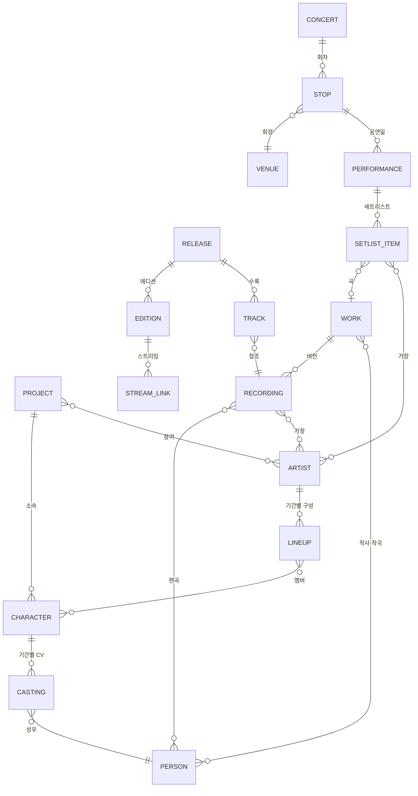
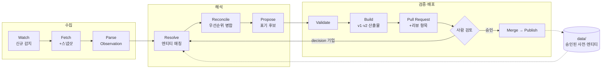

# TakasakiInfo 데이터 자동화 설계

> 상태: 초안 · 작성일 2026-10-15
> 범위: 데이터 모델 재설계, 수집·검증·배포 파이프라인, 표기(음역) 정책, 기존 데이터 이관, イキヅライブ！ 추가

---

## 0. 요약

- **원천 데이터의 단위를 "앨범의 한 행"에서 "엔티티"로 바꾼다.** 인물·캐릭터·아티스트·곡(Work)·음원(Recording)·발매물(Release)을 각각 한 번씩만 저장한다. 지금의 `albums/`, `songs/`, `members/`, `concerts/`, `TakasakiInfo.json`은 모두 여기서 **생성되는 산출물**이 된다.
- **같은 곡이 여러 앨범에 실리는 문제는 `Track → Recording → Work` 참조로 해결한다.** 크레딧과 표기는 Work와 Recording에 한 번만 있으므로 앨범마다 값이 갈라질 수 없다.
- **고유명사는 승인된 사전에서만 출력한다.** 처음 보는 이름은 자동으로 확정하지 않는다. 출처와 근거가 붙은 후보를 만들어 사람이 한 번 승인하면, 그 뒤로는 영구히 재사용한다.
- **수집은 소스별 어댑터가 하고, 필드별 우선순위로 병합한다.** 공식 소스끼리 어긋나면 병합을 막고 리뷰로 넘긴다(fail-closed).
- **GitHub Actions가 매일 신규 발매를 감지해 PR을 만들고, 병합은 사람이 승인한다.** 수정 없이 승인되는 변경 유형만 단계적으로 자동 병합을 연다.
- **공연은 소스마다 역할을 나눈다.** 공식 사이트는 일정·회장·출연진, Fandom은 세트리스트 속보, 나무위키는 교차 확인과 한국어 표기, 라이브 BD·배信 트랙리스트는 최종 확정을 맡는다. 세트리스트는 곡(Work)을 참조한다. 그래야 음원 발매 전에 공연에서 먼저 공개된 곡도 표현할 수 있다.
- **`©プロジェクトイキヅライブ！`(イキヅライブ！ LOVELIVE! BLUEBIRD)를 신규 프로젝트로 추가하고, 새 파이프라인의 파일럿으로 삼는다.**

---

## 1. 배경과 목표

### 1.1 배경

기존 작업은 다음 순서의 수작업이었다.

1. YouTube Music, YouTube, Love Live! Fandom, 나무위키(특히 공연 정보), 각 프로젝트 공식 사이트에서 수집. 신규 정보는 보통 Fandom에 가장 먼저 올라왔다.
2. 작사·작곡·편곡자 대조
3. 고유명사(인명, 그룹명)의 한/영/일 공식 표기, 또는 공식 표기가 없으면 가장 흔한 표기 조사
4. CSV에 한 줄씩 입력한 뒤 로컬 스크립트(`tools/Process.py`)로 JSON 생성

정확도는 높았지만 공수가 너무 커서 2024-01 이후 갱신이 멈췄다.

### 1.2 목표

| ID | 목표 | 판단 기준 |
|---|---|---|
| G1 | **정확도** | 출력되는 모든 값에 출처가 있다. 승인되지 않은 값은 출력되지 않는다. |
| G2 | **일관성** | 같은 대상(사람, 곡, 그룹)은 모든 파일과 언어에서 같은 표기로 나온다. |
| G3 | **자동 반영** | 신규 발매 감지부터 PR 생성까지 사람이 개입하지 않는다. 사람은 "판단"만 한다. |
| G4 | **하위 호환** | 기존 CSV/JSON의 경로와 스키마, 현행 API를 유지한다. |
| G5 | **공백 해소** | 2023-08 이후 누락분을 백필하고, Aqours 결측을 보완한다. |

### 1.3 비목표

- 가사, 이미지 수집 및 배포 (저작권)
- 완전 무인 운영. 정확도가 최우선이므로 사람의 승인 단계는 없애지 않는다. 대신 승인 횟수를 최소화한다.
- OST 백필. README의 우선순위를 유지한다. 모델은 OST도 표현할 수 있게 설계한다.
- API 서버 재작성. 산출물 포맷만 맞춘다.

---

## 2. 현황 진단

2026-10-15에 저장소 데이터를 분석한 결과다.

| 항목 | 수치 / 사례 | 원인 |
|---|---|---|
| 마지막 갱신 | Musical 2023-08-09, Nijigaku·Liella 2023-11-27, Hasunosora 2024-01-02, Aqours는 일부(2021-07 발매분까지), μ's 미착수 | 수작업 공수 |
| 규모 | 트랙 1,073행, 앨범 163개, 고유 곡명 512개(드라마 제외) | — |
| 여러 앨범에 실린 곡 | **100곡** (예: `君のこころは輝いてるかい？`가 싱글과 `Aqours CHRONICLE (2015~2017)`에 모두 있음) | 행 단위 저장으로 같은 정보가 반복됨 |
| 중복 곡 간 불일치 | 발음(pronunciation)이 다른 곡 18개 | 반복 저장된 값이 서로 갈라짐 |
| `songs/*.json` | "곡" 단위 파일인데 같은 곡이 여러 번 등장 | 곡(Work/Recording) 개념이 없음 |
| 통합 JSON 중복 | 완전히 같은 행 9개 (`LIVE with a smile!` ×2, `異次元★♥BIGBANG` ×3) | 같은 발매물이 그룹별 파일에 복사됨 |
| 인명 표기 변형 (ja) | 같은 사람의 ja 표기가 다른 경우 8건: `渡辺 曜`/`渡辺曜`, `菊池博人`/`菊地博人`, `要田 健`/`要田健` 등 ([부록 A](#부록-a-이관-시-1회-결정이-필요한-표기-변형)) | 인명 사전 없음 |
| 인명 표기 변형 (rom/ko) | ja는 같은데 rom/ko가 다른 경우 5건: `小久保祐希` → `Yuki`/`Yu-Ki Kokubo`, `大原万由子` → `Mayuko Ohara`/`Ohara Mayuko` 등 | 인명 사전 없음 |
| 한국어 장음 규칙 | `ゆうき` → 유키, `ゆうご` → 유우고, `しゅう` → 슈 / 슈우 | 음역 규칙이 문서화되지 않음 |
| 로마자 조사 표기 | `no` 124회 / `No` 6회, `o` 14회 / `Wo` 3회 | 로마자 규칙이 문서화되지 않음 |
| 결측 | Aqours 발음 269행, 크레딧 6행, 앨범·트랙·가수 3행이 비어 있음 | — |
| 멤버 | `members/Hasunosora.csv`는 6명인데 공식 사이트 현재 멤버는 8명 (Hinoshita Kaho, Murano Sayaka, Osawa Rurino, Momose Ginko, Kachimachi Kosuzu, Anyoji Hime, Ceras Y. Lilienfeld, Katsuragi Izumi) | 시간 축 없음 |
| CV 교체 | `優木せつ菜` CV가 `楠木ともり;林 鼓子`로만 적혀 있고 교체 시점이 없음 | 시간 축 없음 |
| 카테고리 | 값이 하나뿐이라 AiScReam처럼 4개 프로젝트에 걸친 유닛을 표현할 수 없음 | 단일값 필드 |
| 공연 데이터 범위 | 2개 공연만 있음 (Hasunosora 1st Live Tour, Liella! First LoveLive! Tour). Aqours·Nijigaku 공연 없음 | 수작업 공수 |
| 공연 세트리스트 참조 | 곡명 문자열로 참조해서 `Memories`(Kanon Ver. / Chisato Ver.) 같은 동명 음원을 구분할 수 없음. 앨범 표기와 어긋난 문자열 2건: `Trick ＆ Cute`(전각 ＆), `LIVE with a smile! (Liella! ver.)`(앨범은 `Ver.`) | ID 참조 없음 |
| 공연 세트리스트 내용 | 곡마다 누가 불렀는지(유닛, 멤버) 정보가 없음. MC·영상 구간이 `::MC1`, `::VID2`, `::Encore - Character Talk` 같은 자유 문자열 | 구조 없음 |
| 공연 회장·도시 | 회장명(ja/rom/ko)이 공연마다 따로 저장됨. 도시 필드에 `Tokyo (Additional)`처럼 회차 구분이 섞여 있음 | 회장 사전 없음 |
| 공식 사이트 접근 | 브라우저가 아닌 요청은 **HTTP 403** (2026-10-15 확인). `sitemap.xml`에는 URL이 2개뿐 | 수집기 설계 제약 |

---

## 3. 설계 원칙

1. **단일 원천.** 사람이나 봇이 편집하는 곳은 `data/`의 정규화 YAML뿐이다. 나머지는 모두 생성물이다.
2. **이름은 키가 아니다.** 모든 참조는 ID로 한다. 이름은 속성이다.
3. **모든 값에 출처를 붙인다.** 출처 URL, 확인일, 상태(status)를 함께 저장한다.
4. **모르면 막는다(fail-closed).** 추측으로 채우지 않는다. 미승인 값이 출력 경로에 있으면 CI가 병합을 막는다.
5. **자동화는 제안하고 사람은 판단한다.** 한 번 내린 판단은 사전에 영구 저장해서 같은 질문을 두 번 하지 않는다.
6. **결정적·멱등적으로 동작한다.** 같은 입력에서는 같은 출력이 나온다. 정렬과 포맷을 고정해 diff를 최소로 유지한다.
7. **하위 호환을 지킨다.** 기존 산출물의 경로와 스키마를 유지한다. 내용이 바뀌는 경우는 승인된 "의도된 수정 목록"에 있을 때뿐이다.

---

## 4. 데이터 모델

### 4.1 엔티티 관계



- **Project**: 작품/IP 단위. 예: `aqours`, `nijigasaki`, `liella`, `hasunosora`, `musical`, `yohane`, `ikizulive`, 시리즈 공통 `lovelive-series`, 외부 콜라보 `external`.
- **Person**: 실존 인물. 작사·작곡·편곡가와 성우.
- **Character**: 캐릭터. 프로젝트에 속하며 CV(Person)는 기간별로 연결한다.
- **Artist**: 크레딧에 나오는 가창 주체. 그룹, 유닛, 솔로, 크로스 유닛, 콜라보 등. 여러 프로젝트에 속할 수 있다. 멤버 구성(Lineup)은 기간별로 저장한다.
  - 가창 크레딧이 그룹명이 아니라 캐릭터 나열인 경우(`高海千歌;桜内梨子;渡辺曜`)에는 Character를 직접 가창자로 참조한다.
  - 외부 IP 캐릭터(예: `異次元★♥BIGBANG`의 아이돌마스터 캐릭터)는 `project: external`인 최소 Character로 등록한다.
- **Concert / Stop / Performance / SetlistItem / Venue**: 공연 모델. 투어 하나(Concert)는 회차(Stop: 도시·회장·날짜)들로 이루어지고, 회차마다 공연일(Performance)이 있다. 세트리스트는 공연일 단위로 저장한다. 회장(Venue)은 여러 공연에서 재사용하는 사전 엔티티다. 자세한 내용은 4.6절.

### 4.2 Work, Recording, Release, Track

"같은 곡이 여러 앨범에" 문제를 푸는 핵심 구조다.

| 개념 | 정의 | 예 |
|---|---|---|
| **Work** (곡) | 작사·작곡 단위의 작품 | `Dream Believers` |
| **Recording** (음원) | 실제 녹음 하나. 같은 Work에 여러 개가 있을 수 있다 | `Dream Believers`(103기), `(104th Ver.)`, `(105th Ver.)`, `(SAKURA Ver.)`, `(Off Vocal)` / `Memories (Kanon Ver.)`, `Memories (Chisato Ver.)` / `君のこころは輝いてるかい？ (高海千歌 Solo Ver.)` |
| **Release** (발매물) | 싱글, 앨범, 디지털 싱글, BD 특전, 컴필레이션 등 | `Dream with You / Poppin' Up! / DIVE!` |
| **Edition** | 같은 발매물의 판본 | `【上原歩夢盤】`, `【中須かすみ盤】`, `初回生産限定盤`, `通常盤`, 디지털 |
| **Track** | 발매물의 디스크·트랙 번호 → Recording | 디스크 1 트랙 1 → `dream-with-you#original` |

**크레딧이 붙는 위치**

- 작사, 작곡: **Work**
- 편곡, 가창: **Recording**
- 예외: 버전에 따라 작사·작곡이 달라지는 경우가 드물게 있다. 이때만 Recording에 `credits_override`를 쓰고, 사유(`note`)를 반드시 적는다.

기존 `songs`·`albums`의 한 행은 `Track ⨝ Recording ⨝ Work` 조인으로 생성한다. 크레딧이 한 곳에만 있으므로, `Aqours CHRONICLE`에 실린 곡과 원래 싱글에 실린 곡의 크레딧이나 발음이 달라질 수 없다.

**YouTube 링크**

YouTube Music은 에디션마다 앨범을 따로 만들고 videoId도 따로 발급한다(현행 데이터에서 같은 곡의 링크가 93곡에서 서로 다른 이유). 그래서 링크는 `(Release, Edition, Track)`에 저장한다. 그리고 Recording마다 **대표 링크**를 규칙으로 하나 고른다.

> 대표 발매물 선정 규칙: 최초 발매일 → 같은 날이면 오리지널 싱글/앨범을 컴필레이션보다 우선 → 에디션은 `통상반` > `디지털` > 그 외 순.

### 4.3 엔티티 YAML 예시

모든 파일은 Pydantic 모델로 검증하고, 소비자용으로 JSON Schema를 export한다.

**Project**

```yaml
# data/projects/ikizulive.yaml
id: ikizulive
names:
  ja: イキヅライブ！ LOVELIVE! BLUEBIRD
  rom: Ikizulive! LOVELIVE! BLUEBIRD
  ko: ~                      # 공식 한국어 표기 미확인 → 리뷰 대상
legacy:
  category: Ikizulive        # v1 산출물의 category 값과 파일명 (16절 Q1)
copyright:
  - text: ©プロジェクトイキヅライブ！
    lang: ja
    source: https://www.lovelive-anime.jp/lovehigh/
    checked: 2026-10-15
official:
  site: https://www.lovelive-anime.jp/lovehigh/
  youtube: https://www.youtube.com/@ikizulive
  x: https://x.com/ikizulive_staff
```

**Person**: 이미 사전에 있는 인물

```yaml
# data/persons/mitsumasu-hajime.yaml
id: mitsumasu-hajime
names:
  ja: 光増ハジメ
  kana: みつます はじめ
  rom: Hajime Mitsumasu
  ko: 미츠마스 하지메
native_script: ja            # ja | latin (latin이면 ko에도 원문을 쓴다. 5.4절)
aliases: []                  # 크레딧에서 관측된 변형. 매칭에만 쓰고 출력하지 않는다
evidence:
  names: {status: legacy, source: "migration:v1", checked: 2026-10-15}
```

**Person**: 표기 변형과 오기가 있는 인물

```yaml
# data/persons/kikuchi-hiroto.yaml
id: kikuchi-hiroto
names:
  ja: 菊地博人                # 정규 표기 (소속사/본인 프로필로 확정)
  rom: Hiroto Kikuchi
  ko: 키쿠치 히로토
aliases:
  - {text: 菊池博人, kind: misprint, seen_in: ["nijigasaki/2018-tokimeki-runners"]}
evidence:
  names.ja: {status: official, source: "<소속사 프로필 URL>", checked: 2026-10-??}
```

**Character**: CV가 교체된 경우

```yaml
# data/characters/nijigasaki/yuki-setsuna.yaml
id: yuki-setsuna
project: nijigasaki
names: {ja: 優木せつ菜, rom: Setsuna Yuki, ko: 유키 세츠나}
casting:
  - {person: kusunoki-tomori, until: "<공식 발표일>"}
  - {person: hayashi-coco,    from:  "<공식 발표일>"}
```

**Artist**: 라인업이 바뀌는 크로스 유닛

```yaml
# data/artists/aiscream.yaml
id: aiscream
kind: cross_unit
projects: [nijigasaki, aqours, liella, hasunosora, ikizulive]
names: {ja: AiScReam, rom: AiScReam, ko: AiScReam}
lineups:
  - from: "<결성일>"           # 데뷔 싱글 「愛♡スクリ～ム！」 2025-01-22
    until: "<변경일>"
    members: [uehara-ayumu, kurosawa-ruby, wakana-shiki]
  - from: "<변경일>"
    members: [uehara-ayumu, wakana-shiki, ceras-yanagida-lilienfeld, azabu-mai]
evidence:
  lineups: {status: official, source: https://www.lovelive-anime.jp/special/AiScReam/, checked: 2026-10-15}
```

**Work + Recording**: 한 파일에 같이 둔다(리뷰 편의)

```yaml
# data/works/ikizulive/dou-da-doing.yaml
id: ikizulive/dou-da-doing
title:
  ja: Dou-Da? DOING!
  kana: ドゥーダ ドゥーイング       # 예시. 실제 값은 리뷰로 확정
  rom: Dou-Da? DOING!
  ko: Dou-Da? DOING!
credits:
  lyricist: [{person: hata-aki}]
  composer: [{person: mitsumasu-hajime, affiliation: FirstCall}]
recordings:
  - id: original
    performers: [{artist: ikizurai-bu}]
    arranger: [{person: mitsumasu-hajime, affiliation: FirstCall}]
  - id: off-vocal
    kind: off_vocal
    instrumental_of: original
    arranger: [{person: mitsumasu-hajime, affiliation: FirstCall}]
evidence:
  credits: {status: official, source: "https://www.lovelive-anime.jp/lovehigh/music/detail.php?p=01_5830", checked: 2026-10-15}
```

**Release**: 에디션 2개가 같은 CD를 공유하는 경우

```yaml
# data/releases/ikizulive/2026-dou-da-doing-regain-again-llllove.yaml
id: ikizulive/2026-dou-da-doing-regain-again-llllove
type: single                     # single | album | mini_album | digital_single | bd_bonus | compilation | soundtrack | drama_cd
status: released                 # announced | released | verified (7.4절)
title:
  ja: Dou-Da? DOING! / REGAIN AGAIN LLLLOVE
artist_credit: [{artist: ikizurai-bu}]
label: Lantis
release_date: 2026-06-10
editions:
  - {id: limited, label: {ja: 初回生産限定盤}, catalog: LACM-34819, media: [CD, BD]}
  - {id: regular, label: {ja: 通常盤},       catalog: LACM-24819, media: [CD]}
discs:
  - disc: 1
    editions: all                # 에디션마다 트랙리스트가 다르면 에디션별로 따로 선언
    tracks:
      - {no: 1, recording: ikizulive/dou-da-doing#original}
      - {no: 2, recording: ikizulive/regain-again-llllove#original}
      - {no: 3, recording: ikizulive/super-summer-sensation#original}
      - {no: 4, recording: ikizulive/dou-da-doing#off-vocal}
      - {no: 5, recording: ikizulive/regain-again-llllove#off-vocal}
      - {no: 6, recording: ikizulive/super-summer-sensation#off-vocal}
streaming:
  - platform: youtube_music
    edition: regular
    browse_id: "<MPREb_…>"
    tracks: {1: "<videoId>", 2: "<videoId>", 3: "<videoId>"}
links:
  official: https://www.lovelive-anime.jp/lovehigh/music/detail.php?p=01_5830
  smartlink: https://lnk.to/LACM-24819d
legacy:                          # v1 산출물 재현용 (기본값: 발매물 1개 = v1 앨범 1개)
  albums: [{title: "Dou-Da? DOING! / REGAIN AGAIN LLLLOVE", edition: regular}]
```

기존의 `【上原歩夢盤】`·`【中須かすみ盤】`·`【優木せつ菜盤】` 같은 경우는 Release 1개에 Edition 3개로 저장한다. 그리고 `legacy.albums`에 3개를 선언해 v1 산출물을 지금과 똑같이 재현한다.

### 4.4 다국어 이름 필드와 상태(status)

모든 이름·제목 필드는 `ja`, `kana`, `rom`, `ko` 네 값을 가진다. 근거는 `evidence`에 필드 단위로 기록한다.

| status | 의미 | v1 산출물 출력 |
|---|---|---|
| `official` | 권리자가 해당 언어로 낸 공식 표기 | O |
| `established` | 공식 표기는 없지만 널리 쓰이는 관용 표기이고, 사람이 출처를 확인함 | O |
| `derived` | 규칙 엔진이 생성했고 사람이 승인함 | O |
| `legacy` | v1 수작업 데이터에서 이관된 값 (신뢰하되 재검증 우선순위 낮음) | O |
| `draft` | 미승인 제안 (규칙 엔진, LLM, B급 소스 단독) | **X → CI 병합 차단** |

### 4.5 ID 규칙

- 사람이 읽을 수 있는 slug를 **생성할 때 한 번 정하고 이후 바꾸지 않는다.** 이름이나 로마자가 수정되어도 ID는 유지한다.
- 형식
  - Person: `hata-aki`
  - Character: `uehara-ayumu`
  - Artist: `ikizurai-bu`
  - Work: `<project>/<slug>`
  - Recording: `<work-id>#<variant>`
  - Release: `<project>/<yyyy>-<slug>`
- 충돌하면 `-2`처럼 접미사를 붙인다.
- 삭제하지 않는다. `deprecated: true`와 `replaced_by`로 표시해 외부 소비자의 참조를 보호한다.
- Concert는 `<project>/<slug>`, Venue는 `<slug>` 형식이다.

### 4.6 공연 모델

**세트리스트는 Recording이 아니라 Work를 참조한다.**

- 라이브 퍼포먼스는 녹음물이 아니다.
- 공연에서 먼저 공개되고 음원은 나중에 나오는 곡이 있다. 이런 곡은 Recording 없이 Work만 먼저 만든다(`recordings: []`). 음원이 나오면 그때 Recording이 붙는다.
- 어떤 버전인지는 가창자(`performers`)와 `version`(예: `104th Ver.`, `Liella! Ver.`)으로 표현한다. 대응하는 Recording이 있으면 `recording`으로 선택적으로 연결한다.

**곡이 아닌 항목은 타입으로 구분한다.**

- 타입: `mc`, `video`, `encore`(앙코르 시작), `double_encore`, `talk`(캐릭터 토크 등), `other`
- v1 출력 시 현행 문자열(`::MC1`, `::VID2`)로 렌더링한다. 번호는 빌더가 매긴다.

**출연진은 공연일 단위로 둔다.**

- 기본값은 Concert의 출연진이다.
- 결석이나 특별 출연 같은 차이만 Performance의 `cast_changes`에 적는다.

**회장명은 기간을 가진다.**

- 명명권 변경 등으로 회장명이 바뀌므로 공연 당시의 공식 표기를 출력한다.
- 도시도 사전 엔티티(ja/rom/ko)로 둔다. 현행 `Tokyo (Additional)` 같은 회차 구분은 Stop의 `label`로 분리한다.

**외부 ID를 저장한다.**

Work, Artist, Venue에 `external_ids`(예: `fandom: "Suisai Sekai"`)를 저장한다. Fandom 세트리스트의 문서 링크를 두 번째부터는 바로 매칭할 수 있다(7.7절).

```yaml
# data/venues/makuhari-event-hall.yaml
id: makuhari-event-hall
city: chiba
names:                         # 명칭이 바뀐 회장은 기간별로 여러 항목
  - ja: 幕張イベントホール
    rom: Makuhari Event Hall
    ko: 마쿠하리 이벤트 홀       # 예시. 실제 값은 리뷰로 확정
external_ids: {fandom: ~}
```

```yaml
# data/concerts/ikizulive/1st-live-what-is-my-l.yaml
id: ikizulive/1st-live-what-is-my-l
status: performed              # announced | performed | settled | confirmed (7.7절)
title:
  ja: いきづらい部！ 1st LIVE ～ What is my L ? ～
legacy: {event_code: Ikizu_1st}
cast: [{artist: ikizurai-bu}]  # 공연일 기준 라인업으로 전개
stops:
  - id: chiba
    venue: makuhari-event-hall
    performances:
      - {date: 2026-02-14, label: Day.1, open: "16:30", start: "17:30", setlist: []}
      - {date: 2026-02-15, label: Day.2, open: "16:30", start: "17:30", setlist: []}
sources:
  - https://www.lovelive-anime.jp/lovehigh/live/live_detail.php?_id=WhatismyL
```

세트리스트는 다음 형태다(하스노소라 1st 후쿠오카 Day.1 앞부분. 가창자는 Fandom 기준).

```yaml
setlist:
  - {work: hasunosora/dream-believers, performers: [{artist: hasunosora}]}
  - {work: hasunosora/yup-yup-yup,     performers: [{artist: hasunosora}]}
  - {type: mc}
  - {type: video}
  - {work: hasunosora/suisai-sekai,    performers: [{artist: cerise-bouquet}]}
  - {work: hasunosora/reflection-in-the-mirror, performers: [{artist: cerise-bouquet}]}
  # …
evidence:
  setlist: {status: established, sources: ["fandom:rev/276677", "namuwiki:<URL>"], checked: 2026-10-15}
cast_changes: []
```

---

## 5. 표기 정책

이 절의 규칙은 지금까지 머릿속에 있던 기준을 문서화한 것이다. 규칙 엔진의 사양이자 리뷰 판단 기준으로 쓴다.

### 5.1 표시 문자열과 매칭 키

| 구분 | 처리 | 용도 |
|---|---|---|
| **표시 문자열** | 공식 표기 그대로 저장한다(전각 `！`, `☆`, `♡`, 공백 포함). **NFC만 적용하고 NFKC는 금지**(`ヤダ！`가 `ヤダ!`로 바뀌는 것을 막기 위해) | 저장, 출력 |
| **매칭 키** | NFKC → casefold → 공백·중점(`・·`)·장식 기호(`☆♡♥★`)·구두점 제거. 인명은 여기에 더해 가타카나를 히라가나로 변환 | 동일성 비교에만 쓴다. 저장하거나 출력하지 않는다 |

### 5.2 일본어(ja)

- **곡명·발매물명**은 공식 사이트 트랙리스트 표기를 따른다. YouTube Music 표기가 다르면 경고를 낸다(기존 `tools/TitleValidate.py`가 하던 일).
- **인명**은 인물마다 정규 표기를 하나만 둔다. 결정 순서는 ① 본인·소속사 공식 프로필, ② 해당 프로젝트 공식 사이트에서 가장 많이 쓰인 표기다.
  - 크레딧에 나온 다른 표기는 `aliases`로 저장한다. 입력 매칭에는 쓰지만 출력에는 정규 표기만 나온다.
  - 오기(誤記)도 `kind: misprint` alias로 남긴다. 공식 사이트에도 오기가 있기 때문이다.
  - 공백은 사람마다 정규 표기를 따른다(`畑 亜貴` 대 `光増ハジメ`). **공백을 일괄 정규화하지 않는다.** 대신 공백만 다른 변형은 검증기가 "같은 인물인지" 확인을 요청한다.
- **소속 표기**(`(Arte Refract)`, `(FirstCall)`, `(Jazzin'park)`)는 인명에 포함하지 않는다. 크레딧의 `affiliation` 필드로 분리하고, v1 출력 시 한 가지 형식으로 렌더링한다(16절 Q9).

### 5.3 로마자(rom)

**우선순위**

1. 권리자 공식 라틴 표기: 공식 사이트 영문 멤버명, 글로벌 배포 영문 제목
2. 본인이 쓰는 라틴 표기 (예: `KOUDAI IWATSUBO`, `Yu-Ki Kokubo` 같은 표기는 본인 표기인지 확인한 뒤 채택)
3. Love Live! Fandom의 관용 표기
4. 규칙 엔진

**규칙 엔진**: 기존 데이터에서 추출한 관행을 명문화했다.

| 대상 | 규칙 | 예 |
|---|---|---|
| 인명 | 헵번식, **장음 생략**(마크론·`ou` 없음), 이름-성 순 | `大西 亜玖璃` → Aguri Onishi, `優木` → Yuki, `法元` → Homoto |
| 곡명 | 헵번식 기반, **`う` 장음은 `ou`로 유지**, 조사 `は`→wa · `へ`→e · `を`→o, 첫 단어를 뺀 조사는 소문자 | `太陽を追いかけろ！` → Taiyou o Oikakero!, `夢への一歩` → Yume e no Ippo, `卒業ですね` → Sotsugyou desu ne |
| 원문의 라틴 부분 | 그대로 | `めっちゃGoing!!` → Meccha Going!! |
| 비일본어 이름 | 공식 표기 순서 유지 | `エマ・ヴェルデ` → Emma Verde |

- 공식 표기가 성-이름 순인 경우(예: 하스노소라 공식 사이트의 `Hinoshita Kaho`)에는 **철자만 채택하고, 순서는 저장소 관례(이름-성)를 따른다**(16절 Q2).
- 공식 표기(`official`)는 규칙과 달라도 그대로 쓴다(예: `Wo`를 쓰는 공식 영문 제목). 규칙 위반 경고는 `official`이 아닌 값에만 낸다.

### 5.4 한국어(ko)

한국어는 대상에 따라 성격이 다르다.

- **(a) 고유명사(인명, 캐릭터명, 그룹명)는 음역한다.**
- **(b) 곡명·발매물명은 번역한다.** 가타카나 외래어는 원어로 복원하거나 음역하고, 라틴 원문은 유지한다.

**(a) 고유명사의 우선순위**

1. `official`: 국내 정식 방영·OTT 자막, 국내 공식 계정, 국내 정식 발매물·굿즈, 공식 한국어판 게임
2. `established`: 나무위키 등 국내 관용 표기. 사람이 확인하고 URL을 기록한다
3. `derived`: 규칙 엔진 결과를 사람이 승인한 것
4. `draft`

**규칙 엔진**: 기존 데이터의 관행이다. 국립국어원 표기법과 다르다는 점에 유의한다.

| 항목 | 규칙 | 예 |
|---|---|---|
| 어두 자음 | 격음 (`か`→카, `た`→타) | 코사카 호노카, 키토 아카리 |
| `つ` / `ず`·`づ` | 츠 / 즈 | 야토키 츠카사 |
| `っ` | ㅅ 받침 | 닛타 에미 |
| `ん` | ㄴ 받침 | 칸 칸나 |
| `おお` | 오오 | 오오니시 아구리 |
| `う` 장음 | **불일치, 결정 필요** (16절 Q3) | 유키(`ゆうき`), 오사카(`おうさか`), 코다이(`こうだい`) / 유우고(`ゆうご`), 슈우(`しゅう`, 内田 秀) / 슈(`しゅう`, 兼松 衆) |
| 라틴 원어 이름 | ko에도 원문 유지 (README의 "공식 명칭이 영어이면 한국어 번역 미포함" 정책과 같음) | Akira Sunset, EFFY |

**(b) 곡명 번역**

- 우선순위: 공식 한국어 제목(국내 정식 발매·방영) > 관용 번역(사람이 확인) > `draft` 번역안(LLM).
- 번역안은 **반드시 사람이 승인한다.**
- 기존 번역에는 판단이 많이 들어가 있다. 예: `コワレヤスキ` → 부서지기 쉬운 사랑, `ホップ・ステップ・ワーイ！` → Hop・Step・와이!. 그래서 기존 승인 번역 512개를 스타일 예시집으로 쓴다.

### 5.5 발음(kana, v1의 `pronunciation`)

- **곡명**은 형태소 분석기(SudachiPy, 또는 MeCab+UniDic)로 초안을 만들고 사람이 확인한다. 기존 관행은 원문이 가타카나·라틴이면 가타카나, 한자·히라가나면 히라가나로 쓰는 것이다(`ときめきランナーズ`, `ゆめへのいっぽ`).
- **인명 읽기에는 형태소 분석기를 쓰지 않는다.** `秀`(しゅう/ひで)처럼 읽기가 모호하기 때문이다. 공식 후리가나(보도자료, 소속사 프로필)만 쓴다.

### 5.6 동일성 판정에서 금지하는 것

다음은 **절대 자동 병합하지 않고 후보로만 제시한다.**

- 한자 한 글자 차이 (`菊池` / `菊地`)
- 공백 차이 (`渡辺 曜` / `渡辺曜`)
- 문자 체계 차이 (`KOUDAI IWATSUBO` / `イワツボコーダイ`)
- 성-이름 순서 차이 (`Mayuko Ohara` / `Ohara Mayuko`)

동명이인으로 확인된 경우에는 `distinct_from`으로 선언해 이후 경고를 끈다.

---

## 6. 데이터 소스

### 6.1 소스 목록

| 소스 | 등급 | 얻는 정보 | 수집 방법 | 제약·리스크 |
|---|---|---|---|---|
| 각 프로젝트 공식 사이트 (`lovelive-anime.jp/<project>/…`) | **A** | 트랙리스트, 크레딧, 발매일, 품번, 에디션, MV·리릭비디오 링크, `lnk.to` 링크, 멤버·CV | HTML 파싱 (프로젝트별 어댑터) | 비브라우저 요청 403. 프로젝트마다 구조가 다름(이키즈라이브는 `/lovehigh/music/detail.php?p=…`, 하스노소라 `/discography/`는 리다이렉트). sitemap을 쓸 수 없어 목록 페이지 diff로 감지해야 함. robots.txt는 `/common/`만 금지 |
| 레이블(Lantis) 공식 | **A** | 품번, 발매일, 수록곡 | HTML | 보조 교차 확인용 |
| 공식 보도자료 | **A** | 신규 발표, 캐스트 후리가나 | HTML / 수동 | 비정형 |
| YouTube Music (`ytmusicapi`, 비공식) | **B** (링크는 A) | 아티스트 채널의 앨범·싱글 목록, 트랙 videoId, 배포 제목 | `get_artist`, `get_album` | 비공식이라 깨질 수 있음. 크레딧 없음. **디지털 싱글을 가장 빨리 감지함** |
| YouTube Data API v3 (공식) | **B** | 앨범 재생목록(`OLAK5uy_…`) 항목, 영상 생존 확인 | API 키 | 일일 쿼터 |
| ISRC 소스 (Spotify / Deezer / Apple Music API 중 택일) | **B** | ISRC, UPC, 길이 | API | 정책 변경이 잦으므로 구현 시점에 이용 조건 재확인. 선택 사항 |
| MusicBrainz | **B** | Work/Recording/Release 구조, ISRC, 로케일별 alias | WS/2 API (초당 1회, 식별 가능한 User-Agent) | Love Live 커버리지 편차. 데이터는 CC0 |
| Love Live! Fandom | **B** | **신규 정보가 가장 빨리 올라옴.** 로마자·영문 제목, 버전 목록(예: Dream Believers 103·104·105기·SAKURA·B.G.P. Ver.), 크레딧 교차 확인, 공연 세트리스트(곡별 가창자 포함)와 출연진 | MediaWiki `api.php`: wikitext와 수정 이력(revisions) 조회. 접근 확인함 | 커뮤니티 편집이라 빠뜨리거나 틀리는 경우가 있고, 나중에 정정됨(7.7절 사례). CC BY-SA이므로 출처 표기 |
| 나무위키 | **B** | 국내 관용 한국어 표기(공연명, 회장명, 인명, 곡 번역). 공연 세트리스트와 특이사항(결석, 사고, 깜짝 공개) 교차 확인 | 기본은 **사람이 참조**하고 URL만 기록. 세트리스트 비교 전용 어댑터는 선택 사항(원문을 저장하지 않고 불일치 신호만 생성, 16절 Q11) | 라이선스 CC BY-NC-SA 2.0 KR(비영리 조건). robots.txt는 문서 경로(`/w/`)만 허용하고 나머지(원문 `raw` 등)는 막음. 페이지 구조가 자주 바뀌어 파싱이 깨지기 쉬움 |
| 공식 라이브 페이지 (`/<project>/live/…`) | **A** | 공연명, 일정, 개장·개연 시각, 회장, 출연진, 배信 정보. **세트리스트는 없음** (이키즈라이브 1st LIVE 페이지로 확인) | HTML (공식 사이트 어댑터와 공유) | — |
| 라이브 BD·배信 상품 트랙리스트 | **A** | 수록된 공연일의 세트리스트와 곡별 가창자 확정 | 공식 상품 페이지, Lantis | 공연 후 수개월~1년 뒤에 나옴. 일부 공연일만 수록 |
| 공식 X의 세트리스트 공지 | **A** | 공연 직후 세트리스트 (게시되는 경우) | 사람이 확인 | 이미지인 경우가 많음. 자동 수집 대상 아님 |
| VGMdb, JASRAC J-WID | **B** | 크레딧 교차 확인 | **사람이 참조만** | 공식 API 없음 |
| 기존 v1 데이터 | legacy | 전 필드 | 이관 (12절) | 수작업 검증분 |

### 6.2 필드별 우선순위

| 필드 | 1순위 | 2순위 | 3순위 | 비고 |
|---|---|---|---|---|
| 곡명·발매물명 (ja) | 공식 사이트 | Lantis | YTM | YTM과 다르면 W2 경고 |
| 트랙 순서·디스크 | 공식 사이트 | Lantis | YTM | |
| 작사·작곡·편곡 | 공식 사이트 | Lantis | Fandom·MusicBrainz·VGMdb(수동) | B급 소스뿐이면 `draft` |
| 가창 | 공식 사이트 | YTM | Fandom | |
| 발매일 | 공식 사이트 | Lantis | YTM | 디지털 선행 배포일은 Edition별 |
| 품번·에디션 | 공식 사이트 | Lantis | — | |
| YouTube 링크 | YTM (공식 Topic 앨범) | 공식 사이트 MV 링크 | — | |
| ISRC·길이 | ISRC 소스 | MusicBrainz | — | |
| rom | official | Fandom | 규칙 엔진 | |
| ko | official | 관용 (수동) | 규칙 엔진 / LLM `draft` | |
| 멤버·CV·라인업 기간 | 공식 사이트·공식 뉴스 | Fandom | — | |

**공연 필드**

| 필드 | 1순위 | 2순위 | 3순위 | 비고 |
|---|---|---|---|---|
| 공연명, 일정, 회장, 출연진 | 공식 라이브 페이지 | 공식 뉴스 | Fandom | |
| 결석·출연 변경 | 공식 뉴스 | Fandom, 나무위키 | — | |
| 세트리스트 | BD·배信 트랙리스트, 공식 세트리스트 공지 | Fandom과 나무위키가 일치 | Fandom 단독 → `draft` | 7.7절 상태 참고 |
| 곡별 가창자 | BD 트랙리스트 표기 | Fandom | 나무위키 | |
| 공연명·회장명 ko | 공식 한국어 (있을 때) | 나무위키 (`established`) | 규칙 엔진 | |
| 회장명 rom | 회장 공식 영문명 | Fandom | 규칙 엔진 | |

### 6.3 충돌 처리

| 상황 | 처리 |
|---|---|
| A급 소스끼리 불일치 | `conflict` 리뷰 항목을 만들고 해당 엔티티의 병합을 막는다 |
| A급과 B급 불일치 | A급을 채택하고 불일치를 PR에 표시한다. 같은 어댑터가 반복해서 틀리면 우선순위를 조정한다 |
| B급만 있음 | `draft`로 두고 리뷰를 요청한다 |
| **이미 승인된 값과 새 관측값이 다름** (공식 사이트의 사후 정정 등) | `change` 리뷰 항목. **자동으로 덮어쓰지 않는다** |

---

## 7. 파이프라인

### 7.1 흐름



### 7.2 단계별 상세

**① Watch (신규 감지)**

- 공식 사이트 프로젝트별 music 목록 페이지를 받아, 알려진 detail URL 집합과 비교한다.
- YouTube Music 아티스트 채널별 앨범·싱글 목록을 받아, 알려진 `browseId` 집합과 비교한다.
- 감시 대상은 `automation/config/sources.yaml`에 프로젝트별로 선언한다. **새 프로젝트를 추가할 때는 설정만 추가하면 되도록** 만든다.

**② Fetch와 스냅샷**

- 원문(HTML, JSON)을 해시와 함께 저장한다. 해시가 같으면 이후 단계를 건너뛴다.
- 호스트별 요청 간격을 둔다(공식 사이트는 3초 이상). 조건부 요청과 지수 백오프를 쓴다.
- **수동 투입 경로**: 접근이 막히면 브라우저로 저장한 HTML을 `automation/inbox/`에 넣는다. 같은 파서가 처리한다.
- 공식 사이트 원문 HTML은 공개 저장소에 커밋하지 않는다(16절 Q8). 커밋하는 것은 추출한 사실(Observation)뿐이다.

**③ Parse → Observation**

소스와 무관한 공통 형식으로 변환한다. 이 단계의 값은 원문 문자열 그대로다(해석 전).

```json
{
  "source": "official:ikizulive",
  "url": "https://www.lovelive-anime.jp/lovehigh/music/detail.php?p=01_5830",
  "fetched_at": "2026-10-15T06:00:00+09:00",
  "snapshot": "sha256:…",
  "kind": "release",
  "data": { "title": "Dou-Da? DOING! / REGAIN AGAIN LLLLOVE", "tracks": [ … ], "editions": [ … ] }
}
```

크레딧 파서는 공식 사이트 형식을 처리해야 한다.

```
作詞：畑 亜貴　作曲/編曲：光増ハジメ (FirstCall)
→ lyricist[as="畑 亜貴"], composer[as="光増ハジメ", affiliation="FirstCall"], arranger[as="光増ハジメ", affiliation="FirstCall"]

作詞/作曲/編曲：Yuta Sakai
→ lyricist, composer, arranger 모두 [as="Yuta Sakai"]
```

- 역할 구분자는 `/`, 항목 구분자는 전각 공백, 여러 인물은 `・`·`、`·`&`로 나뉜다.
- **파서가 기대하는 구조를 못 찾으면 "0건"이 아니라 실패로 처리한다.** 조용한 누락을 막기 위해서다.

**④ Resolve (엔티티 해석)**

- **인물**: 매칭 키가 사전의 정규 표기나 alias와 일치하면 기존 ID를 쓴다. 일치하지 않으면 유사 후보(5.6절의 패턴)를 붙여 신규 인물 리뷰 항목을 만든다.
- **발매물**: 공식 detail URL, 품번, YTM `browseId` 중 하나라도 기존과 같으면 같은 Release다. 발매일이 같고 제목 어근이 같으며 `【…盤】`·`［…盤］` 표식이 있으면 같은 Release의 Edition으로 묶는다.
- **음원·곡**: 아래 판정표를 순서대로 적용한다.

| 순서 | 신호 | 판정 | 자동 여부 |
|---|---|---|---|
| 1 | ISRC 일치 | 같은 Recording | 자동 |
| 2 | 제목 매칭 키 + 가창 + 크레딧이 같고, 버전 표식이 없고, 길이 ±2초 | 같은 Recording | 자동 |
| 3 | 2와 같지만 길이 정보 없음 | 같은 Recording 후보 | 리뷰 (일괄 승인 가능) |
| 4 | 제목이 같고 버전 표식(`Ver.`, `Solo Ver.`, `Off Vocal`, `TV size`, `Album ver.`, `104th Ver.` 등)이 있거나 가창이 다름 | 같은 Work의 새 Recording | 자동 생성, 리뷰 표시 |
| 5 | 제목은 같은데 작사·작곡이 다름 | 다른 Work (동명곡) | 리뷰 |
| 6 | 일치 없음 | 새 Work + Recording | 자동 생성 (이름은 별도로 검증) |

- 버전 표식 패턴은 config로 관리한다. 모르는 괄호 표식이 나오면 경고를 낸다.
- Off Vocal은 원곡 Recording에 `instrumental_of`로 연결한다. v1 `songs`에서는 지금처럼 제외한다.

**⑤ Reconcile**

6.2절의 우선순위로 필드값을 정하고 changeset(추가, 변경, 충돌)을 만든다.

**⑥ Propose (표기 후보)**

- 사전에 없는 이름과 제목만 대상이다.
- 후보 출처는 공식 표기 검색 결과, Fandom, 규칙 엔진, 그리고 선택적으로 LLM(9절)이다. 모든 후보에 근거를 붙인다.
- 최상위 후보를 `draft`로 넣고 리뷰를 요청한다.

**⑦ Validate** (8절), **⑧ Build** (10절)

**⑨ PR**

- 봇 브랜치 `sync/YYYY-MM-DD`를 만든다.
- PR 본문에 요약표를 넣는다: 신규 발매물, 트랙, 인물, 충돌, 경고.
- 리뷰 항목(`automation/review/*.yaml`)을 함께 커밋한다.

### 7.3 리뷰 방식

리뷰 항목은 PR 안의 YAML 파일이다. 별도 인프라가 필요 없다.

```yaml
# automation/review/2026-10-15-003.yaml
type: new_person
observed:
  as: Yuta Sakai
  context: "SUPER SUMMER SENSATION!! 作詞/作曲/編曲"
  source: https://www.lovelive-anime.jp/lovehigh/music/detail.php?p=01_5830
candidates:
  - action: create
    id: sakai-yuta
    names: {ja: Yuta Sakai, rom: Yuta Sakai, ko: Yuta Sakai}
    why: "라틴 원어 표기 → ko 원문 유지 (5.4)"
similar: []          # 유사 기존 인물이 있으면 여기에 표시
decision: ~          # approve | approve:<후보번호> | merge:<기존 id> | edit | reject
```

- 사람은 `decision`만 채워서 같은 PR에 커밋한다. 봇이 다시 실행해 `data/`에 반영하고 리뷰 파일을 지운다.
- 모든 리뷰 항목이 처리되고 CI가 통과해야 병합할 수 있다.
- 대량 백필 때는 같은 유형을 한 번에 승인하는 CLI를 제공한다(예: 판정표 3번 항목 일괄 승인).

### 7.4 발매물 생애주기

| 상태 | 의미 | v1 산출물 | v2 산출물 |
|---|---|---|---|
| `announced` | 발표만 됨. 트랙·크레딧이 일부만 공개됨 | 제외 | 상태와 함께 포함 |
| `released` | 발매일이 지났고 링크를 확보함 | 포함 | 포함 |
| `verified` | 발매 후 재수집(기본 30일 뒤)에서 변경이 없음을 확인함 | 포함 | 포함 |

예: 이키즈라이브 「いきづらい部！ あつまれユニットソング！ vol.1」(2026-11-25 발매 예정)은 지금 `announced` 상태다.

### 7.5 자동 병합 단계

| 레벨 | 변경 유형 | 처리 |
|---|---|---|
| **L0** | 기존 트랙의 YouTube 링크 추가·교체(죽은 링크), `released`→`verified` 전환 | CI 통과 시 자동 병합 (Phase 5부터) |
| **L1** | 모든 이름이 사전에서 해석되고 A급 소스로 확인된 신규 발매물·트랙 | PR, 사람이 일괄 승인 |
| **L2** | 신규 인물·캐릭터·그룹, 신규 ko 번역, 충돌, 승인된 값의 변경, 라인업·CV 변경 | PR, 항목마다 사람이 판단 |

- 처음에는 **모든 PR을 수동 병합한다.**
- "L1 PR이 수정 없이 연속 N회 승인됨" 같은 기준을 만족하면 L1 자동 병합을 검토한다.

### 7.6 실행 일정

| 주기 | 작업 |
|---|---|
| 매일 (KST 06:00) | Watch → 신규 처리 → PR |
| 매주 | YouTube 링크 생존 확인 (YouTube Data API `videos.list`, 50개 단위) |
| 매월 | 최근 90일 발매물의 공식 페이지 재수집(사후 정정 감지), 멤버·캐스트 페이지 재수집 |
| 수동 | 백필: `takasaki sync --project hasunosora --since 2024-01-01` |

**실행 위치**: GitHub 호스티드 러너의 IP가 공식 사이트에서 막힐 수 있다. 그 경우 수집 단계만 로컬(macOS launchd)이나 self-hosted runner에서 돌리고 브랜치를 push한다. 이후 단계는 Actions에서 실행한다.

### 7.7 공연 파이프라인

공연은 음반과 정보가 나오는 순서가 다르다. 공식 사이트는 일정과 출연진만 공개하고 세트리스트는 올리지 않는다. 세트리스트는 Fandom에 가장 먼저 올라오고, 공식 확정은 BD·배信 상품이 나올 때 이루어진다. 그래서 공연은 상태를 따로 관리한다.

| 상태 | 시점 | 확보되는 정보 | 주 소스 | v1 출력 |
|---|---|---|---|---|
| `announced` | 공연 발표 | 공연명, 일정, 회장, 출연진 | 공식 라이브 페이지 | 제외 |
| `performed` | 공연 당일~수일 | 세트리스트 초안 (`draft`) | Fandom | 제외 |
| `settled` | 공연 후 | Fandom 수정이 멈췄고, 사람이 나무위키와 대조해 일치를 확인함 | Fandom 수정 이력, 나무위키 | 포함 |
| `confirmed` | BD·배信 발매 후 | 수록된 공연일의 세트리스트와 가창자 확정 | 공식 상품 트랙리스트 | 포함 |

기존 v1 공연 데이터는 이관 시 `settled`로 취급한다.

**① 감지**

- 공식 사이트 live 목록 diff로 신규 공연을 찾아 `announced`를 만든다.
- Fandom은 공연 문서의 수정 이력(`action=query&prop=revisions`)을 폴링한다. 세트리스트 섹션이 바뀌면 다시 파싱한다.

**② Fandom 세트리스트 파싱**

wikitext 예:

```
#{{nihongo|[[Suisai Sekai]]|水彩世界}} by [[Cerise Bouquet]]
#[[DEEPNESS]] by [[Kaho Hinoshita]], [[Sayaka Murano]], [[Kozue Otomune]] and [[Tsuzuri Yugiri]]
#'''Animated Intermission'''
```

- 곡은 ja 표기, 또는 링크된 Fandom 문서명(`external_ids.fandom`)으로 Work에 매칭한다.
- 가창자는 `by` 뒤의 링크로 Artist나 Character에 매칭한다.
- `'''MC'''`, `'''Animated Intermission'''`, `'''ENCORE'''` 같은 굵은 글씨 항목은 매핑표(`patterns.yaml`)로 타입을 정한다. 모르는 항목은 경고를 낸다.
- 공연일 구분은 `<tabber>`의 `Day 1 =` 같은 탭 이름을 쓴다.

**③ `settled` 판정**

- Fandom 세트리스트 섹션이 72시간 동안 바뀌지 않아야 한다.
- 사람이 나무위키와 대조해 일치를 확인한다. 리뷰 항목에는 나무위키 문서 링크와 Fandom 세트리스트를 나란히 보여준다.
- 둘이 다르면 차이 나는 위치를 표시하고 사람이 판단한다.

**④ `confirmed`와 사후 정정**

`settled`도 최종이 아니다. 실제 사례가 있다. 하스노소라 1st Live Tour 아이치 Day.2(2023-11-26)의 더블 앙코르 `Dream Believers`는 저장소 데이터(2024-01-05 커밋)에 이미 있었다. 그런데 Fandom에는 BD 발매 직후인 2024-10-31에야 추가됐다(수정 요약: "Added Dream Believers as last song on Aichi Day 2"). **Fandom은 가장 빠르지만 빠뜨리는 경우가 있다.**

- 라이브 BD는 `type: live_video` Release로 저장한다. 각 트랙은 (공연일, 세트리스트 순번)을 가리킨다.
- BD 트랙리스트가 나오면 저장된 세트리스트와 다시 대조한다. 차이가 있으면 `change` 리뷰 항목을 만든다.
- BD에 모든 공연일이 수록되지는 않는다. 수록되지 않은 날은 `settled`가 최종 상태다.
- `live_video` 발매물은 v1 `albums`에 넣지 않는다(현행 범위 유지).

---

## 8. 검증 규칙

**ERROR: 병합을 막는다**

| ID | 규칙 |
|---|---|
| E1 | 스키마 위반 (Pydantic / JSON Schema) |
| E2 | 참조 무결성 위반 (존재하지 않는 ID 참조) |
| E3 | 출력 경로에 `draft` 값이 있음 |
| E4 | 서로 다른 두 인물의 매칭 키가 같음 (`distinct_from` 선언 시 제외) |
| E5 | 디스크별 트랙 번호가 1..N이 아님 (중복 또는 누락) |
| E6 | `rom`에 가나·한자가 있음, `ko`에 가나가 있음 |
| E7 | `native_script: latin`인 인물의 `ko`가 원문과 다름 (예외 선언이 없을 때) |
| E8 | v1 골든 테스트 실패: 데이터가 바뀌지 않은 영역의 산출물이 바이트 단위로 달라짐 |
| E9 | 공연 세트리스트의 곡 항목이 Work로 해석되지 않음 |
| E10 | 생성물(`albums/`, `songs/`, `members/`, `concerts/`, `TakasakiInfo.json`)을 직접 수정한 커밋 |

**WARN: PR에 표시한다**

| ID | 규칙 |
|---|---|
| W1 | 공백만 다른 인명, 또는 한자 한 글자 차이에 같은 rom (동일인 의심) |
| W2 | YouTube Music 제목과 공식 제목의 매칭 키가 다름 |
| W3 | 가창 캐릭터가 발매일 기준 아티스트 라인업에 없음 |
| W4 | 재수록 발매일이 Recording의 최초 발매일보다 이름 |
| W5 | 로마자 조사 대소문자 규칙 위반 (`official` 제외) |
| W6 | Off Vocal인데 원곡 Recording 연결이 없음 |
| W7 | YouTube 링크가 죽음 |
| W8 | `kana`(발음) 결측 |
| W9 | 알 수 없는 버전 표식, 또는 알 수 없는 세트리스트 구간 표식 |
| W10 | 세트리스트가 소스끼리 다름 (Fandom / 나무위키 / BD 트랙리스트) |
| W11 | 세트리스트의 가창자가 그날 출연진에 없음 (결석 반영 누락 의심) |

---

## 9. LLM 사용 범위

**쓰는 곳** (모두 `draft` 생성용)

- 비정형 크레딧 문자열(뉴스 본문 등)의 구조화. 정규식 파서가 실패했을 때만 쓴다.
- 곡명·발매물명 한국어 번역안. 기존 승인 번역을 예시로 제공한다.
- 신규 인명의 rom/ko 후보와 근거 설명. 근거 URL은 수집기가 찾은 것만 인정하고, 모델이 만든 URL은 버린다.

**쓰지 않는 곳**

- 동일인·동일곡의 최종 판정
- 공식 표기의 "추정"
- `data/` 직접 수정

**구현**

- Claude API, 모델 `claude-opus-5-5`
- Python SDK의 `client.messages.parse()`와 Pydantic 스키마로 구조화된 출력을 강제한다.
- 대량 백필에는 Message Batches API를 쓴다.
- 응답을 쓰기 전에 `stop_reason`을 확인한다.
- `evidence`에 `model`, `prompt_version`을 기록한다.

**도입 전 평가**

기존 승인 데이터(인명 365건, 곡명 번역 512건)의 일부를 가리고 재현율을 측정한다. 기준에 못 미치면 그 용도는 비활성화한다. 규칙 엔진(5.3, 5.4)도 같은 골든셋으로 평가한다.

---

## 10. 산출물과 하위 호환

### 10.1 v1: 현행 경로와 스키마 유지

생성 대상: `albums/<Group>/<Group>.csv|json`, `songs/<Group>/<Group>.json`, `members/<Group>.csv`, `concerts/<Group>/<Group>.json`, `TakasakiInfo.json`

**의도된 내용 변화** (이관 시 사람이 한 번 승인)

1. `TakasakiInfo.json`의 중복 행 9개를 제거한다.
2. 인명 표기를 통일한다 ([부록 A](#부록-a-이관-시-1회-결정이-필요한-표기-변형)).
3. 중복 곡 간 발음 불일치 18건을 통일한다.
4. `songs/*.json`의 중복을 처리한다 (16절 Q4).

**규칙**

- 신규 그룹 파일: `albums/Ikizulive/…`, `songs/Ikizulive/…`, `members/Ikizulive.csv`. `category` 값은 `Ikizulive`(16절 Q1).
- 여러 프로젝트에 걸친 발매물은 지금처럼 관련 그룹 파일마다 넣는다. 통합 JSON에는 한 번만 넣는다.
- `category`는 Recording의 가창 Artist와 Project에서 계산한다. 크로스 유닛은 16절 Q5에 따른다.
- `concerts/*.json`은 현행 형태(`eventCode`, `title`, `date_range`, `sights`, `events[].setlist`)를 유지한다.
  - 곡 항목은 Work의 ja 표기로 렌더링한다. 버전이 있으면 표식을 붙인다.
  - 곡이 아닌 항목은 현행 문자열(`::MC1`, `::VID2`, `::Encore` …)로 렌더링한다.
  - `sights[].city`는 도시의 rom 표기와 Stop의 `label`로 만든다(`Tokyo (Additional)`).
  - 곡별 가창자와 출연진 변경은 v1에 넣지 않는다(16절 Q12).

### 10.2 v2: 신규 (`dist/v2/`)

- 정규화 엔티티 JSON과 JSON Schema
- 비정규화 뷰 (`tracks.json`: v1 행과 같은 평면 구조에 ID, 상태, 출처 추가)
- `announced` 발매물 포함

### 10.3 README와 배포

- README의 **Disclaimer**(권리 표기 목록)와 **Database Status** 표를 `data/projects/*.yaml`에서 생성한다. 공식 권리 표기는 수시로 바뀐다. 예를 들어 AiScReam 특설 페이지는 `©2024 プロジェクトラブライブ！スーパースター!!`, `©2026 プロジェクトラブライブ！蓮ノ空女学院スクールアイドルクラブ`처럼 연도를 포함해 표기하는데, 현 README에는 연도가 없거나 다르다.
- API: 현 API(AWS `ap-northeast-2`)가 데이터를 어디서 읽는지 확인한 뒤, 병합 후 배포 단계를 추가한다 (16절 Q7).

---

## 11. 저장소 구조

```
TakasakiInfo/
├── data/                         # ★ 단일 원천 (사람/봇만 편집)
│   ├── projects/<id>.yaml
│   ├── persons/<id>.yaml
│   ├── characters/<project>/<id>.yaml
│   ├── artists/<id>.yaml
│   ├── works/<project>/<slug>.yaml        # Recording 포함
│   ├── releases/<project>/<yyyy>-<slug>.yaml
│   ├── venues/<id>.yaml                   # 회장 (기간별 명칭)
│   ├── cities/<id>.yaml
│   └── concerts/<project>/<id>.yaml       # 회차·공연일·세트리스트
├── automation/
│   ├── docs/DESIGN.md
│   ├── pyproject.toml
│   ├── config/
│   │   ├── sources.yaml          # 프로젝트별 감시 대상 (공식 URL, YTM 채널 ID, Fandom 공연 문서)
│   │   ├── policy.yaml           # 필드 우선순위, 자동 병합 레벨, 요청 간격
│   │   └── patterns.yaml         # 버전 표식·에디션 표식·Note 매핑
│   ├── src/takasaki/
│   │   ├── model/                # Pydantic 모델, JSON Schema export
│   │   ├── sources/              # 어댑터: official/<project>.py, ytmusic.py, youtube_api.py,
│   │   │                         #         isrc.py, musicbrainz.py, fandom.py, legacy_v1.py
│   │   ├── resolve/              # matchkey.py, person.py, recording.py, release.py
│   │   ├── translit/             # rom.py, ko.py, kana.py
│   │   ├── reconcile.py
│   │   ├── propose.py            # 표기 후보 (+선택적 LLM)
│   │   ├── validate/
│   │   ├── build/                # v1.py (legacy), v2.py, readme.py
│   │   └── cli.py                # takasaki sync | validate | build | review | migrate
│   ├── observations/             # 추출된 사실 (커밋함)
│   ├── review/                   # 미결 리뷰 항목 (PR 안에서만 존재)
│   ├── inbox/                    # 수동 스냅샷 투입
│   └── tests/                    # 골든 테스트, 파서 픽스처
├── dist/v2/                      # 생성물
├── albums/ songs/ members/ concerts/ TakasakiInfo.json   # 생성물 (v1)
└── .github/workflows/            # sync.yml (daily), linkcheck.yml (weekly), ci.yml (PR)
```

로컬 전용인 `tools/`(gitignore 대상)의 역할은 새 구조로 옮긴다.

| 기존 스크립트 | 새 위치 |
|---|---|
| `Process.py` (CSV→JSON) | `build/v1.py` |
| `TitleValidate.py` (YT 제목 대조) | 검증 W2 |
| `CoverValidate.py` (커버 시각 확인) | PR 요약에 썸네일 첨부 |

---

## 12. 기존 데이터 이관

| 단계 | 내용 | 산출 |
|---|---|---|
| M1 임포터 | `albums/*/*.csv`를 원천으로 읽어 `source: legacy` Observation으로 변환한다. JSON은 CSV에서 생성된 것이므로 대조용으로만 쓴다 | Observation |
| M2 인명 사전 | (ja, rom, ko) 3-튜플 365개를 클러스터링한다. [부록 A](#부록-a-이관-시-1회-결정이-필요한-표기-변형)의 13건은 사람이 한 번 결정한다 | `persons/` |
| M3 Work/Recording | 4.2·7.2의 판정표를 적용한다. Note 열의 자유 텍스트(`Kanon Ver.`, `Drama Part`, `Solo Concert Album`, `TVA1 BD Vol.1`, `Disc.1, …`)를 매핑표로 구조화한다 | `works/` |
| M4 Release/Edition | `【…盤】` 앨범 그룹을 Release 1개 + Edition N개로 묶는다. 그룹 파일 간 중복 발매물(`LIVE with a smile!`, `異次元★♥BIGBANG`)을 합친다 | `releases/` |
| M5 멤버 | `members/*.csv`에 공식 사이트 정보를 더해 라인업·CV 기간을 보강한다 (하스노소라 기수, せつ菜 CV) | `characters/`, `artists/` |
| M6 공연 | 세트리스트 문자열을 매칭 키로 Work ID에 해석한다(`Trick ＆ Cute`, `(Liella! ver.)` 같은 표기 차이를 흡수). `::` 표식은 타입으로 바꾼다. 회장과 도시는 사전으로 추출한다. 곡별 가창자는 Fandom에서 보강하는데, `draft`로 넣고 리뷰한다 | `concerts/`, `venues/` |
| M7 골든 라운드트립 | v1을 재생성해 현행 파일과 비교한다. 허용되는 차이는 10.1의 "의도된 내용 변화"뿐이다 | diff 보고서 |
| M8 컷오버 | 이후 v1 파일 직접 편집을 금지한다 (E10) | — |

---

## 13. イキヅライブ！ 반영

### 13.1 프로젝트 정보 (2026-10-15 확인)

| 항목 | 값 |
|---|---|
| 정식 명칭 | イキヅライブ！ LOVELIVE! BLUEBIRD |
| 권리 표기 | ©プロジェクトイキヅライブ！ (연도 없음) |
| 공식 사이트 | https://www.lovelive-anime.jp/lovehigh/ |
| 공식 YouTube / X | @ikizulive / @ikizulive_staff |
| 그룹 | いきづらい部！ (10명) |
| 학교 | Love学院高等学校 (L高) |
| 레이블 | Lantis (품번 LACM) |
| 시작 | 2025-04-15 발표, 2025-05-12 시동 |

### 13.2 멤버 (초기 시드)

| # | 캐릭터 | CV | CV 읽기 |
|---|---|---|---|
| 1 | 高橋ポルカ | 綾咲穂音 | あやさき ほのん |
| 2 | 麻布麻衣 | 遠藤璃菜 | えんどう りな |
| 3 | 五桐 玲 | 宮野 芹 | みやの せり |
| 4 | 駒形花火 | 藤野こころ | ふじの こころ |
| 5 | 金澤奇跡 | 坂野愛羽 | さかの あいは |
| 6 | 調布のりこ | 瀬古梨愛 | せこ りあ |
| 7 | 春宮ゆくり | 奥村優季 | おくむら ゆき |
| 8 | 此花輝夜 | 天沢朱音 | あまさわ あかね |
| 9 | 山田真緑 | 小戸森穂花 | こともり ほのか |
| 10 | 佐々木翔音 | 涼ノ瀬葵音 | すずのせ あおい |

캐릭터 이름의 읽기와 공식 로마자는 공식 멤버 페이지(`/lovehigh/member/?m=0` ~ `?m=9`)에서 수집해 확정한다. 위 표의 CV 읽기는 공식 보도자료 기준이다.

### 13.3 발매 형태와 모델에 미치는 영향

| 형태 | 예 | 모델 요구사항 |
|---|---|---|
| CD 싱글 (초회생산한정반 LACM-34xxx / 통상반 LACM-24xxx, CD 내용 동일) | 1st 「What is my LIFE?」 2025-07-30 (디지털 선행 2025-05-19), 2nd 「Dou-Da? DOING! / REGAIN AGAIN LLLLOVE」 2026-06-10 | Edition 2개가 트랙리스트 공유. **선행 디지털 배포일과 CD 발매일이 다름** → Edition별 날짜 |
| 멤버 솔로 싱글 | 10장 연속 (2025-08-27~) | 대량의 신규 Recording |
| 디지털 싱글 | 2026-08~09: 未完成なラブレター, tap tap tappin'!!, チュリ♡CHUちゅきらり♪, Spinning Parade, POP LOVE, 青春ソーダ, Darling Wanted!, Tale of Primavera | `digital_single` 타입. YTM 감지가 가장 빠름 |
| 유닛송 앨범 | 「いきづらい部！ あつまれユニットソング！ vol.1」 2026-11-25 발매 예정 | `announced` 상태 → 발매 후 재수집 |

공식 사이트 크레딧 형식(파서 픽스처로 사용):

```
01. Dou-Da? DOING!
作詞：畑 亜貴　作曲/編曲：光増ハジメ (FirstCall)
02. REGAIN AGAIN LLLLOVE
作詞：畑 亜貴　作曲/編曲：佐々倉有吾
03. SUPER SUMMER SENSATION!!
作詞/作曲/編曲：Yuta Sakai
04. Dou-Da? DOING! (Off Vocal)
```

이 예에서 `畑 亜貴`, `光増ハジメ`, `佐々倉有吾`는 기존 사전에 있으므로 리뷰가 필요 없다. 리뷰 대상은 `Yuta Sakai`뿐이다. 사전이 쌓일수록 사람이 판단할 일이 줄어드는 구조다.

### 13.4 한국어 표기

공식 한국어 표기를 찾지 못했다. 그래서 프로젝트명·그룹명·캐릭터명이 전부 L2 리뷰 대상이다.

- `イキヅライブ！` → 후보: 이키즈라이브! (규칙 엔진)
- `いきづらい部！` → 기존 관례가 고유명사는 음역하고 보통명사는 번역하는 방식이다(`虹ヶ咲学園スクールアイドル同好会` → 니지가사키 학원 스쿨 아이돌 동호회). 그런데 `いきづらい`는 일반 형용사여서 **음역(이키즈라이부!)과 번역 중 판단이 필요하다.**

### 13.5 크로스 프로젝트

`麻布麻衣`는 AiScReam의 멤버다. AiScReam은 니지가사키·Liella!·하스노소라·いきづらい部！에서 한 명씩 모인 기간 한정 유닛이다(공식 특설 페이지 기준). 결성 당시에는 `上原歩夢`·`黒澤ルビィ`·`若菜四季` 3인이었고 2025-01-22에 데뷔 싱글을 냈다. 현재는 `上原歩夢`·`若菜四季`·`セラス 柳田 リリエンフェルト`·`麻布麻衣` 4인이다. Artist의 다대다 프로젝트 소속과 기간별 라인업(4.3)이 필요한 실제 사례다.

### 13.6 공연

- 공식 사이트에서 확인한 것: `いきづらい部！ 1st LIVE ～ What is my L ? ～`가 2026-02-14(Day.1)와 2026-02-15(Day.2)에 `千葉・幕張イベントホール`에서 10명 전원 출연으로 열렸다(개장 16:30, 개연 17:30).
- 공식 사이트에는 `2ndLIVE`, `3rdLIVE` 공연 페이지도 있다. 개최 여부와 일정은 수집할 때 확인한다.
- 공식 페이지에는 세트리스트가 없다. 7.7절의 흐름대로 Fandom으로 초안을 만들고 나무위키와 대조한다.

### 13.7 파일럿으로 적합한 이유

- 규모가 작다.
- 2025년 이후 데이터라 기존 데이터와 충돌하지 않는다.
- 공식 페이지 구조가 정형적이다.
- 신규 고유명사가 많아 표기 리뷰 흐름을 검증하기 좋다.

---

## 14. 로드맵

| Phase | 내용 | 완료 기준 |
|---|---|---|
| 0. 기반 | Pydantic 스키마, 디렉터리 구조, `validate`/`build` CLI, PR CI | 빈 데이터로 v1 빌드 성공 |
| 1. 이관 | M1~M8, 부록 A 결정, 16절 결정 | **v1 골든 라운드트립 통과** |
| 2. 파일럿 | 이키즈라이브: 공식 사이트 어댑터, YTM 어댑터, 리뷰 흐름, README 생성 | Ikizulive v1/v2 산출물 병합 |
| 3. 공백 백필 | 음반: Hasunosora → Liella → Nijigaku → Musical → Aqours 결측 보완 → Yohane·크로스 프로젝트(AiScReam, LIVE with a smile! 등) → μ's. 프로젝트별 공식 사이트 어댑터 추가. 공연: 각 프로젝트의 음반 백필이 끝난 뒤에 진행한다(세트리스트가 Work를 참조하므로). Fandom 세트리스트 어댑터를 추가한다 | 프로젝트별 최신 발매분·공연까지 반영 |
| 4. 상시 운영 | 일일 sync, 주간 링크 검사, 월간 재검증, 이슈 템플릿 | 신규 발매 후 1일 안에 PR 생성 |
| 5. 자동화 확대 | L0 자동 병합 → 조건 충족 시 L1 | 사람 개입이 L2에 집중됨 |

---

## 15. 운영

- **오류 제보**: GitHub Issue 템플릿("데이터 오류")을 만들고, 봇이 이를 리뷰 항목으로 바꾼다. README의 피드백 링크는 이전 저장소명(`LoveLiveTerm-MultiLang`)을 가리키고 있으므로 정리한다.
- **어댑터 장애**: 파서가 구조를 찾지 못하면 실패로 처리하고 이슈를 자동으로 연다. 사이트 개편을 조기에 감지하기 위해서다.
- **비밀값** (GitHub Secrets): `YOUTUBE_API_KEY`, `ANTHROPIC_API_KEY`(9절 사용 시), ISRC 소스 자격 증명(선택).
- **저작권·약관**
  - 가사와 이미지는 수집하지 않는다.
  - 원문 스냅샷은 비공개로 보관한다.
  - Fandom 유래 텍스트는 CC BY-SA에 따라 출처를 표기한다.
  - 공식 사이트는 저빈도로, 목록 페이지 위주로 수집한다.

---

## 16. 결정 필요 사항

| # | 질문 | 선택지 | 권장 |
|---|---|---|---|
| Q1 | 이키즈라이브의 파일명과 `category` 값 | `Ikizulive` / `Bluebird` / 그룹명 기반 | `Ikizulive` (프로젝트명 기준. `Musical` 선례) |
| Q2 | 로마자 인명 순서 | 저장소 관례(이름-성) / 공식 사이트 순서 | 관례 유지, 철자만 공식 채택 |
| Q3 | 한국어 `う` 장음 | 생략(유키, 오사카, 코다이) / 표기(유우고, 슈우) | 생략 (다수 관행). 슈우·유우고는 `established` 근거가 있을 때만 예외 |
| Q4 | `songs/*.json` 중복 | Recording 기준 1회 + 대표 발매물 / 현행(행 기준) 유지 | Recording 기준 1회 (`songs`라는 이름에 맞게) |
| Q5 | 크로스 유닛의 v1 `category` | `Others` / 신규 값(예: `Series`) | `Others` (현행 값 재사용) |
| Q6 | 졸업 멤버의 `members/*.csv` 포함 | 포함 / 현재 멤버만 | 포함 (v2에는 기간과 상태 포함) |
| Q7 | API 배포 경로 | 현 백엔드가 읽는 위치 확인 필요 | — |
| Q8 | 스냅샷 보관 위치 | Actions artifact / 비공개 저장소 / 로컬 | Actions artifact (90일) + 로컬 |
| Q9 | 소속 표기 렌더링 | `名前(所属)` (현행 다수) / `名前 (所属)` (공식 사이트) | 현행 유지 (v1 diff 최소화) |
| Q10 | 한국어 시리즈명 띄어쓰기 | 현행 공연명은 `러브 라이브!`, README 한국어 섹션과 나무위키는 `러브라이브!` | 하나로 통일. 공식 한국어 표기가 있는지 먼저 확인 |
| Q11 | 나무위키 자동 비교 | 사람이 참조만 / 비교 전용 어댑터(원문 미저장, 불일치 신호만) | 처음에는 사람 참조만. 공연 백필 분량이 커지면 약관을 확인한 뒤 비교 전용 검토 |
| Q12 | v1 공연 데이터에 곡별 가창자 추가 | 추가하지 않음(v2에만) / 추가 | 추가하지 않음 (v1 스키마 유지) |

---

## 부록 A. 이관 시 1회 결정이 필요한 표기 변형

2026-10-15 현행 CSV 분석 결과다. "정규 표기"는 본인·소속사 공식 프로필로 확정한다.

| # | 유형 | 관측된 표기 |
|---|---|---|
| 1 | ja 공백 | `渡辺 曜` / `渡辺曜` |
| 2 | ja 한자 | `菊池博人` / `菊地博人` |
| 3 | ja 공백 | `要田 健` / `要田健` |
| 4 | ja 공백 | `谷 ナオキ` / `谷ナオキ` |
| 5 | ja 공백 | `水野谷 怜` / `水野谷怜` |
| 6 | ja 공백 | `サイトウ リョースケ` / `サイトウリョースケ` |
| 7 | ja 공백·대소문자 | `栗原 暁(Jazzin'park)` / `栗原暁(Jazzin'park)` / `栗原 暁(Jazzin'Park)` |
| 8 | ja 문자 체계 | `イワツボコーダイ` / `KOUDAI IWATSUBO` (rom도 `Kodai Iwatsubo` / `KOUDAI IWATSUBO`) |
| 9 | rom | `小久保祐希` → `Yuki Kokubo` / `Yu-Ki Kokubo` |
| 10 | rom 순서 | `大原万由子` → `Mayuko Ohara` / `Ohara Mayuko` |
| 11 | rom 공백 | `久保田真悟(Jazzin'park)` → `Singo Kubota(Jazzin'park)` / `Singo Kubota (Jazzin'park)` |
| 12 | ko | `Ryota Saito` → ko `Ryota Saito` / `사이토 료타` |
| 13 | ko 장음 | `内田 秀` 우치다 슈우 · `兼松 衆` 카네마츠 슈 · `佐々倉有吾` 사사쿠라 유우고 · `優木` 유키 (16절 Q3) |

## 부록 B. 참고

- 이키즈라이브 공식 사이트: https://www.lovelive-anime.jp/lovehigh/ (음악: `/lovehigh/music/`, 멤버: `/lovehigh/member/`)
- 이키즈라이브 시동 보도자료: https://digitalpr.jp/r/109574
- AiScReam 특설 페이지: https://www.lovelive-anime.jp/special/AiScReam/
- 하스노소라 공식 사이트: https://www.lovelive-anime.jp/hasunosora/
- 이키즈라이브 1st LIVE 공식 페이지: https://www.lovelive-anime.jp/lovehigh/live/live_detail.php?_id=WhatismyL
- Love Live! Fandom MediaWiki API
  - 본문: `https://love-live.fandom.com/api.php?action=parse&page=<Page>&prop=wikitext|revid&format=json`
  - 수정 이력: `https://love-live.fandom.com/api.php?action=query&prop=revisions&titles=<Page>&rvprop=timestamp|user|comment|size&format=json`
- 나무위키: https://namu.wiki/ (사람이 참조, 라이선스 CC BY-NC-SA 2.0 KR)
- MusicBrainz API: https://musicbrainz.org/doc/MusicBrainz_API
- ytmusicapi: https://ytmusicapi.readthedocs.io/
- YouTube Data API v3: https://developers.google.com/youtube/v3
