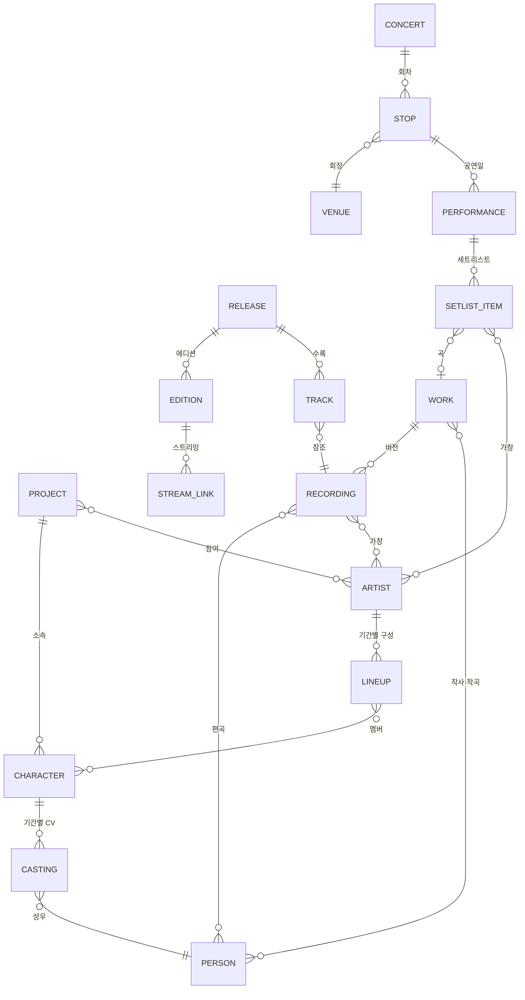
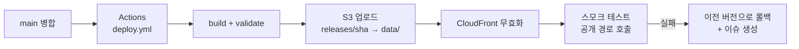
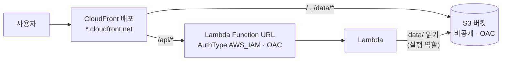

# TakasakiInfo 데이터 자동화 설계

> 상태: 초안 · 작성일 2026-10-15
> 범위: 데이터 모델 재설계, 수집·검증·배포 파이프라인, 표기(음역) 정책, 기존 데이터 이관, イキヅライブ！ 추가

---

## 0. 요약

- **원천 데이터의 단위를 "앨범의 한 행"에서 "엔티티"로 바꾼다.** 인물·캐릭터·아티스트·곡(Work)·음원(Recording)·발매물(Release)을 각각 한 번씩만 저장한다. 지금의 `albums/`, `songs/`, `members/`, `concerts/`, `TakasakiInfo.json`은 모두 여기서 **생성되는 산출물**이 된다.
- **같은 곡이 여러 앨범에 실리는 문제는 `Track → Recording → Work` 참조로 해결한다.** 다른 앨범(또는 다른 에디션)의 같은 곡은 **각각 별도의 Track 레코드**이고, 각자 자기 YouTube Music URL을 가진다. 공유되는 것은 크레딧·표기·발음 같은 곡과 음원의 속성뿐이다. 이 속성은 Work와 Recording에 한 번만 있으므로 앨범마다 값이 갈라질 수 없다.
- **고유명사는 승인된 사전에서만 출력한다.** 처음 보는 이름은 자동으로 확정하지 않는다. 출처와 근거가 붙은 후보를 만들어 사람이 한 번 승인하면, 그 뒤로는 영구히 재사용한다.
- **수집은 소스별 어댑터가 하고, 필드별 우선순위로 병합한다.** 공식 소스끼리 어긋나면 병합을 막고 리뷰로 넘긴다(fail-closed).
- **수집은 각 프로젝트의 공식 사이트부터 확인한다**(결정 D36). 공식에 없는 정보(한국어 표기, 세트리스트, ISRC, 읽기 등)와, 공식이 갱신되지 않아 외부 정보가 더 최신인 경우에는 위키(나무위키·Wikipedia)·Fandom·가사/DB 사이트의 정보를 쓴다. 공식에 맞추는 것이 아니라 공식을 먼저 보는 것이 원칙이다. 외부 정보는 교차 검증에도 쓴다. 기존 수작업 데이터도 이렇게 모았다.
- **GitHub Actions가 매일 신규 발매를 감지해 PR을 만들고, 병합은 사람이 승인한다.** 수정 없이 승인되는 변경 유형만 단계적으로 자동 병합을 연다.
- **원천은 Git의 YAML이고, 질의용 DB(SQLite)와 그래프 데이터는 빌드 산출물이다.** 이것이 고도화된 새 API와 인터랙티브 연결 맵의 기반이 된다(10.5~10.7절).
- **공연은 소스마다 역할을 나눈다.** 공식 사이트는 일정·회장·출연진, Fandom은 세트리스트 속보, 나무위키는 교차 확인과 한국어 표기, 라이브 BD·인터넷 생방송(配信) 트랙리스트는 최종 확정을 맡는다. 세트리스트는 곡(Work)을 참조한다. 그래야 음원 발매 전에 공연에서 먼저 공개된 곡도 표현할 수 있다.
- **`©プロジェクトイキヅライブ！`(イキヅライブ！ LOVELIVE! BLUEBIRD)를 신규 프로젝트로 추가하고, 새 파이프라인의 파일럿으로 삼는다.**

---

## 1. 배경과 목표

### 1.1 배경

기존 작업은 다음 순서의 수작업이었다.

1. 각 프로젝트 공식 사이트를 먼저 확인해 수집. 공식 사이트에 없는 정보(공연 세트리스트, 한국어 표기 등)나 공식보다 최신인 정보는 Love Live! Fandom, 나무위키 등에서 찾았고, 다른 사이트는 교차 검증에도 썼다. YouTube Music·YouTube에서는 링크와 배포 제목을 얻었다. 신규 정보는 보통 Fandom에 가장 먼저 올라왔다.
2. 작사·작곡·편곡자 대조
3. 고유명사(인명, 그룹명)의 한/영/일 공식 표기, 또는 공식 표기가 없으면 가장 흔한 표기 조사
4. CSV에 한 줄씩 입력한 뒤 로컬 스크립트(`tools/Process.py`)로 JSON 생성

정확도는 높았지만 공수가 너무 커서 2024-01 이후 갱신이 멈췄다.

### 1.2 목표

| ID  | 목표          | 판단 기준                                                                    |
| --- | ------------- | ---------------------------------------------------------------------------- |
| G1  | **정확도**    | 출력되는 모든 값에 출처가 있다. 승인되지 않은 값은 출력되지 않는다.          |
| G2  | **일관성**    | 같은 대상(사람, 곡, 그룹)은 모든 파일과 언어에서 같은 표기로 나온다.         |
| G3  | **자동 반영** | 신규 발매 감지부터 PR 생성까지 사람이 개입하지 않는다. 사람은 "판단"만 한다. |
| G4  | **하위 호환** | 기존 CSV/JSON의 경로와 스키마, 현행 API를 유지한다.                          |
| G5  | **공백 해소** | 2023-08 이후 누락분을 백필하고, Aqours 결측을 보완한다.                      |

### 1.3 비목표

- 가사, 이미지 수집 및 배포 (저작권)
- 완전 무인 운영. 정확도가 최우선이므로 사람의 승인 단계는 없애지 않는다. 대신 승인 횟수를 최소화한다.
- OST 백필. README의 우선순위를 유지한다. 모델은 OST도 표현할 수 있게 설계한다.
- 기존 API와의 호환. 사용자가 없으므로 이행 기간 없이 새 API로 교체한다(결정 D17, 10.4절). 저장소의 레거시 파일은 계속 생성한다.

---

## 2. 현황 진단

2026-10-15에 저장소 데이터를 분석한 결과다.

| 항목                    | 수치 / 사례                                                                                                                                                                                                                                                                                                                                                                                                            | 원인                                             |
| ----------------------- | ---------------------------------------------------------------------------------------------------------------------------------------------------------------------------------------------------------------------------------------------------------------------------------------------------------------------------------------------------------------------------------------------------------------------- | ------------------------------------------------ |
| 마지막 갱신             | Musical 2023-08-09, Nijigaku·Liella 2023-11-27, Hasunosora 2024-01-02, Aqours는 일부(2021-07 발매분까지), μ's 미착수                                                                                                                                                                                                                                                                                                   | 수작업 공수                                      |
| 규모                    | 트랙 1,073행, 앨범 163개, 고유 곡명 512개(드라마 제외)                                                                                                                                                                                                                                                                                                                                                                 | —                                                |
| 여러 앨범에 실린 곡     | **100곡** (예: `君のこころは輝いてるかい？`가 싱글과 `Aqours CHRONICLE (2015~2017)`에 모두 있음)                                                                                                                                                                                                                                                                                                                       | 행 단위 저장으로 같은 정보가 반복됨              |
| 중복 곡 간 불일치       | 발음(pronunciation)이 다른 곡 18개                                                                                                                                                                                                                                                                                                                                                                                     | 반복 저장된 값이 서로 갈라짐                     |
| `songs/*.json`          | 같은 곡이 앨범마다 한 행씩 나온다. 행마다 YouTube Music URL이 다르므로 **이 구조 자체는 맞다.** 문제는 크레딧·발음 같은 공유 속성까지 행마다 복사되어 서로 갈라질 수 있다는 점이다                                                                                                                                                                                                                                     | 공유 속성을 한 곳에 두는 구조 없음               |
| 통합 JSON 중복          | 완전히 같은 행 9개 (`LIVE with a smile!` ×2, `異次元★♥BIGBANG` ×3). URL까지 같은, 진짜 중복이다                                                                                                                                                                                                                                                                                                                        | 같은 발매물이 그룹별 파일에 복사됨               |
| 링크 오류               | 다른 곡의 영상 URL이 들어간 행 2건 (YouTube 영상 제목으로 확인): `HAPPY PARTY TRAIN` 2번 `SKY JOURNEY` ← `HAPPY PARTY TRAIN` 영상, `素顔のピクセル` 5번 `シュガーメルト (Off Vocal)` ← `素顔のピクセル (Off Vocal)` 영상 ([부록 A-2](#a-2-링크-점검-대상))                                                                                                                                                             | 손으로 URL을 복사하고, 영상 제목을 대조하지 않음 |
| 메인 URL 대체 (관행)    | 해당 발매물 버전의 URL이 없으면 그 곡의 **메인 URL**(URL이 있는 수록 중 가장 먼저 발매된 것)을 넣는 관행. 예: BD 특전 CD 트랙 11곡(TVA1 BD Vol.1~7, TVA2 BD Vol.1·3·5·7) → Aqours CHRONICLE·솔로 앨범 URL. 기록된 규칙이 없어 적용이 고르지 않음: `Feel Alive / Go Our Way！（R3BIRTH盤）` 4행은 다른 에디션에 URL이 있는데 `NA`, `わちゅごなどぅー (Off Vocal)`에는 보컬 URL이 들어갔지만 다른 Off Vocal 211행은 `NA` | 규칙 미문서화, 손으로 복사                       |
| 인명 표기 변형 (ja)     | 같은 사람의 ja 표기가 다른 경우 8건: `渡辺 曜`/`渡辺曜`, `菊池博人`/`菊地博人`, `要田 健`/`要田健` 등 ([부록 A](#부록-a-이관-시-1회-결정이-필요한-표기-변형))                                                                                                                                                                                                                                                          | 인명 사전 없음                                   |
| 인명 표기 변형 (rom/ko) | ja는 같은데 rom/ko가 다른 경우 5건: `小久保祐希` → `Yuki`/`Yu-Ki Kokubo`, `大原万由子` → `Mayuko Ohara`/`Ohara Mayuko` 등                                                                                                                                                                                                                                                                                              | 인명 사전 없음                                   |
| 한국어 장음 규칙        | `ゆうき` → 유키, `ゆうご` → 유우고, `しゅう` → 슈 / 슈우                                                                                                                                                                                                                                                                                                                                                               | 음역 규칙이 문서화되지 않음                      |
| 로마자 조사 표기        | `no` 124회 / `No` 6회, `o` 14회 / `Wo` 3회                                                                                                                                                                                                                                                                                                                                                                             | 로마자 규칙이 문서화되지 않음                    |
| 결측                    | Aqours 발음 269행, 크레딧 6행, 앨범·트랙·가수 3행이 비어 있음                                                                                                                                                                                                                                                                                                                                                          | —                                                |
| 멤버                    | `members/Hasunosora.csv`는 6명인데 공식 사이트 현재 멤버는 8명 (Hinoshita Kaho, Murano Sayaka, Osawa Rurino, Momose Ginko, Kachimachi Kosuzu, Anyoji Hime, Ceras Y. Lilienfeld, Katsuragi Izumi)                                                                                                                                                                                                                       | 시간 축 없음                                     |
| CV 교체                 | `優木せつ菜` CV가 `楠木ともり;林 鼓子`로만 적혀 있고 교체 시점이 없음                                                                                                                                                                                                                                                                                                                                                  | 시간 축 없음                                     |
| 카테고리                | 값이 하나뿐이라 AiScReam처럼 4개 프로젝트에 걸친 유닛을 표현할 수 없음                                                                                                                                                                                                                                                                                                                                                 | 단일값 필드                                      |
| 공연 데이터 범위        | 2개 공연만 있음 (Hasunosora 1st Live Tour, Liella! First LoveLive! Tour). Aqours·Nijigaku 공연 없음                                                                                                                                                                                                                                                                                                                    | 수작업 공수                                      |
| 공연 세트리스트 참조    | 곡명 문자열로 참조해서 `Memories`(Kanon Ver. / Chisato Ver.) 같은 동명 음원을 구분할 수 없음. 앨범 표기와 어긋난 문자열 2건: `Trick ＆ Cute`(전각 ＆), `LIVE with a smile! (Liella! ver.)`(앨범은 `Ver.`)                                                                                                                                                                                                              | ID 참조 없음                                     |
| 공연 세트리스트 내용    | 곡마다 누가 불렀는지(유닛, 멤버) 정보가 없음. MC·영상 구간이 `::MC1`, `::VID2`, `::Encore - Character Talk` 같은 자유 문자열                                                                                                                                                                                                                                                                                           | 구조 없음                                        |
| 공연 회장·도시          | 회장명(ja/rom/ko)이 공연마다 따로 저장됨. 도시 필드에 `Tokyo (Additional)`처럼 회차 구분이 섞여 있음                                                                                                                                                                                                                                                                                                                   | 회장 사전 없음                                   |
| 공식 사이트 접근        | 브라우저가 아닌 요청은 **HTTP 403** (2026-10-15 확인). `sitemap.xml`에는 URL이 2개뿐                                                                                                                                                                                                                                                                                                                                   | 수집기 설계 제약                                 |

---

## 3. 설계 원칙

1. **단일 원천.** 사람이나 봇이 편집하는 곳은 `data/`의 정규화 YAML뿐이다. 나머지는 모두 생성물이다.
2. **이름은 키가 아니다.** 모든 참조는 ID로 한다. 이름은 속성이다.
3. **모든 값에 출처를 붙인다.** 출처 URL, 확인일, 상태(status)를 함께 저장한다.
4. **모르면 막는다(fail-closed).** 추측으로 채우지 않는다. 미승인 값이 출력 경로에 있으면 CI가 병합을 막는다.
5. **자동화는 제안하고 사람은 판단한다.** 한 번 내린 판단은 사전에 영구 저장해서 같은 질문을 두 번 하지 않는다.
6. **결정적·멱등적으로 동작한다.** 같은 입력에서는 같은 출력이 나온다. 정렬과 포맷을 고정해 diff를 최소로 유지한다.
7. **하위 호환을 지킨다.** 기존 산출물의 경로와 스키마를 유지한다. 내용이 바뀌는 경우는 승인된 "의도된 수정 목록"에 있을 때뿐이다.

---

## 4. 데이터 모델

### 4.1 엔티티 관계



- **Project**: 작품/IP 단위. 예: `aqours`, `nijigasaki`, `liella`, `hasunosora`, `musical`, `yohane`, `ikizulive`, 시리즈 공통 `lovelive-series`, 외부 콜라보 `external`.
- **Person**: 실존 인물. 작사·작곡·편곡가와 성우.
- **Character**: 캐릭터. 프로젝트에 속하며 CV(Person)는 기간별로 연결한다.
- **Artist**: 크레딧에 나오는 가창 주체. 그룹, 유닛, 솔로, 크로스 유닛, 콜라보 등. 여러 프로젝트에 속할 수 있다. 멤버 구성(Lineup)은 기간별로 저장한다.
  - 가창 크레딧이 그룹명이 아니라 캐릭터 나열인 경우(`高海 千歌;桜内 梨子;渡辺 曜`)에는 Character를 직접 가창자로 참조한다.
  - 외부 IP 캐릭터(예: `異次元★♥BIGBANG`의 아이돌마스터 캐릭터)는 `project: external`인 최소 Character로 등록한다.
  - 배우가 배역으로 노래하는 경우(뮤지컬 출연진, `堀内まり菜（椿ルリカ役）`)에는 Person을 가창자로 참조하고 배역 Character를 `role`로 단다. 배역 없는 앙상블은 Person만 참조한다(결정 D29).
- **Concert / Stop / Performance / SetlistItem / Venue**: 공연 모델. 투어 하나(Concert)는 회차(Stop: 도시·회장·날짜)들로 이루어지고, 회차마다 공연일(Performance)이 있다. 세트리스트는 공연일 단위로 저장한다. 회장(Venue)은 여러 공연에서 재사용하는 사전 엔티티다. 자세한 내용은 4.6절.

### 4.2 Work, Recording, Release, Track

"같은 곡이 여러 앨범에" 문제를 푸는 핵심 구조다.

| 개념                    | 정의                                                                                               | 예                                                                                                                                                                                                |
| ----------------------- | -------------------------------------------------------------------------------------------------- | ------------------------------------------------------------------------------------------------------------------------------------------------------------------------------------------------- |
| **Work** (곡)           | 작사·작곡 단위의 작품                                                                              | `Dream Believers`                                                                                                                                                                                 |
| **Recording** (음원)    | 실제 녹음 하나. 같은 Work에 여러 개가 있을 수 있다                                                 | `Dream Believers`(103기), `(104th Ver.)`, `(105th Ver.)`, `(SAKURA Ver.)`, `(Off Vocal)` / `Memories (Kanon Ver.)`, `Memories (Chisato Ver.)` / `君のこころは輝いてるかい？ (高海千歌 Solo Ver.)` |
| **Release** (발매물)    | 싱글, 앨범, 디지털 싱글, BD 특전, 컴필레이션 등                                                    | `Dream with You / Poppin' Up! / DIVE!`                                                                                                                                                            |
| **Edition**             | 같은 발매물의 판본                                                                                 | `【上原歩夢盤】`, `【中須かすみ盤】`, `初回生産限定盤`, `通常盤`, 디지털                                                                                                                          |
| **Track** (수록 레코드) | (발매물, 에디션, 디스크, 트랙 번호) 하나. Recording을 참조하고 **자기 YouTube Music URL**을 가진다 | `【上原歩夢盤】` 디스크 1 트랙 1 → `dream-with-you#original`, URL `0cGBTbjvwuo` / `【中須かすみ盤】` 디스크 1 트랙 1 → 같은 Recording, URL `oIR7h-hp-p4`                                          |

**크레딧이 붙는 위치**

- 작사, 작곡: **Work**
- 편곡, 가창: **Recording**
  - 편곡은 역할을 나눠 둔다(결정 D42): 編曲은 `arranger`, 弦編曲(`ストリングスアレンジ`)은 `strings_arranger`, 管編曲은 `brass_arranger`. `弦管編曲`은 같은 사람을 두 역할에 모두 둔다. 레거시 Arranger 칸은 셋을 이 순서로, 한 사람은 한 번만 출력한다.
- 예외: 버전에 따라 작사·작곡이 달라지는 경우가 드물게 있다. 이때만 Recording에 `credits_override`를 쓰고, 사유(`note`)를 반드시 적는다.
- 크레딧은 보통 Person을 가리킨다. 작중 캐릭터가 작사·작곡자로 크레딧된 경우(예: `Hurray Hurray`의 `高咲 侑`)에는 Character를 가리킨다(결정 D27).
- **해당 없음은 빈 목록이다** (결정 D25). 드라마 트랙의 작사·작곡·편곡, instrumental의 가창자가 그렇다. `NA` 같은 자리표시 엔티티를 만들지 않는다. 레거시에는 빈칸으로 나온다. 빈 칸이 해당 없음인지 결측인지는 Recording의 `kind`로 구분하고, 보컬 음원의 빈 크레딧만 결측으로 경고한다(W14).

기존 `songs`·`albums`의 한 행은 `Track ⨝ Recording ⨝ Work` 조인으로 생성한다. 크레딧이 한 곳에만 있으므로, `Aqours CHRONICLE`에 실린 곡과 원래 싱글에 실린 곡의 크레딧이나 발음이 달라질 수 없다.

**Recording을 나누는 기준: 동일 음원인가**

같은 Recording이라는 것은 **같은 음원이 다른 앨범(에디션)에 실린 것**이라는 뜻이다. 아래 중 하나라도 다르면 별도 Recording이다.

- 가창자 (예: `Memories (Kanon Ver.)` / `(Chisato Ver.)`, 솔로 Ver., 기수별 Ver.)
- 편곡 (Arrangement)
- 길이·편집 (예: `Short Ver.`, `TV size`, `TVA Ver.`, `Movie Ver.`, `Game size`)
- 보컬 / Off Vocal
- 재녹음, 리믹스, 리마스터

이 기준은 크레딧 공유와 메인 URL 대체(아래) 모두에 쓰인다. 특히 메인 URL 대체가 이 판정에 의존하므로, "같은 Recording" 판정은 ISRC 일치나 길이 일치(±2초)로 확인한다. 확인이 안 되면 사람이 승인한다(7.2절 판정표 3번).

**Track은 앨범·에디션마다 별도 레코드다**

YouTube Music은 발매물마다, 에디션마다 앨범을 따로 만들고 videoId도 따로 발급한다. 그래서 같은 곡이라도 앨범이 다르면 URL이 다르다. 이 모델에서는 다음을 지킨다.

- **Track은 절대 합치지 않는다.** 다른 앨범의 같은 곡은 물론, 같은 앨범이라도 에디션이 다르면 별도 Track이다. Track마다 고유 ID(`<release-id>@<edition>/<disc>-<no>`)와 자기 URL이 있다.
- 7.2절의 "같은 Recording" 판정은 **어떤 속성을 공유할지**만 정한다. Track의 개수와 URL에는 영향을 주지 않는다.
- Track에는 그 수록에만 해당하는 값을 둔다: 트랙 번호, URL, 인쇄된 표기(`title_as_printed`, 앨범마다 표기가 다를 때), 비고. 크레딧·표기·발음은 Recording과 Work에서 가져온다.
- 에디션들의 트랙리스트가 같으면 YAML에는 한 번만 적는다(`editions: all`). 빌드할 때 에디션마다 별도 Track으로 펼치고, URL은 `streaming` 항목에 에디션별로 적는다. 예는 4.3절 Release 두 번째 예시.
- YouTube Music에 여러 에디션이 앨범 하나로만 올라가 있으면 그 앨범의 URL을 해당 에디션들이 함께 쓴다. 이때는 `streaming` 항목에 `editions: [a, b]`로 명시한다. **명시 없이 서로 다른 Track의 자기 URL이 같으면 검증 오류다(E11).** 기존 데이터의 링크 오류 2건이 이 규칙으로 잡힌다.

**메인 URL과 대체 출력**

Track에 저장하는 것은 **그 수록 자신의 URL(자기 URL)뿐이다.** 스트리밍이 없는 발매물(BD 특전 CD 등)이거나 그 버전만 배포되지 않은 경우에는 자기 URL을 비워 둔다. 출력할 때는 빌더가 기존 관행대로 그 곡의 **메인 URL**을 계산해서 넣는다. 사람이 URL을 복사해 넣지 않으므로, 링크 오류 2건 같은 복사 실수가 생기지 않는다.

- **메인 URL**: 같은 Recording의 Track 중 **자기 URL이 있는 것 가운데 가장 먼저 발매된 Track**의 URL. 발매일이 같으면 오리지널 싱글·앨범을 컴필레이션보다 우선하고, 그다음 에디션 순서(`통상반` > `디지털` > 그 외)로 정한다. 예: `Pops heartで踊るんだもん！`는 TVA1 BD Vol.1(2016)이 최초 발매지만 스트리밍이 없으므로, Aqours CHRONICLE(2020) 수록분이 메인이다.
- **출력 순서** (레거시 `albums`·`songs`·통합 JSON의 각 행):
  1. 자기 URL
  2. 같은 Recording(동일 음원)의 메인 URL
  3. `NA`
- **대체는 동일 음원끼리만 한다** (결정 D2). 같은 곡이라도 위 "Recording을 나누는 기준" 중 하나라도 다르면 대체하지 않는다. 가창자, 편곡, `Short Ver.`·`Movie Ver.`·`TVA Ver.` 같은 길이·편집 차이, 보컬↔Off Vocal이 모두 해당한다.
  - 그래서 `わちゅごなどぅー (Off Vocal)`은 `NA`가 된다.
  - TVA2 BD Vol.1 `One More Sunshine Story`는 메인 URL 후보가 高海千歌 솔로 앨범의 `(Album Version)`이다. 이관할 때 동일 음원인지 확인하고, 아니면 `NA`가 된다([부록 A-2](#a-2-링크-점검-대상)).
- 메인을 규칙과 다르게 고를 필요가 있으면 Track에 `links.youtube_music: {use: <Track ID>, note: …}`로 명시한다. 단 `use`는 **같은 Recording의 Track만** 가리킬 수 있다(검증기가 강제).
- v1에는 각 Track의 링크와 함께 출처(`own` / `main` / `none`)를 내보낸다. "이 앨범의 URL"과 "메인 URL로 대체된 URL"을 소비자가 구분할 수 있다.
- Recording 단위 뷰(v1 `recordings.json`, 공연 세트리스트 링크 등)도 같은 메인 URL을 쓴다.

### 4.3 엔티티 YAML 예시

모든 파일은 Pydantic 모델로 검증하고, 소비자용으로 JSON Schema를 export한다.

**Project**

```yaml
# data/projects/ikizulive.yaml
id: ikizulive
names:
  ja: イキヅライブ！ LOVELIVE! BLUEBIRD
  rom: Ikizulive! LOVELIVE! BLUEBIRD
  ko: 이키즈라이부! LOVELIVE! BLUEBIRD # 결정 D15 (우선 확정. 공식 한국어 표기가 나오면 교체)
legacy:
  category: Ikizulive # 레거시 산출물의 category 값과 파일명 (결정 D3)
copyright:
  - text: ©プロジェクトイキヅライブ！
    lang: ja
    source: https://www.lovelive-anime.jp/lovehigh/
    checked: 2026-10-15
official:
  site: https://www.lovelive-anime.jp/lovehigh/
  youtube: https://www.youtube.com/@ikizulive
  x: https://x.com/ikizulive_staff
```

**Person**: 이미 사전에 있는 인물

```yaml
# data/persons/mitsumasu-hajime.yaml
id: mitsumasu-hajime
names:
  ja: 光増ハジメ
  kana: みつます はじめ
  rom: Hajime Mitsumasu
  ko: 미츠마스 하지메
native_script: ja # ja | latin (latin이면 ko에도 원문을 쓴다. 5.4절)
aliases: [] # 크레딧에서 관측된 변형. 매칭에만 쓰고 출력하지 않는다
evidence: # 필드마다 출처가 다르면 키를 나눈다 (예시)
  names.ja: { status: official, source: 'https://www.lovelive-anime.jp/lovehigh/music/detail.php?p=01_5830', checked: 2026-10-15 }
  names.rom: { status: established, source: 'https://love-live.fandom.com/wiki/Composers_and_Arrangers', checked: 2026-10-19 }
  names.ko: { status: derived, source: 'https://love-live.fandom.com/wiki/Composers_and_Arrangers', checked: 2026-10-19, note: '§5.4 규칙. 읽기는 Fandom 표기' }
```

**Person**: 표기 변형과 오기가 있는 인물

```yaml
# data/persons/hiroto-kikuchi.yaml
id: hiroto-kikuchi
names:
  ja: 菊池 博人 # 철자는 레이블 크레딧으로 확정. 띄어쓰기는 성·이름에서 규칙으로 정함 (5.2절)
  rom: Hiroto Kikuchi
  ko: 키쿠치 히로토
family_name: { ja: 菊池, rom: Kikuchi, ko: 키쿠치 }
given_name: { ja: 博人, rom: Hiroto, ko: 히로토 }
aliases:
  - { text: 菊地博人, kind: misprint }
evidence:
  names.ja:
    { status: established, source: 'https://www.uta-net.com/arranger/18170/', checked: 2026-10-17 }
```

**Character**: CV가 교체된 경우

성과 이름은 `family_name`·`given_name`에 따로 둔다(결정 D26). 언어마다 어순이 달라도 된다(rom은 이름-성, ja·ko는 성-이름). 정규 이름(`names.ja`)의 띄어쓰기는 5.2절 규칙을 따른다(결정 D28). 아래 `優木せつ菜`는 이름이 가나라 붙여 쓴다.

```yaml
# data/characters/nijigasaki/setsuna-yuki.yaml
id: nijigasaki/setsuna-yuki
project: nijigasaki
names: { ja: 優木せつ菜, rom: Setsuna Yuki, ko: 유키 세츠나 }
family_name: { ja: 優木, rom: Yuki, ko: 유키 }
given_name: { ja: せつ菜, rom: Setsuna, ko: 세츠나 }
casting:
  - { person: kusunoki-tomori, until: '<공식 발표일>' }
  - { person: hayashi-coco, from: '<공식 발표일>' }
```

**Artist**: 라인업이 바뀌는 크로스 유닛

```yaml
# data/artists/aiscream.yaml
id: aiscream
kind: cross_unit
projects: [nijigasaki, aqours, liella, hasunosora, ikizulive]
names: { ja: AiScReam, rom: AiScReam, ko: AiScReam }
lineups:
  - from: '<결성일>' # 데뷔 싱글 「愛♡スクリ～ム！」 2025-01-22
    until: '<변경일>'
    members: [uehara-ayumu, kurosawa-ruby, wakana-shiki]
  - from: '<변경일>'
    members: [uehara-ayumu, wakana-shiki, ceras-yanagida-lilienfeld, azabu-mai]
evidence:
  lineups:
    {
      status: official,
      source: https://www.lovelive-anime.jp/special/AiScReam/,
      checked: 2026-10-15
    }
```

**Work + Recording**: 한 파일에 같이 둔다(리뷰 편의)

```yaml
# data/works/ikizulive/dou-da-doing.yaml
id: ikizulive/dou-da-doing
title:
  ja: Dou-Da? DOING!
  kana: ドゥーダ ドゥーイング # 예시. 실제 값은 리뷰로 확정
  rom: Dou-Da? DOING!
  ko: Dou-Da? DOING!
credits:
  lyricist: [{ person: hata-aki }]
  composer: [{ person: mitsumasu-hajime, affiliation: FirstCall }]
recordings:
  - id: original
    performers: [{ artist: ikizuraibu }]
    arranger: [{ person: mitsumasu-hajime, affiliation: FirstCall }]
  - id: off-vocal
    kind: off_vocal
    instrumental_of: original
    arranger: [{ person: mitsumasu-hajime, affiliation: FirstCall }]
evidence:
  credits:
    {
      status: official,
      source: 'https://www.lovelive-anime.jp/lovehigh/music/detail.php?p=01_5830',
      checked: 2026-10-15
    }
```

**Release**: 에디션 2개가 같은 CD를 공유하는 경우

```yaml
# data/releases/ikizulive/2026-dou-da-doing-regain-again-llllove.yaml
id: ikizulive/2026-dou-da-doing-regain-again-llllove
type: single # single | album | mini_album | digital_single | bd_bonus | compilation | soundtrack | drama_cd
status: released # announced | released | verified (7.4절)
title:
  ja: Dou-Da? DOING! / REGAIN AGAIN LLLLOVE
artist_credit: [{ artist: ikizuraibu }]
label: Lantis
release_date: 2026-06-10
editions:
  - {
      id: limited,
      label: { ja: 初回生産限定盤 },
      catalog: LACM-34819,
      media: [CD, BD]
    }
  - { id: regular, label: { ja: 通常盤 }, catalog: LACM-24819, media: [CD] }
discs:
  - disc: 1
    editions: all # 에디션마다 트랙리스트가 다르면 에디션별로 따로 선언
    tracks:
      - { no: 1, recording: ikizulive/dou-da-doing#original }
      - { no: 2, recording: ikizulive/regain-again-llllove#original }
      - { no: 3, recording: ikizulive/super-summer-sensation#original }
      - { no: 4, recording: ikizulive/dou-da-doing#off-vocal }
      - { no: 5, recording: ikizulive/regain-again-llllove#off-vocal }
      - { no: 6, recording: ikizulive/super-summer-sensation#off-vocal }
streaming:
  - platform: youtube_music
    editions: [limited, regular] # YTM에 앨범이 하나뿐이면 두 에디션이 URL을 함께 씀 (명시 필수)
    browse_id: '<MPREb_…>'
    tracks: { '1-1': '<videoId>', '1-2': '<videoId>', '1-3': '<videoId>' } # 키는 디스크-트랙
links:
  official: https://www.lovelive-anime.jp/lovehigh/music/detail.php?p=01_5830
  smartlink: https://lnk.to/LACM-24819d
legacy: # 레거시 산출물 재현용 (기본값: 발매물 1개 = 레거시 앨범 1개)
  albums: [{ title: 'Dou-Da? DOING! / REGAIN AGAIN LLLLOVE', edition: regular }]
```

**Release**: 에디션마다 YouTube Music 앨범이 따로 있는 경우

에디션 3개 × 곡 6개이므로 Track 레코드는 18개다. 그중 URL이 있는 것은 9개다(곡 3개 × 에디션 3개, Off Vocal은 스트리밍 없음). 아래 URL은 현행 데이터 값이다.

```yaml
# data/releases/nijigasaki/2020-dream-with-you-poppin-up-dive.yaml (일부)
editions:
  - { id: ayumu, label: { ja: 【上原歩夢盤】 } }
  - { id: kasumi, label: { ja: 【中須かすみ盤】 } }
  - { id: setsuna, label: { ja: 【優木せつ菜盤】 } }
discs:
  - disc: 1
    editions: all # 트랙리스트는 같으므로 한 번만 적음 → 빌드 시 에디션별 Track 18개로 펼침
    tracks:
      - { no: 1, recording: nijigasaki/dream-with-you#original }
      - { no: 2, recording: nijigasaki/poppin-up#original }
      - { no: 3, recording: nijigasaki/dive#original }
      - { no: 4, recording: nijigasaki/dream-with-you#off-vocal }
      # …
streaming:
  - {
      platform: youtube_music,
      editions: [ayumu],
      tracks: { '1-1': 0cGBTbjvwuo, '1-2': rO1SX_9buJ0, '1-3': HXXxW8hEF3o }
    }
  - {
      platform: youtube_music,
      editions: [kasumi],
      tracks: { '1-1': oIR7h-hp-p4, '1-2': vGtXstAHlXU, '1-3': toYaxJMIh30 }
    }
  - {
      platform: youtube_music,
      editions: [setsuna],
      tracks: { '1-1': Byrl94vX25U, '1-2': JSqVqFyP1To, '1-3': krzru9NkedE }
    }
legacy:
  albums:
    - {
        title: "Dream with You / Poppin' Up! / DIVE!【上原歩夢盤】",
        edition: ayumu
      }
    - {
        title: "Dream with You / Poppin' Up! / DIVE!【中須かすみ盤】",
        edition: kasumi
      }
    - {
        title: "Dream with You / Poppin' Up! / DIVE!【優木せつ菜盤】",
        edition: setsuna
      }
```

`legacy.albums`에 3개를 선언했으므로 레거시 산출물은 지금과 똑같이 앨범 3개, 행 18개로 재현된다. 각 행에는 자기 에디션의 URL이 들어간다.

### 4.4 다국어 이름 필드와 상태(status)

모든 이름·제목 필드는 `ja`, `kana`, `rom`, `ko` 네 값을 가진다. 근거는 `evidence`에 필드 단위로 기록한다.

| status        | 의미                                                               | 레거시 산출물 출력       |
| ------------- | ------------------------------------------------------------------ | -------------------- |
| `official`    | 권리자가 해당 언어로 낸 공식 표기                                  | O                    |
| `established` | 공식 표기는 없지만 널리 쓰이는 관용 표기이고, 사람이 출처를 확인함 | O                    |
| `derived`     | 규칙 엔진이 생성했고 사람이 승인함                                 | O                    |
| `legacy`      | 레거시 파일에서 이관만 되고 출처를 아직 찾지 못한 값(`source: migration:legacy`). 레거시 파일에 있었다는 것은 출처가 아니다. 출처를 찾아 위 등급으로 바꾸고, 공식과 다른 값은 리뷰로 넘긴다(결정 D41, W18) | O                    |
| `draft`       | 미승인 제안 (규칙 엔진, LLM, B급 소스 단독)                        | **X → CI 병합 차단** |

### 4.5 ID 규칙

- 사람이 읽을 수 있는 slug를 **생성할 때 한 번 정하고 이후 바꾸지 않는다.** 이름이나 로마자가 수정되어도 ID는 유지한다.
- 형식. slug는 rom 표기를 적힌 순서 그대로 소문자·하이픈으로 바꾼 것이다.
  - Person: `aki-hata`
  - Character: `<project>/<slug>` (예: `nijigasaki/ayumu-uehara`)
  - Artist: `ikizuraibu`
  - Work: `<project>/<slug>`
  - Recording: `<work-id>#<variant>` (variant 예: `original`, `off-vocal`, `kanon-ver`, `chika-takami-solo-ver`)
  - Release: `<project>/<yyyy>-<slug>`. 제목이 일본어뿐이면 대표곡의 rom, 그것도 없으면 발매 월일(`2021-0602`)
  - Concert: `<project>/<slug>`, Venue·City: `<slug>`
  - Edition: 발매물 안에서 `e1`, `e2` … (표시 이름은 `label`)
- 프로젝트에 속한 엔티티(Character, Work, Release, Concert)는 ID에 프로젝트가 들어가고, 파일 경로도 `data/<종류>/<project>/…`가 된다.
- 충돌하면 `-2`처럼 접미사를 붙인다. 병합 뒤에도 남는 쪽의 ID를 바꾸지 않는다.
- 삭제하지 않는다. `deprecated: true`와 `replaced_by`로 표시해 외부 소비자의 참조를 보호한다. 단, 리뷰로 병합된 중복 엔티티는 지우고 남는 쪽에 alias로 남긴다(7.3절).
- 스트리밍 URL의 키는 `<disc>-<디스크 안 순번>`이다(트랙 번호가 비어 있는 행도 가리킬 수 있도록).

### 4.6 공연 모델

**세트리스트는 Recording이 아니라 Work를 참조한다.**

- 라이브 퍼포먼스는 녹음물이 아니다.
- 공연에서 먼저 공개되고 음원은 나중에 나오는 곡이 있다. 이런 곡은 Recording 없이 Work만 먼저 만든다(`recordings: []`). 음원이 나오면 그때 Recording이 붙는다.
- 어떤 버전인지는 가창자(`performers`)와 `version`(예: `104th Ver.`, `Liella! Ver.`)으로 표현한다. 대응하는 Recording이 있으면 `recording`으로 선택적으로 연결한다.

**곡이 아닌 항목은 타입으로 구분한다.**

- 타입: `mc`, `video`, `encore`(앙코르 시작), `double_encore`, `talk`(캐릭터 토크 등), `other`
- 레거시 출력 시 현행 문자열(`::MC1`, `::VID2`)로 렌더링한다. 번호는 빌더가 매긴다.

**출연진은 공연일 단위로 둔다.**

- 기본값은 Concert의 출연진이다.
- 결석이나 특별 출연 같은 차이만 Performance의 `cast_changes`에 적는다.

**회장명은 기간을 가진다.**

- 명명권 변경 등으로 회장명이 바뀌므로 공연 당시의 공식 표기를 출력한다.
- 도시도 사전 엔티티(ja/rom/ko)로 둔다. 현행 `Tokyo (Additional)` 같은 회차 구분은 Stop의 `label`로 분리한다.

**외부 ID를 저장한다.**

Work, Artist, Venue에 `external_ids`(예: `fandom: "Suisai Sekai"`)를 저장한다. Fandom 세트리스트의 문서 링크를 두 번째부터는 바로 매칭할 수 있다(7.7절).

```yaml
# data/venues/makuhari-event-hall.yaml
id: makuhari-event-hall
city: chiba
names: # 명칭이 바뀐 회장은 기간별로 여러 항목
  - ja: 幕張イベントホール
    rom: Makuhari Event Hall
    ko: 마쿠하리 이벤트 홀 # 예시. 실제 값은 리뷰로 확정
external_ids: { fandom: ~ }
```

```yaml
# data/concerts/ikizulive/1st-live-what-is-my-l.yaml
id: ikizulive/1st-live-what-is-my-l
status: performed # announced | performed | settled | confirmed (7.7절)
title:
  ja: いきづらい部！ 1st LIVE ～ What is my L ? ～
legacy: { event_code: Ikizu_1st }
cast: [{ artist: ikizuraibu }] # 공연일 기준 라인업으로 전개
stops:
  - id: chiba
    venue: makuhari-event-hall
    performances:
      - {
          date: 2026-02-14,
          label: Day.1,
          open: '16:30',
          start: '17:30',
          setlist: []
        }
      - {
          date: 2026-02-15,
          label: Day.2,
          open: '16:30',
          start: '17:30',
          setlist: []
        }
sources:
  - https://www.lovelive-anime.jp/lovehigh/live/live_detail.php?_id=WhatismyL
```

세트리스트는 다음 형태다(하스노소라 1st 후쿠오카 Day.1 앞부분. 가창자는 Fandom 기준).

```yaml
setlist:
  - { work: hasunosora/dream-believers, performers: [{ artist: hasunosora }] }
  - { work: hasunosora/yup-yup-yup, performers: [{ artist: hasunosora }] }
  - { type: mc }
  - { type: video }
  - { work: hasunosora/suisai-sekai, performers: [{ artist: cerise-bouquet }] }
  - {
      work: hasunosora/reflection-in-the-mirror,
      performers: [{ artist: cerise-bouquet }]
    }
  # …
evidence:
  setlist:
    {
      status: established,
      sources: ['fandom:rev/276677', 'namuwiki:<URL>'],
      checked: 2026-10-15
    }
cast_changes: []
```

---

## 5. 표기 정책

이 절의 규칙은 지금까지 머릿속에 있던 기준을 문서화한 것이다. 규칙 엔진의 사양이자 리뷰 판단 기준으로 쓴다.

### 5.1 표시 문자열과 매칭 키

| 구분            | 처리                                                                                                                                  | 용도                                             |
| --------------- | ------------------------------------------------------------------------------------------------------------------------------------- | ------------------------------------------------ |
| **표시 문자열** | 공식 표기 그대로 저장한다(전각 `！`, `☆`, `♡`, 공백 포함). **NFC만 적용하고 NFKC는 금지**(`ヤダ！`가 `ヤダ!`로 바뀌는 것을 막기 위해) | 저장, 출력                                       |
| **매칭 키**     | NFKC → casefold → 공백·중점(`・·`)·장식 기호(`☆♡♥★`)·구두점 제거. 인명은 여기에 더해 가타카나를 히라가나로 변환                       | 동일성 비교에만 쓴다. 저장하거나 출력하지 않는다 |

**언어별 폭** (결정 D42): ja는 공식 표기 그대로 둔다(전각 `！`·`～`·`＆`, 크레딧 소속의 전각 괄호까지). rom·ko는 반각으로 쓴다: 전각 문자(U+FF01–FFEF)와 전각 공백만 반각으로 바꾸고(`CYaRon！` → `CYaRon!`, `～RUN！CAN！FUN！～` → `~RUN!CAN!FUN!~`), 그 밖의 호환 문자(`℃`, `Ⅱ`, `…`)는 그대로 둔다. E15가 검사한다. 인명의 띄어쓰기는 이와 별개로 D28 규칙을 따르고, 제목은 인쇄된 대로다.

### 5.2 일본어(ja)

- **곡명·발매물명**은 공식 사이트 트랙리스트 표기를 따른다. YouTube Music 표기가 다르면 경고를 낸다(기존 `tools/TitleValidate.py`가 하던 일).
- **인명**은 인물마다 정규 표기를 하나만 둔다. 결정 순서는 ① 본인·소속사 공식 프로필, ② 해당 프로젝트 공식 사이트에서 가장 많이 쓰인 표기다.
  - 크레딧에 나온 다른 표기는 `aliases`로 저장한다. 입력 매칭에는 쓰지만 출력에는 정규 표기만 나온다.
  - 오기(誤記)도 `kind: misprint` alias로 남긴다. 공식 사이트에도 오기가 있기 때문이다.
  - **띄어쓰기는 규칙으로 정한다** (결정 D28). 인물과 캐릭터 모두에 적용하고, 성과 이름은 `family_name`·`given_name`에 따로 저장한다.
    - 성과 이름이 모두 한자: 띄어 쓴다. `畑 亜貴`, `渡辺 曜`, `中﨑 花音`
    - 한쪽이 가나(가나가 섞인 경우 포함): 붙여 쓴다. `光増ハジメ`, `中須かすみ`, `桜小路きな子`, `ペイトン尚未`
    - `々`·`ヶ`·`〆`는 한자로 본다. `・`로 이어진 이름(`エマ・ヴェルデ`)과 라틴 문자 이름은 대상이 아니다.
    - 성과 이름이 모두 가나: 공식 표기를 따른다(본인·소속사 프로필, 없으면 공식 사이트·레이블 크레딧). `サイトウ リョースケ`, `イワツボコーダイ`, `クボナオキ`
    - 발매물·에디션 제목에 들어간 이름(`【上原歩夢盤】`)은 제목이므로 인쇄된 대로 둔다.
    - 인명이 아닌 활동명(필명 등)은 성·이름으로 나누지 않는다. ja는 공식 표기, rom은 표기 순서 그대로 쓴다(`吸血亭 賛美` → `Kyuketsutei Zabi`). 근거 `name_parts`에 그 사유를 적는다(W15 제외).
  - 공백만 다른 변형은 같은 사람으로 단정하지 않는다(5.6절). 검증기가 "같은 인물인지" 확인을 요청한다.
- **소속 표기**(`(Arte Refact)`, `(FirstCall)`, `(Jazzin'park)`)는 인명에 포함하지 않는다. 크레딧의 `affiliation` 필드로 분리한다. 레거시 출력 시에는 현행 다수 형식인 `名前(所属)`(괄호를 붙여 씀)으로 통일한다(결정 D10). 예: `光増ハジメ(FirstCall)`. 공식 사이트가 `光増ハジメ (FirstCall)`처럼 띄어 써도 마찬가지다.
  - 괄호의 폭은 ja에서만 공식 표기를 따른다(결정 D42): 그 크레딧의 근거인 공식 페이지가 전각 괄호로 적으면 크레딧에 `fullwidth: true`를 두고 `大熊 淳生（Arte Refact）`로 쓴다. 공식 사이트끼리도 같은 소속을 전각·반각으로 달리 적으므로(2026-10-19 캐시 기준 전각 122회, 반각 303회) 크레딧마다 근거 페이지를 따르고, 공식 대조(`takasaki official`)가 근거 페이지를 읽을 때 채운다. rom·ko는 언제나 반각 `名前(所属)`이다.

### 5.3 로마자(rom)

**우선순위**

1. 권리자 공식 라틴 표기: 공식 사이트 영문 멤버명, 글로벌 배포 영문 제목
2. 본인이 쓰는 라틴 표기 (예: `KOUDAI IWATSUBO`, `Yu-Ki Kokubo` 같은 표기는 본인 표기인지 확인한 뒤 채택)
3. Love Live! Fandom의 관용 표기
4. 규칙 엔진

**규칙 엔진**: 기존 데이터에서 추출한 관행을 명문화했다.

| 대상             | 규칙                                                                                                 | 예                                                                                                         |
| ---------------- | ---------------------------------------------------------------------------------------------------- | ---------------------------------------------------------------------------------------------------------- |
| 인명             | 헵번식, **장음 생략**(마크론·`ou` 없음), 이름-성 순                                                  | `大西 亜玖璃` → Aguri Onishi, `優木` → Yuki, `法元` → Homoto                                               |
| 곡명             | 헵번식 기반, **`う` 장음은 `ou`로 유지**, 조사 `は`→wa · `へ`→e · `を`→o, 첫 단어를 뺀 조사는 소문자 | `太陽を追いかけろ！` → Taiyou o Oikakero!, `夢への一歩` → Yume e no Ippo, `卒業ですね` → Sotsugyou desu ne |
| 원문의 라틴 부분 | 그대로                                                                                               | `めっちゃGoing!!` → Meccha Going!!                                                                         |
| 비일본어 이름    | 공식 표기 순서 유지                                                                                  | `エマ・ヴェルデ` → Emma Verde                                                                              |

- 공식 표기가 성-이름 순인 경우(예: 하스노소라 공식 사이트의 `Hinoshita Kaho`)에는 **철자만 채택하고, 순서는 저장소 관례(이름-성)를 따른다**(결정 D4). 예: `Ceras Y. Lilienfeld`처럼 공식 철자는 그대로 쓴다.
- 공식 표기(`official`)는 규칙과 달라도 그대로 쓴다(예: `Wo`를 쓰는 공식 영문 제목). 규칙 위반 경고는 `official`이 아닌 값에만 낸다.
- 공식·본인 라틴 표기가 없으면 Fandom 표기를 따른다(결정 D38). 규칙 엔진은 Fandom에도 없을 때만 쓴다. 새 이름의 rom을 제안할 때도 Fandom을 먼저 찾는다. Fandom 표기가 분명한 오기(예: `恋文`을 `Kobumi`, `吸血亭 賛美`를 亭에서 끊은 `Kyuketsu Teizabi`)이거나 Fandom 안에서 엇갈리면(예: `東乃カノ` = `Kano Tono` / `Kano Higashino`) 리뷰로 넘긴다. Fandom 표기가 성·이름으로 나뉘지 않으면(`SAKUMARYO`) 전체 rom만 두고 성·이름의 rom은 비운다.
- D38은 이관 값에도 적용한다(2026-10-19, SRC-names 리뷰). 공식 사이트에 라틴 크레딧이 있는 사람은 그 표기가 우선이다(`Kotaro Egami`, `Ken Ito`, `Yugo Sasakura`. Fandom은 `Koutarou`·`Itou`·`Yuugo`). 같은 리뷰에서 사용자가 정한 예외: `杏ジュリア`는 일본어 표기 순서대로 `An Julia`(D4 예외, 철자는 Fandom·본인의 `Julia`), `大西 亜玖璃`는 본인 표기 `Aguri Onishi`(공식 영문 캐스트는 `Ohnishi`), `桃宇アリサ`는 규칙대로 `Arisa Momo`(Fandom `Momou`), `青木 宏憲`·`廣澤 優也`는 규칙대로 `Hironori Aoki`·`Yuya Hirosawa`(Fandom `Hiroaki`·`Hirozawa`).

### 5.4 한국어(ko)

한국어는 대상에 따라 성격이 다르다.

- **(a) 고유명사(인명, 캐릭터명, 그룹명)는 음역한다.**
  - 단, 뜻이 담긴 말로 지은 그룹·유닛명은 번역한다(나무위키 표기 기준, 결정 D37). 음역하면 뜻이 전달되지 않기 때문이다. 예: `恋文乙女純情派` → `연문처녀순정파`, `既読待ちLovers` → `읽음대기표시Lovers`, `こーるみー!!!` → `콜 미!!!`. 조어나 외래어를 가나로 적은 이름은 지금처럼 음역한다(`スリーズブーケ` → `스리즈 부케`).
- **(b) 곡명·발매물명은 번역한다.** 가타카나 외래어는 원어로 복원하거나 음역하고, 라틴 원문은 유지한다.

**(a) 고유명사의 우선순위**

1. `official`: 국내 정식 방영·OTT 자막, 국내 공식 계정, 국내 정식 발매물·굿즈, 공식 한국어판 게임
2. `established`: 나무위키 등 국내 관용 표기. 사람이 확인하고 URL을 기록한다
3. `derived`: 규칙 엔진 결과를 사람이 승인한 것
4. `draft`

**규칙 엔진**: 기존 데이터의 관행이다. 국립국어원 표기법과 다르다는 점에 유의한다.

| 항목             | 규칙                                                                              | 예                                                                                                                         |
| ---------------- | --------------------------------------------------------------------------------- | -------------------------------------------------------------------------------------------------------------------------- |
| 어두 자음        | 격음 (`か`→카, `た`→타)                                                           | 코사카 호노카, 키토 아카리                                                                                                 |
| `つ` / `ず`·`づ` | 츠 / 즈                                                                           | 야토키 츠카사                                                                                                              |
| `っ`             | ㅅ 받침                                                                           | 닛타 에미                                                                                                                  |
| `ん`             | ㄴ 받침                                                                           | 칸 칸나                                                                                                                    |
| `おお`           | 오오                                                                              | 오오니시 아구리                                                                                                            |
| `う` 장음        | **생략** (결정 D5). 단 `established` 근거(국내 관용 표기)가 확인된 인물은 예외로 그 표기를 유지 | 유키(`ゆうき`), 오사카(`おうさか`), 코다이(`こうだい`), 슈(`しゅう`, 兼松 衆). 예외: 우치다 슈우(内田 秀), 사사쿠라 유우고(佐々倉有吾). 나무위키 표기를 근거로 유지한다(2026-10-19, 부록 A-1 #13). 이관 값의 예외도 발음에 가까운 쪽으로 정했다(2026-10-19, SRC-names): 카토 유우키, 쿠로카와 요오스케, 야마구치 유우타, 모리 유우야, 요코다 코우키, 모모우 아리사. 카와사키 사토미·오오하라 마유코는 규칙 표기 유지 |
| 라틴 원어 이름   | ko에도 원문 유지 (README의 "공식 명칭이 영어이면 한국어 번역 미포함" 정책과 같음) | Akira Sunset, EFFY                                                                                                         |

**시리즈명**

`ラブライブ！`는 **`러브 라이브!`**(띄어 씀)로 쓴다(결정 D11). 공연명, 프로젝트명, README 한국어 섹션 모두에 적용한다.

- 예: 러브 라이브! 선샤인!!, 러브 라이브! 슈퍼스타!!, 러브 라이브! 하스노소라 여학원 스쿨 아이돌 클럽
- 나무위키 등에서 가져온 표기라도(나무위키는 `러브라이브!`로 붙여 씀) 시리즈명 부분은 이 규칙으로 바꾼다.
- `LOVELIVE!`처럼 원문이 라틴 문자인 부분은 라틴 원문 유지 규칙을 따른다.

**(b) 곡명 번역**

- 우선순위: 공식 한국어 제목(국내 정식 발매·방영) > 나무위키 문서의 번역 > 그 밖의 관용 번역(사람이 확인) > `draft` 번역안(LLM).
  - 신곡은 나무위키 번역을 기본값으로 쓴다(결정 D30). 표기는 문서 그대로 옮긴다(예: `어느 날... 영원처럼!`). 오역 소지가 있을 때만 경고하고 사람이 판단한다.
- 번역안은 **반드시 사람이 승인한다.**
- 기존 번역에는 판단이 많이 들어가 있다. 예: `コワレヤスキ` → 부서지기 쉬운 사랑, `ホップ・ステップ・ワーイ！` → Hop・Step・와이!. 그래서 기존 승인 번역 512개를 스타일 예시집으로 쓴다.

### 5.5 발음(kana, 레거시의 `pronunciation`)

- **곡명**은 형태소 분석기(SudachiPy, 또는 MeCab+UniDic)로 초안을 만들고 사람이 확인한다. 기존 관행은 원문이 가타카나·라틴이면 가타카나, 한자·히라가나면 히라가나로 쓰는 것이다(`ときめきランナーズ`, `ゆめへのいっぽ`).
- **인명 읽기에는 형태소 분석기를 쓰지 않는다.** `秀`(しゅう/ひで)처럼 읽기가 모호하기 때문이다. 공식 후리가나(보도자료, 소속사 프로필)만 쓴다.
- 인명 읽기는 성과 이름 사이를 항상 띄어 쓴다(`わたなべ よう`, `みつます はじめ`. 결정 D28).

### 5.6 동일성 판정에서 금지하는 것

다음은 **절대 자동 병합하지 않고 후보로만 제시한다.**

- 한자 한 글자 차이 (`菊池` / `菊地`)
- 공백 차이 (`渡辺 曜` / `渡辺曜`)
- 문자 체계 차이 (`KOUDAI IWATSUBO` / `イワツボコーダイ`)
- 성-이름 순서 차이 (`Mayuko Ohara` / `Ohara Mayuko`)

동명이인으로 확인된 경우에는 `distinct_from`으로 선언해 이후 경고를 끈다.

---

## 6. 데이터 소스

**출처 원칙** (결정 D36): 공식 사이트(프로젝트 공식 사이트·포털·공식 뉴스, 레이블, 공식 배포 음원)를 **먼저** 확인한다. 공식에 맞추라는 뜻은 아니다. B급 소스는 (1) 공식에 없는 정보를 찾을 때, (2) 공식이 갱신되지 않아 B급 소스가 더 최신일 때 쓰고, (3) 교차 검증에도 쓴다. 공식을 확인하고도 B급 값을 쓸 때는 근거 note에 그 이유를 적는다: 공식에 없으면 `공식 미게재`, 공식이 오래됐으면 `공식보다 최신`(W16). 예: 하스노소라 공식 멤버 페이지는 2026-10-18에도 103期를 재학 중으로 보여 주지만, 103期는 2026-03-31에 졸업했으므로 위키의 졸업일을 쓴다.

### 6.1 소스 목록

| 소스                                                      | 등급             | 얻는 정보                                                                                                                                                                         | 수집 방법                                                                                                                         | 제약·리스크                                                                                                                                                                                                                  |
| --------------------------------------------------------- | ---------------- | --------------------------------------------------------------------------------------------------------------------------------------------------------------------------------- | --------------------------------------------------------------------------------------------------------------------------------- | ---------------------------------------------------------------------------------------------------------------------------------------------------------------------------------------------------------------------------- |
| 각 프로젝트 공식 사이트 (`lovelive-anime.jp/<project>/…`) | **A**            | 트랙리스트, 크레딧, 발매일, 품번, 에디션, MV·리릭비디오 링크, `lnk.to` 링크, 멤버·CV                                                                                              | HTML 파싱 (프로젝트별 어댑터)                                                                                                     | 비브라우저 요청 403. 프로젝트마다 구조가 다름(이키즈라이브는 `/lovehigh/music/detail.php?p=…`, 하스노소라 `/discography/`는 리다이렉트). sitemap을 쓸 수 없어 목록 페이지 diff로 감지해야 함. robots.txt는 `/common/`만 금지 |
| 레이블(Lantis) 공식                                       | **A**            | 품번, 발매일, 수록곡                                                                                                                                                              | HTML                                                                                                                              | 보조 교차 확인용                                                                                                                                                                                                             |
| 공식 보도자료                                             | **A**            | 신규 발표, 캐스트 후리가나                                                                                                                                                        | HTML / 수동                                                                                                                       | 비정형                                                                                                                                                                                                                       |
| YouTube Music (`ytmusicapi`, 비공식)                      | **B** (링크는 A) | 아티스트 채널의 앨범·싱글 목록, 트랙 videoId, 배포 제목                                                                                                                           | `get_artist`, `get_album`                                                                                                         | 비공식이라 깨질 수 있음. 크레딧 없음. **디지털 싱글을 가장 빨리 감지함**                                                                                                                                                     |
| YouTube Data API v3 (공식)                                | **B**            | 앨범 재생목록(`OLAK5uy_…`) 항목, 영상 생존 확인                                                                                                                                   | API 키                                                                                                                            | 일일 쿼터                                                                                                                                                                                                                    |
| ISRC 소스 (Spotify / Deezer / Apple Music API 중 택일)    | **B**            | ISRC, UPC, 길이                                                                                                                                                                   | API                                                                                                                               | 정책 변경이 잦으므로 구현 시점에 이용 조건 재확인. 선택 사항                                                                                                                                                                 |
| MusicBrainz                                               | **B**            | Work/Recording/Release 구조, ISRC, 로케일별 alias                                                                                                                                 | WS/2 API (초당 1회, 식별 가능한 User-Agent)                                                                                       | Love Live 커버리지 편차. 데이터는 CC0                                                                                                                                                                                        |
| Love Live! Fandom                                         | **B**            | 공식에 없는 정보: 공연 세트리스트(곡별 가창자 포함)와 출연진, 버전 목록(예: Dream Believers 103·104·105기·SAKURA·B.G.P. Ver.). 로마자·영문 제목과 크레딧 교차 확인. 신규 정보가 가장 빨리 올라와, 공식이 갱신되지 않은 동안에는 이쪽이 최신일 수 있다 | MediaWiki `api.php`: wikitext와 수정 이력(revisions) 조회. 접근 확인함                                                            | 커뮤니티 편집이라 빠뜨리거나 틀리는 경우가 있고, 나중에 정정됨(7.7절 사례). CC BY-SA이므로 출처 표기                                                                                                                         |
| 나무위키                                                  | **B**            | 국내 관용 한국어 표기(공연명, 회장명, 인명, 곡 번역). 공연 세트리스트와 특이사항(결석, 사고, 깜짝 공개) 교차 확인                                                                 | **세트리스트 비교 전용 어댑터**(결정 D12, 7.7절 ④). 원문을 저장하지 않고 불일치 신호만 만든다. 한국어 표기는 사람이 참조하고 URL을 기록한다 | 라이선스 CC BY-NC-SA 2.0 KR(비영리 조건). robots.txt는 문서 경로(`/w/`)만 허용하고 나머지(원문 `raw` 등)는 막음. 페이지 구조가 자주 바뀌어 파싱이 깨지기 쉬움                                                                |
| 공식 라이브 페이지 (`/<project>/live/…`)                  | **A**            | 공연명, 일정, 개장·개연 시각, 회장, 출연진, 인터넷 생방송(配信) 정보. **세트리스트는 없음** (이키즈라이브 1st LIVE 페이지로 확인)                                                 | HTML (공식 사이트 어댑터와 공유)                                                                                                  | —                                                                                                                                                                                                                            |
| 라이브 BD·인터넷 생방송(配信) 상품 트랙리스트             | **A**            | 수록된 공연일의 세트리스트와 곡별 가창자 확정                                                                                                                                     | 공식 상품 페이지, Lantis                                                                                                          | 공연 후 수개월~1년 뒤에 나옴. 일부 공연일만 수록                                                                                                                                                                             |
| 공식 X의 세트리스트 공지                                  | **A**            | 공연 직후 세트리스트 (게시되는 경우)                                                                                                                                              | 사람이 확인                                                                                                                       | 이미지인 경우가 많음. 자동 수집 대상 아님                                                                                                                                                                                    |
| VGMdb, JASRAC J-WID                                       | **B**            | 크레딧 교차 확인                                                                                                                                                                  | **사람이 참조만**                                                                                                                 | 공식 API 없음                                                                                                                                                                                                                |
| 기존 레거시 데이터                                            | 출처 아님        | 전 필드                                                                                                                                                                           | 이관 (12절)                                                                                                                       | 이관한 값의 출처는 따로 찾는다(D41). 공식 사이트 대조(`takasaki official <프로젝트>`)로 확인하고, 공식에 없는 값은 Fandom·나무위키 등에서 찾는다. 레거시에 있었다는 사실은 README에만 남긴다                                                                                                                                                                                                                |

### 6.2 필드별 우선순위

| 필드                | 1순위                 | 2순위               | 3순위                          | 비고                           |
| ------------------- | --------------------- | ------------------- | ------------------------------ | ------------------------------ |
| 곡명·발매물명 (ja)  | 공식 사이트           | Lantis              | YTM                            | YTM과 다르면 W2 경고           |
| 트랙 순서·디스크    | 공식 사이트           | Lantis              | YTM                            |                                |
| 작사·작곡·편곡      | 공식 사이트           | Lantis              | Fandom·MusicBrainz·VGMdb(수동) | B급 소스뿐이면 `draft`         |
| 가창                | 공식 사이트           | YTM                 | Fandom                         |                                |
| 발매일              | 공식 사이트           | Lantis              | YTM                            | 디지털 선행 배포일은 Edition별 |
| 품번·에디션         | 공식 사이트           | Lantis              | —                              |                                |
| YouTube 링크        | YTM (공식 Topic 앨범) | 공식 사이트 MV 링크 | —                              |                                |
| ISRC·길이           | ISRC 소스             | MusicBrainz         | —                              |                                |
| rom                 | official              | Fandom              | 규칙 엔진                      |                                |
| ko                  | official              | 관용 (수동)         | 규칙 엔진 / LLM `draft`        |                                |
| 멤버·CV·라인업 기간 | 공식 사이트·공식 뉴스 | Fandom              | —                              |                                |

표에 없는 필드도 같다. 1순위인 공식부터 확인한다. 공식에 없거나, 공식이 갱신되지 않아 2·3순위 소스가 더 최신이면 그 값을 쓰고 근거 note에 이유를 적는다(W16).

**공연 필드**

| 필드                       | 1순위                                                   | 2순위                    | 3순위                 | 비고            |
| -------------------------- | ------------------------------------------------------- | ------------------------ | --------------------- | --------------- |
| 공연명, 일정, 회장, 출연진 | 공식 라이브 페이지                                      | 공식 뉴스                | Fandom                |                 |
| 결석·출연 변경             | 공식 뉴스                                               | Fandom, 나무위키         | —                     |                 |
| 세트리스트                 | BD·인터넷 생방송(配信) 트랙리스트, 공식 세트리스트 공지 | Fandom과 나무위키가 일치 | Fandom 단독 → `draft` | 7.7절 상태 참고 |
| 곡별 가창자                | BD 트랙리스트 표기                                      | Fandom                   | 나무위키              |                 |
| 공연명·회장명 ko           | 공식 한국어 (있을 때)                                   | 나무위키 (`established`) | 규칙 엔진             |                 |
| 회장명 rom                 | 회장 공식 영문명                                        | Fandom                   | 규칙 엔진             |                 |

### 6.3 충돌 처리

| 상황                                                               | 처리                                                                                     |
| ------------------------------------------------------------------ | ---------------------------------------------------------------------------------------- |
| A급 소스끼리 불일치                                                | `conflict` 리뷰 항목을 만들고 해당 엔티티의 병합을 막는다                                |
| A급과 B급 불일치                                                   | 어느 쪽이 최신인지 본다. 공식이 갱신되지 않은 것이면 최신 값을 쓰고 근거 note에 `공식보다 최신`과 공식 쪽 값을 남긴다. 판단이 어려우면 리뷰 항목으로 넘긴다. 같은 어댑터가 반복해서 틀리면 우선순위를 조정한다 |
| B급만 있음                                                         | `draft`로 두고 리뷰를 요청한다                                                           |
| 근거가 B급 출처뿐이고 공식을 확인한 기록이 없음 (이관·수동 입력분)  | W16 경고. 공식 페이지를 확인해 같은 값이면 근거를 공식으로 바꾸고, 공식에 없으면 `공식 미게재`, 공식이 오래됐으면 `공식보다 최신`을 note에 적는다 |
| **이미 승인된 값과 새 관측값이 다름** (공식 사이트의 사후 정정 등) | `change` 리뷰 항목. **자동으로 덮어쓰지 않는다**                                         |

---

## 7. 파이프라인

### 7.1 흐름


### 7.2 단계별 상세

**① Watch (신규 감지)**

- 공식 사이트 프로젝트별 music 목록 페이지를 받아, 알려진 detail URL 집합과 비교한다.
- YouTube Music 아티스트 채널별 앨범·싱글 목록을 받아, 알려진 `browseId` 집합과 비교한다.
- 감시 대상은 `automation/config/sources.yaml`에 프로젝트별로 선언한다. **새 프로젝트를 추가할 때는 설정만 추가하면 되도록** 만든다.

**② Fetch와 스냅샷**

- 원문(HTML, JSON)을 해시와 함께 저장한다. 해시가 같으면 이후 단계를 건너뛴다.
- 호스트별 요청 간격을 둔다(공식 사이트는 3초 이상). 조건부 요청과 지수 백오프를 쓴다.
- **수동 투입 경로**: 접근이 막히면 브라우저로 저장한 HTML을 `automation/inbox/`에 넣는다. 같은 파서가 처리한다.
- 원문 HTML은 공개 저장소에 커밋하지 않는다. GitHub Actions artifact(90일 보관)와 로컬에 둔다(결정 D9). 커밋하는 것은 추출한 사실(Observation)뿐이다.

**③ Parse → Observation**

소스와 무관한 공통 형식으로 변환한다. 이 단계의 값은 원문 문자열 그대로다(해석 전).

```json
{
  "source": "official:ikizulive",
  "url": "https://www.lovelive-anime.jp/lovehigh/music/detail.php?p=01_5830",
  "fetched_at": "2026-10-15T06:00:00+09:00",
  "snapshot": "sha256:…",
  "kind": "release",
  "data": { "title": "Dou-Da? DOING! / REGAIN AGAIN LLLLOVE", "tracks": [ … ], "editions": [ … ] }
}
```

크레딧 파서는 공식 사이트 형식을 처리해야 한다.

```
作詞：畑 亜貴　作曲/編曲：光増ハジメ (FirstCall)
→ lyricist[as="畑 亜貴"], composer[as="光増ハジメ", affiliation="FirstCall"], arranger[as="光増ハジメ", affiliation="FirstCall"]

作詞/作曲/編曲：Yuta Sakai
→ lyricist, composer, arranger 모두 [as="Yuta Sakai"]
```

구현 메모 (이키즈라이브, 2026-10-18): `takasaki/official.py`(가져오기·캐시·`new-names` 리뷰)와 `takasaki/ikizulive.py`(파서·가져오기). Observation은 JSON 파일 대신 파이썬 dataclass로 두고 바로 해석한다(원문은 `.cache/official/`에만 남는다). 파서는 예상한 구조가 아니면 빈 결과 대신 `ParseError`를 낸다: 크레딧 줄의 모르는 라벨(`歌：…`), 품번·트랙이 없는 페이지 등. 공식 사이트는 봇 UA에 403을 주므로 브라우저 UA로 3초 이상 간격을 두고 받는다(2026-10-18 승인).

- 역할 구분자는 `/`, 항목 구분자는 전각 공백, 여러 인물은 `・`·`、`·`&`로 나뉜다.
- **파서가 기대하는 구조를 못 찾으면 "0건"이 아니라 실패로 처리한다.** 조용한 누락을 막기 위해서다.

**④ Resolve (엔티티 해석)**

- **인물**: 매칭 키가 사전의 정규 표기나 alias와 일치하면 기존 ID를 쓴다. 일치하지 않으면 유사 후보(5.6절의 패턴)를 붙여 신규 인물 리뷰 항목을 만든다.
- **발매물**: 공식 detail URL, 품번, YTM `browseId` 중 하나라도 기존과 같으면 같은 Release다. 발매일이 같고 제목 어근이 같으며 `【…盤】`·`［…盤］` 표식이 있으면 같은 Release의 Edition으로 묶는다.
- **음원·곡**: 아래 판정표를 순서대로 적용한다.

| 순서 | 신호                                                                                                                   | 판정                     | 자동 여부                      |
| ---- | ---------------------------------------------------------------------------------------------------------------------- | ------------------------ | ------------------------------ |
| 1    | ISRC 일치                                                                                                              | 같은 Recording           | 자동                           |
| 2    | 제목 매칭 키 + 가창 + 크레딧이 같고, 버전 표식이 없고, 길이 ±2초                                                       | 같은 Recording           | 자동                           |
| 3    | 2와 같지만 길이 정보 없음                                                                                              | 같은 Recording 후보      | 리뷰 (일괄 승인 가능)          |
| 4    | 제목이 같고 버전 표식(`Ver.`, `Solo Ver.`, `Off Vocal`, `TV size`, `Short Ver.`, `TVA Ver.`, `Movie Ver.`, `Album ver.`, `104th Ver.` 등)이 있거나, 가창 또는 편곡이 다름 | 같은 Work의 새 Recording (4.2절 "Recording을 나누는 기준") | 자동 생성, 리뷰 표시           |
| 5    | 제목은 같은데 작사·작곡이 다름                                                                                         | 다른 Work (동명곡)       | 리뷰                           |
| 6    | 일치 없음                                                                                                              | 새 Work + Recording      | 자동 생성 (이름은 별도로 검증) |

- 버전 표식 패턴은 config로 관리한다. 모르는 괄호 표식이 나오면 경고를 낸다.
- Off Vocal은 원곡 Recording에 `instrumental_of`로 연결한다. 레거시 `songs`에서는 지금처럼 제외한다.
- **이 판정표는 Recording 공유 여부만 정한다.** 결과와 상관없이 관측된 수록마다 Track을 하나씩 만들고 URL을 그대로 붙인다(4.2절).
- URL은 동일성 신호로 쓰지 않는다. 앨범과 에디션마다 URL이 다르므로, URL이 다르다고 다른 Recording이라고 볼 수 없다. 반대로 서로 다른 Track에 같은 URL이 나오면 입력 오류일 가능성이 높으므로 E11로 막는다.

**⑤ Reconcile**

6.2절의 우선순위로 필드값을 정하고 changeset(추가, 변경, 충돌)을 만든다.

**⑥ Propose (표기 후보)**

- 사전에 없는 이름과 제목만 대상이다.
- 후보 출처는 공식 표기 검색 결과, Fandom, 규칙 엔진, 그리고 선택적으로 LLM(9절)이다. 모든 후보에 근거를 붙인다.
- 최상위 후보를 `draft`로 넣고 리뷰를 요청한다.

**⑦ Validate** (8절), **⑧ Build** (10절)

**⑨ PR**

- 봇 브랜치 `sync/YYYY-MM-DD`를 만든다.
- PR 본문에 요약표를 넣는다: 신규 발매물, 트랙, 인물, 충돌, 경고.
- 리뷰 항목(`automation/review/*.yaml`)을 함께 커밋한다.

### 7.3 리뷰 방식

리뷰 항목은 PR 안의 YAML 파일이다. 별도 인프라가 필요 없다.

```yaml
# automation/review/2026-10-15-003.yaml
type: new_person
observed:
  as: Yuta Sakai
  context: 'SUPER SUMMER SENSATION!! 作詞/作曲/編曲'
  source: https://www.lovelive-anime.jp/lovehigh/music/detail.php?p=01_5830
candidates:
  - action: create
    id: sakai-yuta
    names: { ja: Yuta Sakai, rom: Yuta Sakai, ko: Yuta Sakai }
    why: '라틴 원어 표기 → ko 원문 유지 (5.4)'
similar: [] # 유사 기존 인물이 있으면 여기에 표시
decision: ~ # approve | approve:<후보번호> | merge:<기존 id> | edit | reject
```

- 공식 사이트에서 처음 나온 이름은 종류별 `new-names` 파일(`IKZ-members.yaml`, `IKZ-artists.yaml`, `IKZ-persons.yaml`, `IKZ-titles.yaml`)에 항목 하나씩 올라간다(결정 D35). 항목에는 성·이름(`family_name`/`given_name`) 또는 한 단어 이름(`names`), 근거 등급(`status`), 출처, 경고(`warn`)를 적는다. 읽기가 빈 항목이 있으면 그 이름을 쓰는 발매물은 들어가지 않는다. 다 채워지면 엔티티가 `draft`로 생기고(`ref`가 채워짐), `decision: approve`로 항목 값과 등급이 확정된다. 항목의 `source`는 그 이름이 실린 공식 페이지이고(공식을 먼저 확인했다는 기록, W16), ko·rom을 가져온 곳은 `note`에 적는다. 이미 있는 발매물의 제목은 다시 묻지 않는다.
- 사람은 `decision`만 채워서 같은 PR에 커밋한다. 봇이 다시 실행해 `data/`에 반영하고 리뷰 파일을 지운다(`takasaki review apply`).
  - decision 문법: `merge:<종류>:<id>`(병합. 참조를 고쳐 쓰고 다른 표기는 alias로 남김), `distinct`, `kind:<아티스트 종류>`, `rule` / `keep:<status>`(라틴 원어 이름의 ko), `done`(직접 고친 뒤 닫기). 자세한 것은 `automation/README.md`.
- 모든 리뷰 항목이 처리되고 CI가 통과해야 병합할 수 있다.
- 대량 백필 때는 같은 유형을 한 번에 승인하는 CLI를 제공한다(예: 판정표 3번 항목 일괄 승인).

### 7.4 발매물 생애주기

| 상태        | 의미                                                  | 레거시 산출물 | v1 산출물        |
| ----------- | ----------------------------------------------------- | --------- | ---------------- |
| `announced` | 발표만 됨. 트랙·크레딧이 일부만 공개됨                | 제외      | 상태와 함께 포함 |
| `released`  | 발매일이 지났고 링크를 확보함                         | 포함      | 포함             |
| `verified`  | 발매 후 재수집(기본 30일 뒤)에서 변경이 없음을 확인함 | 포함      | 포함             |

예: 이키즈라이브 「いきづらい部！ あつまれユニットソング！ vol.1」(2026-11-25 발매 예정)은 지금 `announced` 상태다.

### 7.5 자동 병합 단계

| 레벨   | 변경 유형                                                                   | 처리                               |
| ------ | --------------------------------------------------------------------------- | ---------------------------------- |
| **L0** | 기존 트랙의 YouTube 링크 추가·교체(죽은 링크), `released`→`verified` 전환   | CI 통과 시 자동 병합 (Phase 5부터) |
| **L1** | 모든 이름이 사전에서 해석되고 A급 소스로 확인된 신규 발매물·트랙            | PR, 사람이 일괄 승인               |
| **L2** | 신규 인물·캐릭터·그룹, 신규 ko 번역, 충돌, 승인된 값의 변경, 라인업·CV 변경 | PR, 항목마다 사람이 판단           |

- 처음에는 **모든 PR을 수동 병합한다.**
- "L1 PR이 수정 없이 연속 N회 승인됨" 같은 기준을 만족하면 L1 자동 병합을 검토한다.

### 7.6 실행 일정

| 주기             | 작업                                                                             |
| ---------------- | -------------------------------------------------------------------------------- |
| 매일 (KST 06:00) | Watch → 신규 처리 → PR                                                           |
| 매주             | YouTube 링크 생존 확인 (YouTube Data API `videos.list`, 50개 단위)               |
| 매월             | 최근 90일 발매물의 공식 페이지 재수집(사후 정정 감지), 멤버·캐스트 페이지 재수집 |
| 수동             | 백필: `takasaki sync --project hasunosora --since 2024-01-01`                    |
| `main` 병합 시   | 빌드 → 검증 → S3 배포 → 스모크 테스트 (10.4절)                                   |

**실행 위치**: GitHub 호스티드 러너의 IP가 공식 사이트에서 막힐 수 있다. 그 경우 수집 단계만 로컬(macOS launchd)이나 self-hosted runner에서 돌리고 브랜치를 push한다. 이후 단계는 Actions에서 실행한다.

### 7.7 공연 파이프라인

공연은 음반과 정보가 나오는 순서가 다르다. 공식 사이트는 일정과 출연진만 공개하고 세트리스트는 올리지 않는다. 세트리스트는 Fandom에 가장 먼저 올라오고, 공식 확정은 BD·인터넷 생방송(配信) 상품이 나올 때 이루어진다. 그래서 공연은 상태를 따로 관리한다.

| 상태        | 시점                           | 확보되는 정보                                                | 주 소스                    | 레거시 출력 |
| ----------- | ------------------------------ | ------------------------------------------------------------ | -------------------------- | ------- |
| `announced` | 공연 발표                      | 공연명, 일정, 회장, 출연진                                   | 공식 라이브 페이지         | 제외    |
| `performed` | 공연 당일~수일                 | 세트리스트 초안 (`draft`)                                    | Fandom                     | 제외    |
| `settled`   | 공연 후                        | Fandom 수정이 멈췄고, 나무위키 비교 결과가 일치하며, 사람이 승인함 | Fandom 수정 이력, 나무위키 비교 어댑터 | 포함    |
| `confirmed` | BD·인터넷 생방송(配信) 발매 후 | 수록된 공연일의 세트리스트와 가창자 확정                     | 공식 상품 트랙리스트       | 포함    |

기존 레거시 공연 데이터는 이관 시 `settled`로 취급한다.

**① 감지**

- 공식 사이트 live 목록 diff로 신규 공연을 찾아 `announced`를 만든다.
- Fandom은 공연 문서의 수정 이력(`action=query&prop=revisions`)을 폴링한다. 세트리스트 섹션이 바뀌면 다시 파싱한다.

**② Fandom 세트리스트 파싱**

wikitext 예:

```
#{{nihongo|[[Suisai Sekai]]|水彩世界}} by [[Cerise Bouquet]]
#[[DEEPNESS]] by [[Kaho Hinoshita]], [[Sayaka Murano]], [[Kozue Otomune]] and [[Tsuzuri Yugiri]]
#'''Animated Intermission'''
```

- 곡은 ja 표기, 또는 링크된 Fandom 문서명(`external_ids.fandom`)으로 Work에 매칭한다.
- 가창자는 `by` 뒤의 링크로 Artist나 Character에 매칭한다.
- `'''MC'''`, `'''Animated Intermission'''`, `'''ENCORE'''` 같은 굵은 글씨 항목은 매핑표(`patterns.yaml`)로 타입을 정한다. 모르는 항목은 경고를 낸다.
- 공연일 구분은 `<tabber>`의 `Day 1 =` 같은 탭 이름을 쓴다.

**③ `settled` 판정**

- Fandom 세트리스트 섹션이 72시간 동안 바뀌지 않아야 한다.
- 나무위키 비교 어댑터(④)가 Fandom 세트리스트와 대조한다.
  - **일치하면** L1 리뷰 항목이 되어 일괄 승인할 수 있다.
  - **다르면** L2 리뷰 항목이 된다. 차이 나는 순번과 양쪽 곡을 보여주고, 사람이 나무위키 문서 링크를 열어 판단한다.
  - **어댑터가 실패하면**(문서 구조 변경, 차단 등) 사람이 직접 대조하는 방식으로 돌아간다.

**④ 나무위키 비교 어댑터** (결정 D12)

목적은 세트리스트를 Fandom 한 곳에만 의존하지 않는 것이다. 나무위키 내용을 데이터로 가져오지는 않는다.

- **대상 문서**: 공연 YAML에 `external_ids.namuwiki: "<문서명>"`을 둔다. 첫 리뷰 때 사람이 한 번 등록한다.
- **수집 범위**: robots.txt가 허용하는 `/w/<문서명>`만 요청한다. 대상은 `performed` 상태 공연과 BD 대조 시점뿐이다. 하루 1회 이하로, 요청 간격은 10초 이상 둔다. User-Agent에 프로젝트 이름과 연락처를 넣는다.
- **처리**: 문서에서 세트리스트 구간을 찾는다. 곡명을 매칭 키로 정규화해 Work ID 순열로 바꾸고, Fandom 기반 순열과 비교한다.
- **저장하는 것**: 문서 URL, 조회 시각, 일치 여부, 불일치 위치(순번과 우리 쪽 Work ID). **원문 HTML과 추출한 텍스트는 저장하지 않는다**(라이선스 CC BY-NC-SA 2.0 KR).
- **매칭되지 않는 곡명**: 나무위키는 한국어 번역 제목이나 부제를 함께 적는 경우가 많다. 매칭되지 않으면 "판단 불가"로 표시하고 사람에게 넘긴다. 억지로 맞추지 않는다.
- **착수 전**: 이용약관을 확인하고, 대표 공연 3~5개로 파싱 가능성을 검증한다(스파이크). 안정적으로 파싱할 수 없으면 사람이 직접 대조하는 방식을 유지한다.

**⑤ `confirmed`와 사후 정정**

`settled`도 최종이 아니다. 실제 사례가 있다. 하스노소라 1st Live Tour 아이치 Day.2(2023-11-26)의 더블 앙코르 `Dream Believers`는 저장소 데이터(2024-01-05 커밋)에 이미 있었다. 그런데 Fandom에는 BD 발매 직후인 2024-10-31에야 추가됐다(수정 요약: "Added Dream Believers as last song on Aichi Day 2"). **Fandom은 가장 빠르지만 빠뜨리는 경우가 있다.**

- 라이브 BD는 `type: live_video` Release로 저장한다. 각 트랙은 (공연일, 세트리스트 순번)을 가리킨다.
- BD 트랙리스트가 나오면 저장된 세트리스트와 다시 대조한다. 차이가 있으면 `change` 리뷰 항목을 만든다.
- BD에 모든 공연일이 수록되지는 않는다. 수록되지 않은 날은 `settled`가 최종 상태다.
- `live_video` 발매물은 레거시 `albums`에 넣지 않는다(현행 범위 유지).

---

## 8. 검증 규칙

**ERROR: 병합을 막는다**

| ID  | 규칙                                                                                                                                                   |
| --- | ------------------------------------------------------------------------------------------------------------------------------------------------------ |
| E1  | 스키마 위반 (Pydantic / JSON Schema)                                                                                                                   |
| E2  | 참조 무결성 위반 (존재하지 않는 ID 참조)                                                                                                               |
| E3  | 레거시 파일에 나가는 엔티티(발매물 → 음원·곡 → 인물·캐릭터·아티스트, 멤버, 공연)에 `draft` 근거가 있음. `announced` 발매물은 레거시에 나가지 않으므로 검사하지 않는다(7.4절) |
| E4  | 서로 다른 두 인물의 매칭 키가 같음 (`distinct_from` 선언 시 제외)                                                                                      |
| E5  | 디스크별 트랙 번호가 1..N이 아님 (중복 또는 누락)                                                                                                      |
| E6  | `rom`에 가나·한자가 있음, `ko`에 가나가 있음. 크레딧 소속도 rom·ko 칸에 그대로 찍히므로 같은 검사를 받는다(가나·한자 소속은 언어별 이름으로, D31) |
| E7  | `native_script: latin`인 인물의 `ko`가 원문과 다름 (예외 선언이 없을 때)                                                                               |
| E8  | 레거시 골든 테스트 실패: 데이터가 바뀌지 않은 영역의 산출물이 바이트 단위로 달라짐                                                                         |
| E9  | 공연 세트리스트의 곡 항목이 Work로 해석되지 않음                                                                                                       |
| E10 | 생성물(`albums/`, `songs/`, `members/`, `concerts/`, `TakasakiInfo.json`)을 직접 수정한 커밋. 별도 규칙 없이 CI의 `takasaki check`(E8)가 겸한다. 생성물만 고치면 빌드 결과와 달라져 실패한다 |
| E11 | 서로 다른 Track의 **자기 URL**이 같은 YouTube videoId임 (`streaming.editions`로 공유를 명시한 경우 제외. 메인 URL 대체로 출력된 값은 비교 대상이 아님) |
| E12 | 인물·캐릭터의 `family_name`·`given_name`을 합친 것이 전체 이름과 다름(언어별, 어순 무관, `・` 무시), 또는 ja·kana의 띄어쓰기가 5.2·5.5절 규칙과 다름 (결정 D26, D28) |
| E13 | 이름·제목의 앞뒤에 공백이 있음 (레거시 칸에 그대로 새어 나간다) |
| E14 | 발매물·트랙의 Note에 빌더가 만드는 부분(`Disc.N`, `Drama Part`, `Link is from`)이 손으로 들어가 있음 (결정 D32) |
| E15 | `rom`·`ko`에 전각 문자(U+FF01–FFEF)나 전각 공백이 있음. ja는 공식 표기 그대로, rom·ko는 반각이다(결정 D42) |

**WARN: PR에 표시한다**

| ID  | 규칙                                                                                                                                                                                                                     |
| --- | ------------------------------------------------------------------------------------------------------------------------------------------------------------------------------------------------------------------------ |
| W1  | 공백만 다른 인명, 또는 한자 한 글자 차이에 같은 rom (동일인 의심)                                                                                                                                                        |
| W2  | 자기 URL 영상의 제목(YouTube oEmbed / Data API로 조회)과 Track 제목의 매칭 키가 다름. 다른 곡의 영상을 붙인 경우를 잡는다(링크 오류 2건이 여기에 걸림). 버전 표기만 다른 경우(`(Album Version)` 생략 등)는 패턴으로 허용 |
| W3  | 가창 캐릭터가 발매일 기준 아티스트 라인업에 없음                                                                                                                                                                         |
| W4  | 재수록 발매일이 Recording의 최초 발매일보다 이름                                                                                                                                                                         |
| W5  | 로마자 조사 대소문자 규칙 위반 (`official` 제외)                                                                                                                                                                         |
| W6  | Off Vocal인데 원곡 Recording 연결이 없음                                                                                                                                                                                 |
| W7  | YouTube 링크가 죽음                                                                                                                                                                                                      |
| W8  | `kana`(발음) 결측                                                                                                                                                                                                        |
| W9  | 알 수 없는 버전 표식, 또는 알 수 없는 세트리스트 구간 표식                                                                                                                                                               |
| W10 | 세트리스트가 소스끼리 다름 (Fandom / 나무위키 / BD 트랙리스트)                                                                                                                                                           |
| W11 | 세트리스트의 가창자가 그날 출연진에 없음 (결석 반영 누락 의심)                                                                                                                                                           |
| W12 | 메인 URL 대체가 근거로 삼은 "같은 Recording" 판정이 ISRC나 길이로 확인되지 않고 사람 승인만 있음 (동일 음원이 아니면 대체가 틀리므로 표시) |
| W13 | YouTube Music 앨범의 트랙 수·순서가 발매물 트랙리스트와 다름 (URL을 엉뚱한 Track에 붙였을 가능성)                                                                                                                        |
| W14 | 보컬 음원의 가창자·작사·작곡·편곡 중 빈 것이 있음. 해당 없음은 빈 목록이므로(결정 D25) 드라마·instrumental은 검사하지 않는다 |
| W15 | 한자가 들어간 일본어 인명(rom이 두 단어)에 `family_name`·`given_name`이 없음. 띄어쓰기 규칙을 확인할 수 없다. 근거 `name_parts`에 성·이름이 없는 사유(활동명 등)가 있으면 제외 |
| W16 | 공식 사이트를 먼저 확인한 기록이 없음(결정 D36): 공식 사이트가 내는 종류의 값(ja 표기, rom, 캐스팅, 라인업, 크레딧, 트랙리스트, 발매일, 에디션)의 근거가 공식이 아닌 사이트뿐이고, 근거 note에 `공식 미게재`·`공식보다 최신`이 없음. 공식 출처는 `lovelive-anime.jp`(각 프로젝트·포털), Lantis, YouTube Music(공식 배포 제목). ko·가나·인물 본인 로마자(5.3절 ②)·음원 동일성 확인은 제외 |
| W17 | 발매물 제목에 rom 또는 ko가 없음(결정 D39). 수록곡 제목으로 이뤄진 제목과 라틴 문자만으로 된 제목은 빌더가 채우므로, 그 밖의 제목만 걸린다. 리뷰(`new-names`)로 값을 저장한다 |
| W18 | 근거가 이관 기록(`source: migration:legacy`)뿐인 값이 있음(결정 D41). 레거시 파일에 있었다는 것은 출처가 아니므로 출처를 찾거나, 공식과 다른 값이면 리뷰로 넘긴다 |

---

## 9. LLM 사용 범위

**쓰는 곳** (모두 `draft` 생성용)

- 비정형 크레딧 문자열(뉴스 본문 등)의 구조화. 정규식 파서가 실패했을 때만 쓴다.
- 곡명·발매물명 한국어 번역안. 기존 승인 번역을 예시로 제공한다.
- 신규 인명의 rom/ko 후보와 근거 설명. 근거 URL은 수집기가 찾은 것만 인정하고, 모델이 만든 URL은 버린다.

**쓰지 않는 곳**

- 동일인·동일곡의 최종 판정
- 공식 표기의 "추정"
- `data/` 직접 수정

**구현**

- Claude API, 모델 `claude-opus-5-5`
- Python SDK의 `client.messages.parse()`와 Pydantic 스키마로 구조화된 출력을 강제한다.
- 대량 백필에는 Message Batches API를 쓴다.
- 응답을 쓰기 전에 `stop_reason`을 확인한다.
- `evidence`에 `model`, `prompt_version`을 기록한다.

**도입 전 평가**

기존 승인 데이터(인명 365건, 곡명 번역 512건)의 일부를 가리고 재현율을 측정한다. 기준에 못 미치면 그 용도는 비활성화한다. 규칙 엔진(5.3, 5.4)도 같은 골든셋으로 평가한다.

---

## 10. 산출물, 데이터베이스, API

### 10.1 레거시: 현행 경로와 스키마 유지

생성 대상: `albums/<Group>/<Group>.csv|json`, `songs/<Group>/<Group>.json`, `members/<Group>.csv`, `concerts/<Group>/<Group>.json`, `TakasakiInfo.json`

**의도된 내용 변화** (이관 시 사람이 한 번 승인)

1. `TakasakiInfo.json`의 중복 행 9개를 제거한다.
2. 인명 표기를 통일한다 ([부록 A](#부록-a-이관-시-1회-결정이-필요한-표기-변형)).
3. 중복 곡 간 발음 불일치 18건을 통일한다.
4. 링크 오류 2건을 고친다 ([부록 A-2](#a-2-링크-점검-대상), YouTube Music에서 올바른 URL을 확인한 뒤).
5. 메인 URL 대체 규칙(4.2절, 결정 D2)을 일관되게 적용한다.
   - `Feel Alive / Go Our Way！（R3BIRTH盤）` 4행: `NA` → 메인 URL
   - `わちゅごなどぅー (Off Vocal)`: 보컬 URL → `NA`
   - TVA BD 특전 트랙 11곡: 메인 URL로 출력되는 동일 음원인지 확인한다. 동일 음원이 아니면 `NA`로 바뀐다(특히 `One More Sunshine Story` ↔ `(Album Version)`).
6. 크레딧의 `NA`(해당 없음)를 빈칸으로 바꾼다 (결정 D25). 드라마 23행, 뮤지컬 instrumental 3행. 다른 드라마 행은 원래 빈칸이었다. 링크 열의 `NA`는 그대로다.
7. 일본어 인명의 띄어쓰기를 규칙대로 통일한다 (결정 D28). 인물·캐릭터 모두, ja 열에서 띄어쓰기만 바뀐다. 예: `畑亜貴` → `畑 亜貴`, `高海千歌` → `高海 千歌`, `堀内 まり菜` → `堀内まり菜`, 뮤지컬 배역 `椿 ルリカ役` → `椿ルリカ役`.
8. 레거시 원본의 오류를 고친다.
   - `members/Liella.csv`의 `ウィーン・マルガレーテ`: rom `Margarete Wien` → `Wien Margarete`(공식 라틴 순서), ko `유이나`(성우 이름이 들어가 있었음) → `빈 마르가레테`
   - `未完成ドリーム！`: 가창자 rom 열의 `晴風サヤカ`·`鈴賀レナ` 순서가 ja·ko 열과 뒤바뀌어 있었음
   - `CYaRon!` 가창자 ja가 비어 있던 행 1개
   - `杉山勝彦`의 ko가 이름-성 순서(`카츠히코 스기야마`)였음 → `스기야마 카츠히코`
   - `Liella! CLUB CD SET 2023`의 발매일이 디지털 싱글 배포일(2023-08-02)로 들어가 있었음 → CD 발매일 2023-07-01
   - `Awaken the power`의 `聖良と理亞を…` 3곡: 드라마 트랙인데 Note가 비어 있었음 → `Drama Part`
   - 두 사람이 한 칸에 들어가 있던 크레딧 `小高光太郎・UiNA` → `小高 光太郎;UiNA`
   - 이름·제목 끝의 공백 (`オードリー `, `Dream Land ! Dream World ! `, `Sarah to Leah o Omotenase! `)
9. 소속 표기를 정리한다. 이름 안에 남아 있던 소속(`栗原 暁(Jazzin'Park)`, `大熊淳生（Arte Refact）`, `ヒロキ（リリィ、さよなら。）`)을 분리하고, `Arte Refract`(오타)를 `Arte Refact`로 고친다.
10. 라틴 원어 이름의 ko를 원문으로 둔다(5.4절): `로렌 카오리` → `Lauren Kaori`, `INFX(이노픽스)` → `INFX`.
11. 레거시에 REMIX 한 행씩만 있던 Aqours 유닛 1st 풀앨범 3장(CYaRon!「ある日…永遠みたいに！」, AZALEA「We'll get the next dream!!!」, Guilty Kiss「Shooting Star Warrior」)을 전체 14트랙으로 채운다. REMIX는 원곡 Work의 Recording(`#remix`)이고, 제목은 공식 트랙리스트 표기(`GENKI ZENKAI DAY!DAY!DAY! REMIX` 등)를 따른다. 기존 곡은 ISRC로 원래 음원과 같은지 확인했다.
12. Note 열을 부분에서 다시 만든다(M3, 결정 D32). `Disc.N`·`Drama Part`·`Link is from the [...]`는 빌더가 만들고, 발매물 전체에 공통인 설명은 레거시 앨범의 `note`, 트랙 고유 설명은 트랙의 `note`에 둔다. `Link is from the [...]`는 메인 URL로 대체된 모든 행에 붙고(출처는 레거시 앨범 제목), 손으로 적던 표기 차이(`.`/`,`, 대괄호 유무, `We‘ll`)는 통일된다. CHRONICLE(2015~2017)은 실제 4장으로 나누되 레거시는 연속 번호를 유지한다(`flatten_discs`).
13. YouTube Music 링크를 고친다. 기존 videoId 대부분이 "Video unavailable"이다(2026-10-17 확인). 로그인 세션으로 앨범을 다시 조회해, 이번에 다룬 발매물 6개(2021 유닛 풀앨범 3장, `HAPPY PARTY TRAIN`, `始まりは君の空` 두 에디션, `Feel Alive / Go Our Way！`)의 URL을 현재 videoId로 바꾸고 빠진 것(Off Vocal 포함)을 채웠다.
14. `members/Hasunosora.csv`를 고친다(M5): `村野さやか`·`乙宗 梢`의 유닛이 서로 뒤바뀌어 있었다(실제는 さやか가 DOLLCHESTRA, 梢가 スリーズブーケ). 104期(百生 吟子, 徒町 小鈴, 安養寺 姫芽)와 105期(セラス 柳田 リリエンフェルト, 桂城 泉)를 뒤에 붙인다(D7).
15. 그 밖의 인명: `Giga＆TeddyLoid` → `Giga;TeddyLoid`(두 사람), rom 순서 `An Juria`·`Kushita Mine`·`Tanaka Mush` → 이름-성(D4), `藤井 万利子`의 ko `후지` → `후지이`.
16. YouTube Music 링크를 다시 채운다(Phase 2 어댑터, 결정 D34). 레거시 1,112행 중 죽은 URL → 현재 URL 592행, `NA` → URL 101행(대부분 Off Vocal: 지금의 YouTube Music 앨범에는 Off Vocal도 있다), URL → `NA` 13행(BD 특전에 복사돼 있던 죽은 값, 원래 앨범이 아직 데이터에 없음). 스트리밍이 없는 `Liella! CLUB CD SET 2023`의 `UNIVERSE!!`는 같은 음원(ISRC)인 디지털 싱글을 링크 출처로만 두는 발매물로 넣어 메인 URL로 대체한다(레거시 파일에는 행을 추가하지 않음). 대표 에디션 하나만 올라간 싱글의 나머지 에디션과 니지가사키판 `not ALONE not HITORI` 58행에는 `Link is from the [...]`가 붙는다. 저장된 videoId 709개가 모두 재생된다(2026-10-17).
17. 뮤지컬 `ゆめの羅針盤（文化祭 Ver.）`: 별개의 곡(`ゆめの羅針盤`)으로 이관돼 있던 것을 원곡 `ゆめの羅針盤（コンパス）`의 음원으로 합치고, 제목을 `ゆめの羅針盤（コンパス）（文化祭 Ver.）`로 고친다(YouTube Music 트랙 제목과 같다).
18. `サイトウリョースケ` → `サイトウ リョースケ`: 공식 사이트 크레딧 표기(D28, D36). ja 열의 공백만 바뀐다.
19. 하스노소라 발매물 50개를 더한다(Phase 3, D40). 기존 하스노소라 행은 그대로다.
20. 에디션을 지정하지 않은 레거시 앨범(발매물 전체를 뜻함)은 에디션을 적은 스트리밍 항목에서도 자기 URL을 찾는다. 지금까지는 그런 항목을 건너뛰어 메인 URL로 대체됐다. 이키즈라이브 `Dou-Da? DOING! / REGAIN AGAIN LLLLOVE`(두 에디션이 YouTube Music 앨범 하나를 공유) 4행이 먼저 나온 디지털 싱글의 영상 대신 CD 자기 영상으로 바뀐다(D1).
21. 이관 값의 출처 확인(D41)에서 나온 리뷰를 반영한다(2026-10-19, 결정 D42).
    - 편곡 칸에 弦·管編曲 담당이 모든 곡에서 들어간다. 지금까지는 레거시가 넣은 18곡에만 있었다(예: `渡辺 拓也` → `渡辺 拓也;真部 裕`). 공식 페이지의 오기 `菅編曲`(「みてろ！」)은 管編曲으로 읽는다
    - ja 크레딧의 소속 괄호가 근거 공식 페이지를 따른다(`大熊 淳生(Arte Refact)` → `大熊 淳生（Arte Refact）`, 하스노소라·리에라 등)
    - 공식과 다른 크레딧을 고친다: `千変万華` 편곡 `大熊 淳生（Arte Refact）;真部 裕`, `Flyer's High`에서 `兼松 衆` 삭제(어느 출처에도 없음), `Märchen Star` 편곡 `Diz`, `Love U my friends` 작곡에 `Shunsuke Harada`, `谷ナオキ(HANO)`, 공식 순서(`アナログハート` 작곡, `MAZE TOWN`·`未来ハーモニー` 편곡), `UNIVERSE!!` 편곡 `哥丸 雄貴;出羽 良彰`(uta-net·Fandom, 공식 미게재), `未完成ドリーム！` 가창자를 배우（배역役） 형식으로(D29), `Happy Nyan! Days` 작사 `nana hatori` → `PASSiON KiNG;Rico`, 작곡 `PASSiON KiNG;Rico` → `PASSiON KiNG;JOE`(YouTube Music의 레이블 메타데이터)
    - 인명: `Emi Nitta`, `Wakana Okuma`, `Motoki Masuda`/`마스다 모토키`, `Kurumi Fujimoto`, `Ryuhei Yamada`, `Ryo 'LEFTY' Miyata`, `nulut`, `Ereka Suzuki`, `高慶"CO-K"卓史`, `Arisa Momo`/`모모우 아리사`, D38의 Fandom 표기(`Kyou Takada` 등 12명), `An Julia`, D5 예외(`모리 유우야` 등). 병합: `nana hitori` → `nana hatori`, `NOVECHICA` → `NOVECHIKA`
    - 표기: `A·ZU·NA` → `A・ZU・NA`(U+30FB), ja `CYaRon!` → `CYaRon！`, 공식 표기와 폭만 다르던 곡명 14개(`DIVE!` → `DIVE！`, `Trick & Cute` → `Trick ＆ Cute`, `ノンフィクション！！` → `ノンフィクション!!`, 리에라 드라마 `~…~` → `～…～`와 인쇄된 띄어쓰기 등), `計画篇`·`集合篇` → `編`, `かすみのトキメキ祝祭！` 읽기 `カーニバル`. rom·ko 공연명 `～RUN！CAN！FUN！～` → `~RUN!CAN!FUN!~`
    - 트랙: `Shadow Effect`에 드라마 트랙 5 `怪盗を捕まえろ！？`. 이관 때 별개의 곡으로 갈라진 Off Vocal·12人Ver. 6개를 원곡의 음원으로 합친다(출력 행은 같다). 솔로 콘서트 앨범 3장은 공식대로 디스크 2장으로 나누고 레거시는 이어서 번호를 매긴다(Note에 `Disc.N`이 붙는다)

`songs/*.json`은 지금처럼 수록마다 한 행을 유지한다. 행마다 URL이 다르기 때문이다.

**규칙**

- 신규 그룹 파일: `albums/Ikizulive/…`, `songs/Ikizulive/…`, `members/Ikizulive.csv`. `category` 값은 `Ikizulive`(결정 D3).
- 여러 프로젝트에 걸친 발매물은 지금처럼 관련 그룹 파일마다 넣는다. 통합 JSON에는 한 번만 넣는다.
- `category`는 Recording의 가창 Artist와 Project에서 계산한다. 크로스 유닛(AiScReam 등)은 `Others`다(결정 D6).
- `members/*.csv`에는 졸업 멤버도 넣는다(결정 D7). 기존 행 순서는 유지하고, 새 멤버는 합류 시점의 공식 사이트 순서대로 뒤에 붙인다. 졸업 멤버의 `Unit` 열은 졸업 당시 유닛이다. 재적·졸업 상태와 기간은 v1에만 넣는다.
- `concerts/*.json`은 현행 형태(`eventCode`, `title`, `date_range`, `sights`, `events[].setlist`)를 유지한다.
  - 곡 항목은 Work의 ja 표기로 렌더링한다. 버전이 있으면 표식을 붙인다.
  - 곡이 아닌 항목은 현행 문자열(`::MC1`, `::VID2`, `::Encore` …)로 렌더링한다.
  - `sights[].city`는 도시의 rom 표기와 Stop의 `label`로 만든다(`Tokyo (Additional)`).
  - 곡별 가창자와 출연진 변경은 레거시에 넣지 않는다. v1에만 넣는다(결정 D13).

### 10.2 v1: 신규 (`dist/v1/`)

- 정규화 엔티티 JSON과 JSON Schema
- 비정규화 뷰 (`tracks.json`: 레거시 행과 같은 평면 구조에 ID, 상태, 출처 추가)
- `announced` 발매물 포함
- 같은 빌드에서 SQLite DB(10.5절)와 `graph.json`(10.7절)도 만든다. 세 산출물은 항상 같은 데이터 버전이다.
- 구현 (`takasaki dist`, 배포 때는 `data/v1/…`·`data/takasakiinfo.sqlite`로 올라간다. `graph.json`은 Phase 7)
  - 엔티티 파일: `projects.json`, `persons.json`, `characters.json`, `artists.json`, `works.json`(음원 포함), `releases.json`, `cities.json`, `venues.json`, `concerts.json`. 모델 그대로이고 기본값도 넣는다. 발매물 제목만 예외로, 저장하지 않은 rom·ko를 빌더가 채운다(D39). SQLite `label`에서는 이 값의 상태가 `derived`다
  - 뷰: `tracks.json`(Track ID `<release>@<edition 또는 ->/<disc>-<순번>`, 상태, 발매일, 모든 언어의 제목, 가창·크레딧(참조와 이름), 링크와 출처 `own`/`main`/`none`), `recordings.json`(음원별 크레딧, ISRC 등 외부 ID, 메인 URL)
  - `schema/<엔티티>.json`: 모델에서 만든 JSON Schema
  - `quality.json`: 엔티티 수, 채움률(발음, ko, rom, 발매물 제목 ko·rom, 링크), 근거 상태 분포, 미결 리뷰 수, 프로젝트별 최신 발매일·링크율
  - 모든 파일을 `{"schemaVersion": "1.0.0", "dbLastUpdate", "count", "data"}`로 감싼다. 데이터 파일은 공백 없이 쓴다

### 10.3 README와 배포

- README의 **Disclaimer**(권리 표기 목록)와 **Database Status** 표를 `data/projects/*.yaml`에서 생성한다. 공식 권리 표기는 수시로 바뀐다. 예를 들어 AiScReam 특설 페이지는 `©2024 プロジェクトラブライブ！スーパースター!!`, `©2026 プロジェクトラブライブ！蓮ノ空女学院スクールアイドルクラブ`처럼 연도를 포함해 표기하는데, 현 README에는 연도가 없거나 다르다.
- README 한국어 섹션의 시리즈명도 `러브 라이브!`로 생성한다(결정 D11).
- 구현 (2026-10-19): `takasaki/readme.py`가 `templates/README.md`(손으로 쓰는 본문)의 자리표시자를 채운다. 데이터에서 만드는 것: Database Status 표(그룹별 최신 발매일·앨범·트랙·스트리밍 링크율·파일 링크), 전체 통계와 배지, 발매 예정(`announced`), 파일명·카테고리 목록, JSON 예시(실제 생성 파일에서 발췌), 언어별 Disclaimer. `takasaki build`가 레거시 파일과 함께 쓰고 `takasaki check`(E8)가 비교한다. README를 고칠 때는 템플릿을 고친다.
- 권리 표기(2026-10-19 확인): 일본어는 시리즈 포털(`lovelive-anime.jp`)의 목록을 따른다(공식 사이트 중 가장 최신. `©2024 …スーパースター!!`, `©2026 …蓮ノ空…`, `にじよん あにめーしょん2`, `イキヅライブ！`). 영어는 공식 영문 사이트(`/worldwide/`)의 `PROJECT Lovelive!` 형식에 포털의 연도를 쓴다. 공식 영어 표기가 없는 이키즈라이브는 일본어 표기를 그대로 쓴다. `©PROJECT YOHANE`은 Aqours, にじよん은 니지가사키 프로젝트에 둔다.
- API 배포는 10.4절.

### 10.4 API 배포 (결정 D8)

**현재 구조**

API Gateway(`ap-northeast-2`) → Lambda → S3의 `TakasakiInfo.json`을 읽어 응답한다. Git과 S3 사이에 자동화가 없어서 S3 파일을 손으로 갱신해 왔다.

**호환 의무 없음 (결정 D17)**

기존 API는 사용자가 없다. 그래서 이행 기간 없이 교체한다.

- 기존 API Gateway·Lambda에 S3 자동 업로드를 붙이는 중간 단계를 두지 않는다. 새 구조로 바로 간다.
- 엔드포인트와 응답 형식도 새로 설계한다(10.6절). 기존 `/full`, `/random`, `/search`를 유지할 의무는 없다.
- 기존 API Gateway 엔드포인트는 새 API가 공개되면 폐기한다. README의 API 절도 그때 새로 쓴다.
- 저장소의 레거시 파일(CSV/JSON)은 API와 별개다. 계속 생성한다(10.1절).

**배포 절차**

아래 절차(인증, 업로드 순서, 확인, 롤백)는 새 구조에 그대로 적용한다.



1. **트리거**: `data/`나 빌더 코드가 바뀐 커밋이 `main`에 병합될 때, 그리고 수동 실행(`workflow_dispatch`). 데이터 sync PR이 병합되면 배포까지 자동으로 이어진다.
2. **인증**: GitHub OIDC로 IAM 역할을 위임받는다. 장기 액세스 키를 GitHub에 저장하지 않는다.
   - 역할의 신뢰 정책은 이 저장소의 `main` 브랜치로 제한한다.
   - 권한은 최소로 준다.
     - 버킷의 `releases/*`, `data/*`, `site/*`에 대한 `s3:PutObject`, `s3:GetObject`. S3 복사는 원본의 `GetObject`와 대상의 `PutObject` 권한으로 동작한다(별도 Copy 권한은 없음).
     - 릴리스를 공개 경로에 그대로 맞추려고(지난 릴리스에만 있던 파일 제거) `data/*`, `site/*`에 대한 `s3:DeleteObject`. 버킷 버전 관리가 켜져 있어 지운 객체도 90일간 복구할 수 있다.
     - 롤백 대상을 찾기 위한 `releases/` 범위의 `s3:ListBucket`
     - 해당 배포 하나에 대한 `cloudfront:CreateInvalidation`, `cloudfront:GetInvalidation`
   - 인프라 자체(버킷, 배포, Lambda)를 바꾸는 권한은 주지 않는다. 인프라 변경은 사람이 로컬에서 배포한다(아래 인프라 구성).
3. **빌드·검증**: 8절 ERROR 규칙을 전부 다시 통과해야 업로드한다. PR CI를 통과했더라도 병합 결과물로 한 번 더 검증한다.
4. **업로드 순서**
   - 먼저 불변 경로 `releases/<git sha>/`에 산출물 전체(레거시 파일, v1 JSON, SQLite, `graph.json`)를 올린다.
   - 그다음 공개 경로 `data/`로 복사한다. CloudFront와 Lambda는 `data/`만 읽는다. S3 객체 쓰기는 원자적이므로 쓰다 만 파일을 읽는 일은 없다.
   - 데이터 버전 파일(`data/version.json`: `dbLastUpdate`, git sha)을 맨 마지막에 쓴다. Lambda는 이 파일이 바뀌었을 때만 데이터를 다시 읽는다.
   - 업로드 전후 SHA-256을 비교한다. JSON은 `Content-Type: application/json; charset=utf-8`로 올린다.
   - 버킷 버전 관리(Versioning)를 켠다.
5. **CloudFront 무효화**: `/*` 한 번. 무효화 비용은 요청한 경로 수로 계산되며 `/*`는 1개로 친다.
6. **스모크 테스트**: 배포 후 공개 경로를 호출한다.
   - 정적 데이터 파일과 API 응답의 데이터 버전(`dbLastUpdate`)이 새 산출물과 같은지 확인한다.
   - 대표 질의(검색, 단건 조회)가 정상 응답하는지 확인한다.
   - 실패하면 직전 `releases/<sha>/`를 현행 경로로 다시 복사해 롤백하고 이슈를 연다.
7. **Lambda의 데이터 갱신**: Lambda는 데이터를 실행 환경 메모리에 들고 있으므로, `data/version.json`을 확인해 새 릴리스를 다시 읽어야 한다(10.6절).
8. **`dbLastUpdate` 정의 변경**: 현행 `Process.py`는 빌드 시각을 넣는다. 그러면 데이터가 같아도 빌드할 때마다 파일이 바뀌어 골든 테스트(E8)와 멱등성 원칙에 어긋난다. 새 빌더는 시계를 읽지 않고 `data/meta.yaml`의 `db_last_update`를 그대로 넣는다. 이 값은 데이터를 바꾸는 쪽(sync 봇, `takasaki review apply`, 수동 편집 뒤 `takasaki stamp`)이 갱신한다. 그래서 빌드는 `data/`만의 순수 함수가 된다.

필요한 설정: 값은 인프라 스택의 출력(Outputs)에서 가져온다.

- GitHub Secrets: `AWS_ROLE_ARN`. 공개 저장소의 Actions 로그는 누구나 볼 수 있으므로, AWS 계정 ID가 들어 있는 역할 ARN을 로그에서 가린다. 워크플로도 계정 ID 마스킹(`mask-aws-account-id`)을 켠다.
- GitHub Variables: `AWS_REGION`, `S3_BUCKET`, `DISTRIBUTION_ID`, `BASE_URL`. 알려져도 쓸 수 없는 값이다.
- 계정 ID와 알림 이메일은 저장소에 남기지 않는다. CDK에 명령줄 `-c`로만 넘기고, `infra/cdk.context.json`은 gitignore한다.

**인프라 구성 (결정 D18)**



- **진입점은 CloudFront 하나다. API Gateway는 쓰지 않는다.** 읽기 전용 공개 데이터라 API Gateway의 인증·요청 제한·사용량 계획이 필요 없고, 요청마다 붙는 요금만 늘어난다.
- **경로별 원본** (캐시 동작 3개)

| 경로 | 원본 | 캐시 정책 (관리형) | 비고 |
| --- | --- | --- | --- |
| `/` (기본) | S3 `site/` (원본 경로 `/site`) | `CachingOptimized` | 연결 맵 사이트 (10.7절). 원본 경로 덕에 `releases/`는 CloudFront로 접근할 수 없다 |
| `/data/*` | S3 `data/` | `CachingOptimized` | 레거시 파일(`/data/legacy/…`), v1 JSON(`/data/v1/…`), SQLite, `graph.json`, `version.json` |
| `/api/*` | Lambda Function URL | `CachingDisabled` | 원본 요청 정책 `AllViewerExceptHostHeader`. 엣지 캐시 없음(아래 캐시, 결정 D24) |

- **정적인 것은 S3에서 바로 서빙하고, Lambda는 질의만 처리한다.** 호출 수가 줄고, Lambda 동기 응답 크기 한도(6MB)에도 걸리지 않는다.
- **S3 OAC**: 버킷은 완전 비공개(퍼블릭 액세스 차단)로 둔다. 버킷 정책은 `cloudfront.amazonaws.com`에 `s3:GetObject`를 허용하되, `AWS:SourceArn`을 이 배포로 제한한다.
- **Lambda OAC**
  - Function URL의 인증 방식은 `AWS_IAM`이다. 그래서 CloudFront를 거치지 않은 직접 호출은 403이 된다.
  - Lambda 리소스 정책에 `lambda:InvokeFunctionUrl`과 `lambda:InvokeFunction` 두 권한을 `cloudfront.amazonaws.com`에 주고, `AWS:SourceArn`을 이 배포로 제한한다. 이 정책은 Lambda 콘솔에서 편집할 수 없으므로 IaC로 넣는다.
  - 원본 요청 정책 `AllViewerExceptHostHeader`로 Host 헤더를 Lambda에 넘기지 않는다.
  - 캐시 정책도 Host를 캐시 키에 넣으면 안 된다. 캐시 키의 헤더는 원본 요청 정책과 상관없이 항상 원본으로 전달된다. 그러면 Lambda가 서명을 거부해 `403 AccessDeniedException`이 난다.
- **API는 GET만 쓴다.** OAC 경유 POST/PUT은 클라이언트가 본문 해시를 `x-amz-content-sha256` 헤더로 보내야 하므로, 쓰기 API는 이 경로에 두지 않는다.
- **캐시**
  - 정적 파일(`/`, `/data/*`)은 CloudFront에 길게 두고 배포 때 무효화한다.
  - `/api/*`는 CloudFront에서 캐시하지 않는다(`CachingDisabled`, 결정 D24). 쿼리 문자열을 캐시 키에 넣는 관리형 캐시 정책은 모두 Host도 캐시 키에 넣어서 OAC 서명이 깨진다. Host 없이 쿼리 문자열만 넣는 사용자 정의 캐시 정책은 Free 플랜에서 쓸 수 없다(Business 이상).
  - 그래서 Lambda 응답의 `Cache-Control`은 브라우저 캐시에만 쓰인다. 브라우저 캐시는 배포 때 무효화할 수 없으므로 짧게 둔다(예: `max-age=300`).
  - 무작위 응답은 `Cache-Control: no-store`로 캐시하지 않는다.
  - Lambda 호출이 부담될 만큼 트래픽이 늘면 Business 플랜이나 종량제로 옮기고, 쿼리 문자열만 캐시 키에 넣는 사용자 정의 캐시 정책을 쓴다.
- **같은 도메인**: 연결 맵 사이트와 API가 같은 배포에 있어서, 사이트에서 API를 부를 때 CORS 설정이 필요 없다. 외부에서 데이터를 쓰는 사람을 위해 `/data/*`와 `/api/*`에는 관리형 CORS 응답 헤더 정책을 건다.
- **도메인**: 커스텀 도메인은 쓰지 않는다. `*.cloudfront.net` 기본 주소를 쓴다(결정 D19).
- **비용 안전장치**: Lambda 예약 동시성(예: 5)으로 동시 실행에 상한을 두고, AWS Budgets 알림을 건다.
- **인프라 정의는 저장소에 둔다(`infra/`).** 인프라 변경은 사람이 로컬에서 배포하고, Actions는 데이터 배포만 한다. 기존 Lambda 코드는 가져오지 않고 새로 작성한다.
- **CloudFront 요금제**: Flat-rate **Free** 플랜(결정 D21). 가입에 필요한 WAF 웹 ACL(규칙 4개: IP별 요청 제한 + AWS 관리형 규칙 3개, Free 한도 5개)을 함께 만든다. 가입할 수 없는 계정이면 WAF 없이 종량제로 배포한다(`-c flat_rate=false`). 플랜 밖의 WAF는 월 약 $8가 들기 때문이다.
- **스택과 리전** (결정 D22, AWS CDK Python)

| 스택 | 리전 | 내용 | 이유 |
| --- | --- | --- | --- |
| `TakasakiInfo-Waf` | us-east-1 | WAF 웹 ACL | CloudFront용 WAF는 us-east-1에만 만들 수 있다 |
| `TakasakiInfo-App` | ap-northeast-2 | S3, Lambda + Function URL, CloudFront, GitHub 배포 역할, 예산 알림 | 데이터와 연산은 사용자와 가까운 서울 |
| `TakasakiInfo-Plan` | us-east-1 | Flat-rate Free 가입 (`AWS::PricingPlanManager::Subscription`) | 가입 API가 us-east-1에만 있다. 웹 ACL → 배포 → 가입 순서가 필요하다 |

  - 세 스택은 CDK 리전 간 참조로 값을 주고받고, 배포 순서(Waf → App → Plan)도 CDK가 지킨다.
  - 배포 방법은 `infra/README.md`.
- **기존 리소스**: 기존 API Gateway, 기존 Lambda, 기존 S3 객체는 새 API 공개 직후 삭제한다(결정 D20).

### 10.5 데이터베이스

**계층 구분**

| 계층 | 형태 | 역할 |
| --- | --- | --- |
| 원천 | Git의 `data/*.yaml` | 사람과 봇이 편집한다. 모든 변경이 PR 리뷰를 거치고, Git 이력이 곧 변경 감사 기록이다 |
| 데이터베이스 | `takasakiinfo.sqlite` (빌드 산출물) | 질의, 검색, API용. 원천에서 매번 다시 만들므로 직접 수정하지 않는다 |
| 교환 포맷 | 레거시 CSV/JSON, v1 JSON, `graph.json` | 소비자 배포용 |

원천을 DB가 아니라 Git의 YAML로 두는 이유는 세 가지다. 모든 변경이 리뷰를 거치고(정확도 원칙), 변경 이력과 출처가 자동으로 남고, 같은 커밋에서는 항상 같은 DB가 나온다. DB는 언제든 원천에서 다시 만들 수 있는 파생물이다.

**스키마 (정규화)**

4절의 엔티티를 그대로 테이블로 옮긴다. MusicBrainz의 Work / Recording / Release / Medium / Track 모델과 같은 구조라 외부 ID 연결이 쉽다.

| 구분 | 테이블 |
| --- | --- |
| 엔티티 | `project`, `person`, `character`, `artist`, `work`, `recording`, `release`, `edition`, `track`, `concert`, `stop`, `performance`, `venue`, `city` |
| 관계 | `credit`(대상, person, role, affiliation, 순서), `performer`(recording, artist 또는 character, 순서), `lineup_member`(artist, character, from, until), `casting`(character, person, from, until), `entity_project`(엔티티, project), `setlist_item`(performance, 순번, 타입, work, version, recording), `stream_link`(track, platform, url, 출처 own/main) |
| 이름 | `label`(엔티티, lang, value, status, is_primary), `alias`(엔티티, text, kind) |
| 출처 | `source`(url, 종류, fetched_at), `evidence`(엔티티, 필드, status, source, checked_at) |
| 외부 ID | `external_id`(엔티티, system, value). system 예: fandom, musicbrainz, namuwiki, ytm |

- **이름은 별도 테이블(`label`)로 둔다.** YAML에서는 `ja/kana/rom/ko` 고정 키지만, DB에서는 행으로 펼친다.
  - alias까지 한 번에 검색할 수 있다.
  - 공식 영어 번역 제목(`en`, 로마자와 다름) 같은 새 언어를 추가해도 스키마가 바뀌지 않는다.
- **기간이 있는 관계는 `from`/`until`을 가진 행이다.** "2024-05-01 시점의 スリーズブーケ 멤버" 같은 질의가 쿼리 하나로 끝난다.
- **자주 쓰는 조인은 뷰로 둔다**: `v_track_flat`(레거시 행과 같은 평면 구조), `v_person_credits`, `v_work_performances`.
- **검색 인덱스**: SQLite FTS5(trigram 토크나이저)로 `label`과 `alias`를 모두 색인한다. 매칭 키(5.1절) 열도 함께 색인한다. 가나, 한자, 로마자, 한국어 어느 쪽으로 입력해도 찾을 수 있고, 부분 문자열로도 찾을 수 있다.
  - trigram은 세 글자 이상만 찾는다. `渡辺 曜`는 구문(`"渡辺 曜"`)이나 공백을 뺀 매칭 키로 찾고, 두 글자 이하 검색어는 API가 `label`에 `LIKE`로 찾는다.
- **구현** (`automation/src/takasaki/build_sqlite.py`): 위 테이블 외에 `meta`(스키마 버전, `dbLastUpdate`), 다형 테이블(`label`, `alias`, `evidence`, `external_id`, `entity_project`)의 엔티티 키는 `종류:id`다. 빌드 끝에 외래 키 검사를 돌리고 위반이 있으면 실패한다.
- **제약 조건**: 외래 키, `UNIQUE`(예: `track`의 발매물·에디션·디스크·번호), `CHECK`(예: `from <= until`)를 DB에도 건다. 8절 검증의 일부를 DB 차원에서 한 번 더 보장하는 셈이다.

**SQLite를 고른 이유**

- 데이터가 작다. 백필 후에도 수만 행, 수 MB 규모로 예상된다.
- 파일 하나라서 S3에 올리면 Lambda가 그대로 읽을 수 있고, 서버 비용이 없다.
- 사용자도 파일을 내려받아 바로 SQL로 쓸 수 있다.
- 데이터가 크게 늘거나 쓰기 API가 필요해지면 PostgreSQL로 옮기면 된다. 스키마는 그대로 쓸 수 있다.

**버전 관리**

- 데이터 릴리스마다 태그(`data-YYYY.MM.DD`)를 단다. SQLite, v1 JSON, `graph.json`을 GitHub Release 첨부 파일과 S3 `releases/<sha>/`에 올린다.
- 산출물에 스키마 버전(`schema_version`, semver)을 넣는다. 레거시 파일은 형식을 동결한다. v1은 하위 호환 변경만 minor로 올리고, 깨지는 변경은 v2(`/data/v2/`, `/api/v2/`)로 낸다.
- 품질 지표를 산출물과 함께 낸다: 필드별 채움률, status 분포(`official` 비율 등), 미결 리뷰 수. README의 Database Status 표가 이 지표에서 생성된다.

### 10.6 API

기존 API를 대체한다(결정 D17). 기존 엔드포인트와 맞출 필요는 없다.

**데이터 접근**

- Lambda가 콜드 스타트 때 S3의 `data/takasakiinfo.sqlite`를 `/tmp`로 받아 읽기 전용으로 질의한다.
- 몇 분 간격으로 `data/version.json`을 확인하고, 바뀌었으면 DB를 다시 받는다.
- 경로는 `/api/v1/…`다(결정 D23). 기존 API는 버전 경로가 없었고 호환 의무도 없으므로 새 API를 v1부터 시작한다. 새 데이터 형식도 같은 번호(v1, `/data/v1/`)를 쓰고, 저장소의 현행 형식은 레거시(`/data/legacy/`)라 부른다. 깨지는 변경이 생기면 `/data/v2/`·`/api/v2/`를 낸다.

**엔드포인트 (예)**

| 용도 | 경로 |
| --- | --- |
| 통합 검색 | `GET /api/v1/search?q=&type=&project=` (다국어, alias, 부분 일치) |
| 단건 조회 | `GET /api/v1/{works,recordings,releases,persons,characters,artists,concerts,venues}/{id}` |
| 인물 크레딧 | `GET /api/v1/persons/{id}/credits?role=composer` |
| 시점별 라인업 | `GET /api/v1/artists/{id}/lineup?at=2024-05-01` |
| 곡의 버전·수록 | `GET /api/v1/works/{id}/recordings`, `GET /api/v1/recordings/{id}/tracks` |
| 곡의 공연 이력 | `GET /api/v1/works/{id}/performances` (첫 공개 공연 포함) |
| 협업 관계 | `GET /api/v1/persons/{id}/collaborators` |
| 부분 그래프 | `GET /api/v1/graph?center={id}&depth=2&types=` (연결 맵의 드릴다운용) |

- 응답에는 ja, kana, rom, ko 이름을 모두 넣는다. `?include=evidence`를 주면 출처와 상태도 넣는다.
- 캐시는 10.4절 인프라 구성을 따른다(엣지 캐시 없음, 짧은 브라우저 캐시).
- 응답 스키마는 OpenAPI로 정의하고, 데이터 모델과 같은 Pydantic 모델에서 생성한다.
- REST로 시작한다. 클라이언트가 관계를 여러 단계로 엮어 질의하는 일이 많아지면 GraphQL을 검토한다.

### 10.7 연결 맵 (인터랙티브 그래프)

**그래프 모델**

빌드할 때 DB에서 `graph.json`(노드와 엣지)을 만든다.

| 구분 | 내용 |
| --- | --- |
| 노드 | Project, Person, Character, Artist, Work, Release, Concert, Venue |
| 사실 엣지 | 작사·작곡·편곡 (Person → Work), 가창 (Artist·Character → Work), 멤버 (Character → Artist, 기간), CV (Character → Person, 기간), 수록 (Work → Release), 공연 (Work → Concert, 횟수), 회장 (Concert → Venue), 소속 (→ Project) |
| 파생 엣지 | 공동 크레딧 (Person ↔ Person, 함께 만든 곡 수), 공동 가창 (Character ↔ Character), 유닛 간 공유 멤버 |

- 노드 수를 줄이기 위해 Recording은 Work 노드에 합쳐서 보여준다. 버전별 정보는 상세 패널에서 펼친다.
- **화면의 모든 연결은 근거로 되짚을 수 있어야 한다.** 사실 엣지는 DB의 관계 행에서만 만든다. 파생 엣지는 계산 규칙과 가중치를 문서화하고, 화면에서 사실 엣지와 구분해서 표시한다.
- **그래프의 품질은 인명 정규화가 결정한다.** 예를 들어 `菊池博人`/`菊地博人`가 둘로 갈라져 있으면 작곡가 노드도 둘로 쪼개지고 연결이 끊긴다. 부록 A-1을 이관 단계에서 처리하는 이유다.

**프런트엔드**

- 정적 사이트(`web/`)로 만든다. WebGL 그래프 렌더러를 쓴다. Sigma.js + graphology를 권장하는데, 수천~수만 노드도 부드럽게 그린다.
- 기능
  - 검색
  - 프로젝트·노드 종류·역할 필터
  - 언어 전환 (ja / rom / ko)
  - 노드 중심 보기 (선택한 노드와 그 이웃만)
  - 기간 슬라이더 (라인업·CV 변화)
  - 상세 패널: 크레딧, 수록, 공연 이력, YouTube Music 링크
- 전체 `graph.json`을 정적으로 불러온다. 백필 후에도 수 MB 이하로 예상된다. 상세 정보는 API로 조회한다.
- 배포: 같은 데이터 릴리스로 빌드해 S3 + CloudFront(또는 GitHub Pages)에 올린다. 연결 맵과 API가 항상 같은 데이터 버전을 보게 한다.

---

## 11. 저장소 구조

```
TakasakiInfo/
├── data/                         # ★ 단일 원천 (사람/봇만 편집)
│   ├── projects/<id>.yaml
│   ├── persons/<id>.yaml
│   ├── characters/<project>/<id>.yaml
│   ├── artists/<id>.yaml
│   ├── works/<project>/<slug>.yaml        # Recording 포함
│   ├── releases/<project>/<yyyy>-<slug>.yaml
│   ├── venues/<id>.yaml                   # 회장 (기간별 명칭)
│   ├── cities/<id>.yaml
│   └── concerts/<project>/<id>.yaml       # 회차·공연일·세트리스트
├── automation/
│   ├── docs/DESIGN.md
│   ├── pyproject.toml
│   ├── config/
│   │   ├── sources.yaml          # 프로젝트별 감시 대상 (공식 URL, YTM 채널 ID, Fandom 공연 문서)
│   │   ├── policy.yaml           # 필드 우선순위, 자동 병합 레벨, 요청 간격
│   │   └── patterns.yaml         # 버전 표식·에디션 표식·Note 매핑
│   ├── src/takasaki/
│   │   ├── model/                # Pydantic 모델, JSON Schema export
│   │   ├── sources/              # 어댑터: official/<project>.py, ytmusic.py, youtube_api.py,
│   │   │                         #         isrc.py, musicbrainz.py, fandom.py, namuwiki.py(비교 전용),
│   │   │                         #         legacy.py
│   │   ├── resolve/              # matchkey.py, person.py, recording.py, release.py
│   │   ├── translit/             # rom.py, ko.py, kana.py
│   │   ├── reconcile.py
│   │   ├── propose.py            # 표기 후보 (+선택적 LLM)
│   │   ├── validate/
│   │   ├── build/                # legacy.py, v1.py, sqlite.py, graph.py, readme.py
│   │   └── cli.py                # takasaki sync | validate | build | review | migrate
│   ├── observations/             # 추출된 사실 (커밋함)
│   ├── review/                   # 미결 리뷰 항목 (PR 안에서만 존재)
│   ├── inbox/                    # 수동 스냅샷 투입
│   └── tests/                    # 골든 테스트, 파서 픽스처
├── dist/                         # 생성물: v1/, takasakiinfo.sqlite, graph/graph.json
├── web/                          # 연결 맵 정적 사이트 (10.7절)
├── albums/ songs/ members/ concerts/ TakasakiInfo.json   # 생성물 (레거시)
├── infra/                        # AWS CDK(Python): stacks/{waf,app,plan}.py, lambda/api/, tests/ (10.4절)
└── .github/workflows/            # sync.yml (daily), linkcheck.yml (weekly), ci.yml (PR),
                                  # deploy.yml (main 병합 → S3)
```

로컬 전용인 `tools/`(gitignore 대상)의 역할은 새 구조로 옮긴다.

| 기존 스크립트                       | 새 위치               |
| ----------------------------------- | --------------------- |
| `Process.py` (CSV→JSON)             | `build/legacy.py`         |
| `TitleValidate.py` (YT 제목 대조)   | 검증 W2               |
| `CoverValidate.py` (커버 시각 확인) | PR 요약에 썸네일 첨부 |

---

## 12. 기존 데이터 이관

| 단계               | 내용                                                                                                                                                                                                                                                                                                                                                                     | 산출                      |
| ------------------ | ------------------------------------------------------------------------------------------------------------------------------------------------------------------------------------------------------------------------------------------------------------------------------------------------------------------------------------------------------------------------ | ------------------------- |
| M1 임포터          | `albums/*/*.csv`를 원천으로 읽어 `source: legacy` Observation으로 변환한다. JSON은 CSV에서 생성된 것이므로 대조용으로만 쓴다. **기존 행 1개는 Track 1개가 되고 URL은 그대로 보존한다**                                                                                                                                                                                   | Observation               |
| M2 인명 사전       | (ja, rom, ko) 3-튜플 365개를 클러스터링한다. [부록 A](#부록-a-이관-시-1회-결정이-필요한-표기-변형)의 13건은 사람이 한 번 결정한다                                                                                                                                                                                                                                        | `persons/`                |
| M3 Work/Recording  | 4.2·7.2의 판정표를 적용한다. Note 열의 자유 텍스트(`Kanon Ver.`, `Drama Part`, `Solo Concert Album`, `TVA1 BD Vol.1`, `Disc.1, …`)를 매핑표로 구조화한다 (2026-10-17 완료, 결정 D32)                                                                                                                                                                                                                 | `works/`                  |
| M4 Release/Edition | `【…盤】` 앨범 그룹을 Release 1개 + Edition N개로 묶는다. 에디션마다 URL이 다르면 `streaming` 항목을 에디션별로 만든다. 그룹 파일 간 중복 발매물(`LIVE with a smile!`, `異次元★♥BIGBANG`)을 합친다(URL까지 같은 진짜 중복이므로 Track도 하나). 다른 발매물의 메인 URL을 복사해 넣은 행은 자기 URL을 비운다(빌더가 메인 URL을 계산하므로 출력은 같아야 하고, M7에서 확인) | `releases/`               |
| M5 멤버            | `members/*.csv`에 공식 사이트 정보를 더해 라인업·CV 기간을 보강한다 (하스노소라 기수, せつ菜 CV). 2026-10-17 완료(D33). 2026-10-18 공식 멤버 페이지 확인: 캐릭터·CV는 일치, 라인업은 공식이 갱신되지 않아 위키 기준 유지(D36)                                                                                                                                                                                                                                                                         | `characters/`, `artists/` |
| M6 공연            | 세트리스트 문자열을 매칭 키로 Work ID에 해석한다(`Trick ＆ Cute`, `(Liella! ver.)` 같은 표기 차이를 흡수). `::` 표식은 타입으로 바꾼다. 회장과 도시는 사전으로 추출한다. 곡별 가창자는 Fandom에서 보강하는데, `draft`로 넣고 리뷰한다. 곡별 가창자는 Phase 3(Fandom 세트리스트 어댑터)으로 넘겼다                                                                                                                                    | `concerts/`, `venues/`    |
| M7 골든 라운드트립 | 레거시 파일을 재생성해 현행 파일과 비교한다. 허용되는 차이는 10.1의 "의도된 내용 변화"뿐이다                                                                                                                                                                                                                                                                                      | diff 보고서               |
| M8 컷오버          | 이후 레거시 파일 직접 편집을 금지한다 (E10, CI의 E8 검사가 겸한다). 2026-10-17 완료                                                                                                                                                                                                                                                                                                                                  | —                         |
| M9 출처 확인       | 이관한 값마다 출처를 찾는다(D41). 곡·발매물은 공식 사이트 대조(`takasaki official <프로젝트>`, 검사 전용)로 트랙·크레딧·가창자를 맞춰 보고 같으면 그 페이지를 근거로 단다. 이름은 공식 크레딧·멤버 페이지(ja), Fandom(rom), 나무위키(ko)에서 찾고, 공식에 없는 값(BD 특전 크레딧, 공연 세트리스트)은 B급 출처에 `공식 미게재`를 적는다. 공식과 다른 값은 고치지 않고 리뷰(`review/SRC-*.yaml`)로 넘긴다 | 근거, 리뷰 파일           |

---

## 13. イキヅライブ！ 반영

### 13.1 프로젝트 정보 (2026-10-15 확인)

| 항목             | 값                                       |
| ---------------- | ---------------------------------------- |
| 정식 명칭        | イキヅライブ！ LOVELIVE! BLUEBIRD        |
| 권리 표기        | © プロジェクトイキヅライブ！ (연도 없음) |
| 공식 사이트      | https://www.lovelive-anime.jp/lovehigh/  |
| 공식 YouTube / X | @ikizulive / @ikizulive_staff            |
| 그룹             | いきづらい部！ (10명)                    |
| 학교             | Love 学院高等学校 (L 高)                 |
| 레이블           | Lantis (품번 LACM)                       |
| 시작             | 2025-04-15 발표, 2025-05-12 시동         |

### 13.2 멤버 (초기 시드)

| #   | 캐릭터     | CV         | CV 읽기         |
| --- | ---------- | ---------- | --------------- |
| 1   | 高橋ポルカ | 綾咲 穂音  | あやさき ほのん |
| 2   | 麻布 麻衣  | 遠藤 璃菜  | えんどう りな   |
| 3   | 五桐 玲    | 宮野 芹    | みやの せり     |
| 4   | 駒形 花火  | 藤野こころ | ふじの こころ   |
| 5   | 金澤 奇跡  | 坂野 愛羽  | さかの あいは   |
| 6   | 調布のりこ | 瀬古 梨愛  | せこ りあ       |
| 7   | 春宮ゆくり | 奥村 優季  | おくむら ゆき   |
| 8   | 此花 輝夜  | 天沢 朱音  | あまさわ あかね |
| 9   | 山田 真緑  | 小戸森 穂花 | こともり ほのか |
| 10  | 佐々木 翔音 | 涼ノ瀬葵音 | すずのせ あおい |

캐릭터 이름과 공식 로마자는 공식 멤버 페이지(`/lovehigh/member/`)에서 확인했다(개별 주소 `?m=0`~`?m=9`는 목록과 같은 내용). 공식 사이트에는 읽기가 없다. 캐릭터·CV 읽기는 반다이남코필름웍스 보도자료(2025-05-12, [전격온라인 게재](https://dengekionline.com/article/202505/41829))에서 넣었다. 위키백과와도 일치한다(D36).

### 13.3 발매 형태와 모델에 미치는 영향

| 형태                                                                  | 예                                                                                                                                                     | 모델 요구사항                                                                             |
| --------------------------------------------------------------------- | ------------------------------------------------------------------------------------------------------------------------------------------------------ | ----------------------------------------------------------------------------------------- |
| CD 싱글 (초회생산한정반 LACM-34xxx / 통상반 LACM-24xxx, CD 내용 동일) | 1st 「What is my LIFE?」 2025-07-30 (디지털 선행 2025-05-19), 2nd 「Dou-Da? DOING! / REGAIN AGAIN LLLLOVE」 2026-06-10                                 | Edition 2개가 트랙리스트 공유. **선행 디지털 배포일과 CD 발매일이 다름** → Edition별 날짜 |
| 멤버 솔로 싱글                                                        | 10장 연속 (2025-08-27~)                                                                                                                                | 대량의 신규 Recording                                                                     |
| 디지털 싱글                                                           | 2026-08~09: 未完成なラブレター, tap tap tappin'!!, チュリ ♡CHU ちゅきらり ♪, Spinning Parade, POP LOVE, 青春ソーダ, Darling Wanted!, Tale of Primavera | `digital_single` 타입. YTM 감지가 가장 빠름                                               |
| 유닛송 앨범                                                           | 「いきづらい部！ あつまれユニットソング！ vol.1」 2026-11-25 발매 예정                                                                                 | `announced` 상태 → 발매 후 재수집                                                         |

공식 사이트 크레딧 형식(파서 픽스처로 사용):

```
01. Dou-Da? DOING!
作詞：畑 亜貴　作曲/編曲：光増ハジメ (FirstCall)
02. REGAIN AGAIN LLLLOVE
作詞：畑 亜貴　作曲/編曲：佐々倉有吾
03. SUPER SUMMER SENSATION!!
作詞/作曲/編曲：Yuta Sakai
04. Dou-Da? DOING! (Off Vocal)
```

이 예에서 `畑 亜貴`, `光増ハジメ`, `佐々倉 有吾`는 기존 사전에 있으므로 리뷰가 필요 없다. 리뷰 대상은 `Yuta Sakai`뿐이다. 사전이 쌓일수록 사람이 판단할 일이 줄어드는 구조다.

### 13.4 한국어 표기

공식 한국어 표기를 찾지 못했다.

- `いきづらい部！` → **이키즈라이부!** (음역, 결정 D14)
- `イキヅライブ！ LOVELIVE! BLUEBIRD` → **이키즈라이부! LOVELIVE! BLUEBIRD** (결정 D15, 우선 확정). 라틴 부분은 원문을 유지한다. 공식 한국어 표기가 나오면 `official`로 교체한다.
- 프로젝트명과 그룹명의 한국어 앞부분(`이키즈라이부!`)이 같다. 그래서 검색 결과와 연결 맵(10.7절)에서는 엔티티 종류(프로젝트 / 그룹)를 함께 표시한다.
- 캐릭터명 10명은 규칙 엔진 후보를 만들어 L2 리뷰로 확정한다. 공식 한국어 표기가 나오면 `official`로 교체한다.

### 13.5 크로스 프로젝트

`麻布 麻衣`는 AiScReam의 멤버다. AiScReam은 니지가사키·Liella!·하스노소라·いきづらい部！에서 한 명씩 모인 기간 한정 유닛이다(공식 특설 페이지 기준). 결성 당시에는 `上原 歩夢`·`黒澤ルビィ`·`若菜 四季` 3인이었고 2025-01-22에 데뷔 싱글을 냈다. 현재는 `上原 歩夢`·`若菜 四季`·`セラス 柳田 リリエンフェルト`·`麻布 麻衣` 4인이다. Artist의 다대다 프로젝트 소속과 기간별 라인업(4.3)이 필요한 실제 사례다.

### 13.6 공연

- 공식 사이트에서 확인한 것: `いきづらい部！ 1st LIVE ～ What is my L ? ～`가 2026-02-14(Day.1)와 2026-02-15(Day.2)에 `千葉・幕張イベントホール`에서 10명 전원 출연으로 열렸다(개장 16:30, 개연 17:30).
- 공식 사이트에는 `2ndLIVE`, `3rdLIVE` 공연 페이지도 있다. 개최 여부와 일정은 수집할 때 확인한다.
- 공식 페이지에는 세트리스트가 없다. 7.7절의 흐름대로 Fandom으로 초안을 만들고 나무위키와 대조한다.

### 13.7 파일럿으로 적합한 이유

- 규모가 작다.
- 2025년 이후 데이터라 기존 데이터와 충돌하지 않는다.
- 공식 페이지 구조가 정형적이다.
- 신규 고유명사가 많아 표기 리뷰 흐름을 검증하기 좋다.

### 13.8 가져오기 결과와 모델링 (2026-10-18 가져옴, 2026-10-19 이름 승인)

공식 사이트 음악 목록 29건 중 28건을 넣었다. AiScReam 「NEXT CARD」는 크로스 프로젝트 유닛이라 Phase 3으로 미룬다(13.5).

- 발매물 종류는 품번으로 정한다: `LACM` 싱글, `LACA` 앨범, `LZC` 디지털 싱글. 레이블 `Lantis`는 `LA…` 품번에만 적는다(디지털 품번의 레이블은 페이지에 없다).
- CD는 에디션 2개(초회생산한정반·통상반)가 트랙리스트를 같이 쓴다. 굿즈는 매체가 아니라 `media`에서 뺀다. 디지털 싱글도 품번을 남기려고 에디션 하나(`media: [digital]`)를 둔다.
- 솔로 싱글의 「配信は…から」 같은 발매일 주석은 에디션을 따로 만들지 않고 `evidence.release_date.note`에 둔다. 1st 싱글의 선행 배포(2025-05-19 시작)는 공식 뉴스(`news/detail.php?p=01_4689`)에 나오지만 음악 목록에 별도 상품이 없어 발매물로 넣지 않았다(누락 발매물 백필, Phase 3).
- `What is my LIFE? (高橋ポルカ Solo Ver.)`처럼 버전 표기는 ja 제목·`version`에 인쇄된 그대로 둔다(`麻布麻衣 Solo Ver.`, 정규 이름은 `麻布 麻衣`). rom·ko는 캐릭터 이름으로 만든다.
- 유닛은 회차마다 바뀐다(1회: CHAKI！·Mi×Nori=Tea·Plumina·SH1ON, 2회: こーるみー!!!·既読待ちLovers·恋文乙女純情派, 각 회차가 10명을 나눈다). 그래서 `members/Ikizulive.csv`의 `Unit` 열은 비워 둔다. 짝 곡(おためしペアリング)은 유닛 이름이 없어 캐릭터 두 명을 가창자로 적는다.
- 유닛송 앨범은 `announced`라 레거시 출력에서 빠진다(7.4). 발매 후 다시 가져오면 `released`로 바뀐다.

---

## 14. 로드맵

| Phase          | 내용                                                                                                                                                                                                                                                                                           | 완료 기준                            |
| -------------- | ---------------------------------------------------------------------------------------------------------------------------------------------------------------------------------------------------------------------------------------------------------------------------------------------- | ------------------------------------ |
| 0. 기반        | Pydantic 스키마, 디렉터리 구조, `validate`/`build` CLI, PR CI                                                                                                                                                                                                                                  | 빈 데이터로 레거시 빌드 성공             |
| 1. 이관·배포   | M1~M8, 부록 A 결정. 배포 파이프라인(10.4절: `infra/`, OIDC 역할, `deploy.yml`, 스모크 테스트, 롤백)                                                                                                                                                                                                 | **레거시 골든 라운드트립 통과**, Actions로 S3 배포·스모크 테스트 성공 |
| 2. 파일럿      | 이키즈라이브: 공식 사이트 어댑터, YTM 어댑터, 리뷰 흐름, README 생성. SQLite 빌드(10.5절)와 품질 지표 | Ikizulive 레거시·v1·SQLite 산출물 병합          |
| 3. 공백 백필   | 음반: Hasunosora → Liella → Nijigaku → Musical → Aqours 결측 보완 → Yohane·크로스 프로젝트(AiScReam, LIVE with a smile! 등) → μ's. 프로젝트별 공식 사이트 어댑터 추가, W16에 남은 값은 이 어댑터로 공식 페이지와 다시 대조한다(D36). 발매물 메타데이터(`links`의 공식 페이지·smartlink, 레이블, 에디션·품번, `type`, `artist_credit`)는 지금 이키즈라이브에만 있으므로 이 어댑터로 채운다. 음원 발음(kana) 결측(W8)도 이때 보완한다. 공연: 각 프로젝트의 음반 백필이 끝난 뒤에 진행한다(세트리스트가 Work를 참조하므로). Fandom 세트리스트 어댑터를 추가하고 이관 때 넘긴 곡별 가창자(M6)를 채우며, 나무위키 비교 어댑터는 스파이크로 가능성을 확인한 뒤 추가한다(7.7절 ④) | 프로젝트별 최신 발매분·공연까지 반영 |
| 4. 상시 운영   | 일일 sync, 주간 링크 검사, 월간 재검증, 이슈 템플릿                                                                                                                                                                                                                                            | 신규 발매 후 1일 안에 PR 생성        |
| 5. 자동화 확대 | L0 자동 병합 → 조건 충족 시 L1                                                                                                                                                                                                                                                                 | 사람 개입이 L2에 집중됨              |
| 6. API         | `infra/`의 인프라 위에 SQLite 기반 API(10.6절). 정적 데이터는 S3에서 바로 서빙 | 새 API 공개, 기존 API Gateway 엔드포인트 폐기(D17) |
| 7. 연결 맵     | `graph.json` 빌드, `web/` 정적 사이트(10.7절), API 부분 그래프 연동. Phase 3 백필과 부록 A-1 인명 정규화가 끝난 뒤 진행 | 연결 맵 공개 |

---

## 15. 운영

- **오류 제보**: GitHub Issue 템플릿("데이터 오류")을 만들고, 봇이 이를 리뷰 항목으로 바꾼다. README의 피드백 링크는 이전 저장소명(`LoveLiveTerm-MultiLang`)을 가리키고 있으므로 정리한다.
- **어댑터 장애**: 파서가 구조를 찾지 못하면 실패로 처리하고 이슈를 자동으로 연다. 사이트 개편을 조기에 감지하기 위해서다.
- **비밀값** (GitHub Secrets): `YOUTUBE_API_KEY`, `ANTHROPIC_API_KEY`(9절 사용 시), ISRC 소스 자격 증명(선택). AWS는 OIDC 역할 위임을 쓰므로 액세스 키를 저장하지 않는다(10.4절).
- **저작권·약관**
  - 가사와 이미지는 수집하지 않는다.
  - 원문 스냅샷은 Actions artifact(90일)와 로컬에만 둔다.
  - Fandom 유래 텍스트는 CC BY-SA에 따라 출처를 표기한다.
  - 나무위키는 비교 신호와 한국어 제목·표기의 근거(5.4절, D30)로만 쓴다. 문서 본문은 저장하지 않는다. 어댑터를 켜기 전에 이용약관을 확인한다.
  - 공식 사이트는 저빈도로, 목록 페이지 위주로 수집한다.

---

## 16. 결정 사항

### 16.1 결정 기록

| #   | 원래 질문 | 날짜       | 결정 | 반영 위치 |
| --- | --------- | ---------- | ---- | --------- |
| D1  | —         | 2026-10-16 | 다른 앨범의 같은 곡은 명확히 별도 레코드(Track)이며 각자 YouTube Music URL을 가진다. 같은 앨범의 다른 에디션도 마찬가지다. `songs/*.json`은 수록마다 한 행을 유지한다 | 4.2절, 10.1절 |
| D2  | Q4        | 2026-10-16 | 해당 앨범 버전의 URL이 없으면 메인 URL(URL이 있는 수록 중 최초 발매분)로 대체한다. 대체는 **동일 음원이 다른 앨범에 있는 경우만** 허용한다. 가창자·편곡이 다르거나 `Short Ver.`·`Movie Ver.`·`TVA Ver.` 같은 차이가 있으면 허용하지 않는다. 보컬↔Off Vocal 교차도 허용하지 않는다 | 4.2절 |
| D3  | Q1        | 2026-10-16 | 이키즈라이브의 파일명과 `category` 값은 `Ikizulive` | 4.3절, 10.1절 |
| D4  | Q2        | 2026-10-16 | 로마자 인명은 저장소 관례(이름-성) 순서를 유지하고, 철자만 공식 표기를 채택 | 5.3절 |
| D5  | Q3        | 2026-10-16 | 한국어 `う` 장음은 생략. `established` 근거가 있는 인물만 예외 | 5.4절, 부록 A-1 |
| D6  | Q5        | 2026-10-16 | 크로스 유닛의 레거시 `category`는 `Others` | 10.1절 |
| D7  | Q6        | 2026-10-16 | `members/*.csv`에 졸업 멤버도 넣음. 상태와 기간은 v1에 | 10.1절 |
| D8  | Q7        | 2026-10-16 | API는 S3의 `TakasakiInfo.json`을 Lambda가 읽어 응답하는 구조. 지금까지 Git→S3 자동화가 없었으므로 배포 경로를 새로 만들고, 전면 개편도 허용 | 10.4절 |
| D9  | Q8        | 2026-10-16 | 원문 스냅샷은 GitHub Actions artifact(90일) + 로컬에 보관 | 7.2절, 15절 |
| D10 | Q9        | 2026-10-16 | 소속 표기는 레거시에서 현행 `名前(所属)`(붙여 씀)으로 렌더링 | 5.2절 |
| D11 | Q10       | 2026-10-16 | 한국어 시리즈명은 `러브 라이브!`(띄어 씀)로 통일 | 5.4절, 10.3절 |
| D12 | Q11       | 2026-10-16 | 나무위키 세트리스트 비교 전용 어댑터를 개발 (가능하면). 원문 미저장, 착수 전 약관 확인과 스파이크 | 6.1절, 7.7절 ④, 15절 |
| D13 | Q12       | 2026-10-16 | 레거시 공연 데이터에 곡별 가창자를 넣지 않음. v1에만 | 10.1절 |
| D14 | —         | 2026-10-16 | `いきづらい部！`의 한국어 표기는 음역 `이키즈라이부!` | 13.4절 |
| D15 | —         | 2026-10-16 | `イキヅライブ！ LOVELIVE! BLUEBIRD`의 한국어 표기는 `이키즈라이부! LOVELIVE! BLUEBIRD`로 우선 확정. 공식 한국어 표기가 나오면 교체 | 4.3절, 13.4절 |
| D16 | —         | 2026-10-16 | DB 구조 개편, API 고도화, 정보 간 인터랙티브 연결 맵을 설계 범위에 포함 | 10.5~10.7절, 14절 |
| D17 | —         | 2026-10-17 | 기존 API는 사용자가 없으므로 이행 기간 없이 교체한다. 엔드포인트·응답 형식 호환 의무 없음. 저장소 레거시 파일은 계속 생성 | 1.3절, 10.4절, 10.6절, 14절 |
| D18 | —         | 2026-10-17 | 진입점은 CloudFront 하나, API Gateway 없음. S3와 Lambda Function URL은 OAC로 CloudFront 경유 요청만 받는다. 정적은 S3, 질의는 Lambda. OAC 요건 준수, Host 헤더 미전달, 배포 때 무효화하는 캐시, 단일 배포 | 10.4절 |
| D19 | —         | 2026-10-17 | 커스텀 도메인은 당분간 쓰지 않는다(`*.cloudfront.net`) | 10.4절 |
| D20 | —         | 2026-10-17 | 기존 API Gateway·Lambda·S3 객체는 새 API 공개 직후 삭제 | 10.4절 |
| D21 | Q13       | 2026-10-17 | CloudFront 요금제는 Flat-rate Free. 가입에 필요한 WAF 웹 ACL을 함께 관리 | 10.4절 |
| D22 | Q14       | 2026-10-17 | IaC는 AWS CDK(Python). Lambda와 S3는 서울(ap-northeast-2), WAF와 요금제 가입은 us-east-1. 스택 3개를 리전 간 참조로 연결 | 10.4절, `infra/` |
| D23 | —         | 2026-10-17 | 새 API와 새 데이터 형식을 v1로 부른다(`/api/v1/…`, `dist/v1/`, `/data/v1/…`). 기존 API에 버전 경로가 없었으므로 v1부터 시작한다. 저장소의 현행 형식은 레거시로 부른다(`/data/legacy/…`, 이관 출처 `migration:legacy`, 배치 `data/legacy/layout.yaml`) | 10.1절, 10.2절, 10.4절, 10.5절, 10.6절 |
| D24 | —         | 2026-10-17 | `/api/*`는 CloudFront에서 캐시하지 않는다(`CachingDisabled`). 쿼리 문자열을 키에 넣는 관리형 캐시 정책은 모두 Host를 포함해 OAC 서명이 깨지고(403), Free 플랜은 사용자 정의 캐시 정책을 허용하지 않는다. API 캐시는 짧은 브라우저 `Cache-Control`만 쓴다 | 10.4절, 10.6절 |
| D25 | —         | 2026-10-17 | 크레딧의 "해당 없음"은 빈 목록으로 둔다. 레거시의 `NA`를 인물·아티스트로 옮긴 `na` 엔티티는 지운다. 레거시에는 빈칸으로 출력한다. 결측과의 구분은 Recording의 `kind`로 하고, 보컬 음원의 빈 크레딧만 경고한다(W14) | 4.2절, 8절, 10.1절 |
| D26 | —         | 2026-10-17 | 캐릭터의 성과 이름을 새 필드 `family_name`·`given_name`(언어별 이름)에 분리해 둔다. (처음에는 정규 이름을 붙여 쓰기로 했으나 같은 날 D28로 대체) | 4.3절, 8절(E12) |
| D27 | —         | 2026-10-17 | 작중 캐릭터가 크레딧된 경우(`高咲 侑`의 작사·작곡) 크레딧이 Character를 가리킬 수 있다. 실존 인물이 아닌 Person을 만들지 않는다 | 4.2절 |
| D28 | —         | 2026-10-17 | 일본어 인명의 띄어쓰기 기본값: 성·이름이 모두 한자면 띄어 쓰고, 한쪽이 가나면 붙여 쓴다. 읽기(kana)는 항상 띄어 쓴다. 인물에도 `family_name`·`given_name`을 두고 규칙으로 렌더링한다. 성·이름이 모두 가나면 공식 표기를 따른다 | 5.2절, 5.5절, 8절(E12, W15), 10.1절 |
| D29 | —         | 2026-10-17 | 뮤지컬 출연진처럼 배우가 배역으로 노래하면 가창자는 Person, 배역은 Character 참조(`role`). 앙상블은 Person만. 레거시는 `배우（배역役）` 형식을 유지 | 4.1절 |
| D30 | —         | 2026-10-17 | 신곡의 한국어 제목은 나무위키 문서의 번역을 기본값으로 쓴다. 나무위키 번역에 오역 소지가 있을 때만 경고한다 | 5.4절, 15절 |
| D31 | —         | 2026-10-17 | 크레딧 소속은 언어별 이름을 가질 수 있다(`ミト(クラムボン)` → rom·ko `Mito(clammbon)`, `미토(clammbon)`). 라틴 문자 소속은 지금처럼 문자열 하나 | 4.2절, 8절(E6) |
| D32 | —         | 2026-10-17 | 레거시 Note를 구조화한다(M3). `Disc.N`(여러 장을 한 앨범으로 펼친 경우), `Drama Part`(음원 종류), `Link is from the [...]`(메인 URL 대체 행 전부, 출처는 레거시 앨범 제목)는 빌더가 만들고, 앨범 공통 설명과 트랙 고유 설명만 저장한다. 앨범 공통 설명이 발매물 종류를 가리키면 `type`도 채운다 | 4.2절, 8절(E14), 10.1절 |
| D33 | —         | 2026-10-17 | 하스노소라 라인업 기간은 期(학년도) 단위로 적고 시작·끝을 4/1·3/31로 표기한다(실제 졸업·해산일이 있으면 그 날짜). 발표만 되고 활동 전인 기수(106期, 2027-01 시작)는 합류 시점에 반영한다 | 4.1절, 12절 M5 |
| D34 | —         | 2026-10-17 | YouTube Music 어댑터의 매칭 규칙: 앨범의 모든 트랙이 발매물 안에 순서대로 있고 발매물의 보컬 트랙을 전부 담은 앨범이 하나뿐일 때만 반영한다. 다른 `【…盤】` 라벨이 붙은 앨범은 쓰지 않는다. 자기 앨범이 없는 에디션은 같은 트랙의 다른 에디션 URL로 대체된다(D2). 죽은 값은 교체하고 살아 있는 값은 덮어쓰지 않는다(`ytm-change`). BD 특전에 복사된 죽은 값은 지운다. 로그인 세션 없이는 실행하지 않는다 | 6.1절, 7.2절, 7.5절(L0) |
| D35 | —         | 2026-10-18 | 공식 사이트 어댑터가 만난 새 이름(인물·캐릭터·아티스트·곡·발매물 제목)은 `new-names` 리뷰 파일에 먼저 올린다. 읽기(성·이름, rom, ko)가 채워진 뒤에만 엔티티를 만들고(id는 그때 rom으로 정해짐), `draft`로 두었다가 `approve`로 확정한다. 나무위키 ko는 제안 값으로 채우고, 나무위키 안에서 엇갈리거나 오역 소지가 있으면 `warn`을 단다 | 7.3절, 13.8절 |
| D36 | —         | 2026-10-18 | 모든 프로젝트에서 수집은 공식 사이트(포털·공식 뉴스·레이블·공식 배포 음원 포함)부터 확인한다. 공식에 맞추라는 뜻은 아니다. 공식에 없는 정보와, 공식이 갱신되지 않아 외부 정보가 더 최신인 경우에는 위키·Fandom·가사/DB 사이트의 정보를 쓰고 근거 note에 이유(`공식 미게재`·`공식보다 최신`)를 적는다. 기존 수작업 데이터도 이렇게 모았다. 공식을 확인한 기록이 없는 외부 근거 값은 W16으로 표시한다. 이에 따라 하스노소라 캐릭터·성우, Aqours 2021 유닛 앨범의 트랙·크레딧·리믹서, 스태프 표기를 공식 페이지에서 확인해 근거를 바꿨다. 하스노소라 라인업은 공식 멤버 페이지가 갱신되지 않아(103期를 재학 중으로 표시) 위키의 졸업·해산일을 유지한다. `サイトウ リョースケ`는 공식 크레딧 표기로 바꾼다 | 0절, 1.1절, 6절, 8절(W16) |
| D37 | —         | 2026-10-18 | 뜻이 담긴 말로 지은 그룹·유닛명의 ko는 음역하지 않고 번역한다(나무위키 표기 기준). 이키즈라이브 유닛 `こーるみー!!!`·`既読待ちLovers`·`恋文乙女純情派`가 첫 사례 | 5.4절 |
| D38 | —         | 2026-10-19 | 로마자는 공식·본인 표기가 없으면 Fandom을 따른다(규칙 엔진보다 우선). 이키즈라이브 곡명 8개(`Kurari to Bright`, `Hissatsu My Mai Mode` 등), 새 스태프 6명(`Erica Masaki`, `SAKUMARYO` 등. `吸血亭 賛美`는 활동명이라 성·이름 없이 `Kyuketsutei Zabi`. Fandom은 `Kyuketsu Teizabi`로 잘못 끊음), 유닛 2개(`Call Me!!!`, `Kidokumachi Lovers`)를 Fandom에 맞췄다. 그룹명은 사용자 결정(`Ikizuraibu!`)을 따른다(Fandom은 `Ikizurai-Bu!`) | 5.3절 |
| D39 | —         | 2026-10-19 | 발매물 제목에도 rom·ko를 둔다(영어 표기는 다른 이름처럼 `rom`). 수록곡 제목으로 이뤄진 제목(`A／B`, 구분자와 전각·반각 무관)은 곡의 rom·ko를 ` / `로 이어 빌더가 만들고 저장하지 않는다. 라틴 문자만으로 된 제목은 원문(NFKC)이 rom·ko다. 그 밖의 제목(2026-10-19 기준 8개)은 `new-names` 리뷰로 저장한다. 저장된 값이 항상 우선한다. 레거시의 앨범 제목 칸은 그대로 ja다 | 4.4절, 8절(W17), 10.2절 |
| D40 | —         | 2026-10-19 | 공식 사이트 어댑터를 공통 임포터(`importer.py`)와 사이트별 파서로 나눈다. 하스노소라: 현행 목록(`/music/cd/`·`/music/str/`)과 목록에서 빠졌지만 아직 열리는 예전 번호 페이지(`/music/NN/`)를 읽고, 날짜·제목이 같은 에디션별 페이지(`【…盤】`)는 한 발매물로 묶는다. 라이브 BD, OST(BGM), V.A.(트리뷰트), 제목 미정 예정작, 크로스 프로젝트(AiScReam, 「Bring the LOVE！」)는 넣지 않는다. 버전 `N期 Ver.`는 rom `Nth Ver.`·ko `N기 Ver.`, `N期NEW Ver.`는 `Nth NEW Ver.`·`N기 NEW Ver.`(Fandom 트랙 목록 표기). 버전 표기 없이 다른 가창자가 부른 같은 곡(졸업 앨범 솔로)은 별도 음원 `<캐릭터>-solo`. `弦編曲`은 새 발매물에 넣지 않는다(레거시가 일부 곡에서 편곡자에 넣은 것은 D41 참고. D42로 바뀜: 역할을 나눠 모두 넣는다). 레거시에서 넘어온 발매물은 날짜·제목으로 찾아 공식 링크·종류·레이블·에디션·아티스트를 채우고 트랙은 비교만 한다(같으면 근거를 공식으로). 캐릭터와 기간별 라인업(D33)은 건드리지 않는다. 공식 페이지의 명백한 오기(36 「Retrofutur（Off Vocal）」)는 바로잡는 근거(국립국회도서관 납본 기록 등)를 붙여 어댑터의 정정표(`TRACK_FIXES`)로 고친다. 2026-10-19 재검토로 `タケノコ少年`의 ko는 나무위키 번역 `죽순소년`, `N期NEW Ver.`의 ko는 `N기 NEW Ver.`로 정했다 | 6.1절, 7.2절, 14절 |
| D41 | —         | 2026-10-19 | 이관한 값의 근거 `migration:legacy`는 출처가 아니다(레거시 파일에 있었다는 기록일 뿐). 레거시에 있었다는 사실은 README에만 남기고, 모든 값의 출처를 찾는다. 곡·발매물은 공식 CD 페이지와 대조한다(니지가사키·리에라·Aqours·뮤지컬은 검사 전용 어댑터 `check_only`, 하스노소라 어댑터도 크레딧까지). 트랙리스트·크레딧·가창자·이름 표기가 같으면 그 페이지를 블록 앵커까지(`cd.php#cd04`) 근거로 단다. 발매물에는 그 페이지를 공식 링크로 더할 뿐 종류·레이블·에디션은 채우지 않는다(검사는 저장된 값의 출처만 찾는다). 편곡만 실린 페이지와 가창자만 실린 페이지는 모든 페이지를 읽은 뒤 합치고, 크레딧 없이 가창자만 실린 버전(솔로 콘서트 앨범 등)은 같은 곡의 공식 편곡을 따른다고 보고 `derived`로 단다. 공식에 없는 값(BD 특전 CD의 크레딧과 Off Vocal 트랙, 이름의 rom·ko, 공연 세트리스트)은 Fandom·나무위키·uta-net·소속사 프로필·공식 계정(YouTube·X, note에 `공식 계정`)에서 찾고 `공식 미게재`를 적는다. 이름은 필드마다 출처가 달라 `names.ja`·`names.rom`·`names.ko`·`names.kana`로 나누고, 공연은 공연일마다 `setlist.<날짜>`로 단다. 레거시가 일부 곡(18곡)에서 弦·管編曲 담당을 편곡자에 넣은 것은 근거 note에 적고 방침은 리뷰로 넘긴다(D42로 결정). 공식 페이지의 오기는 `misprint` alias로 남긴다(`YOU for YUU`, `Giz Mo’`). 출처와 값이 다른 것은 고치지 않고 `review/SRC-*.yaml`로 넘겼다(2026-10-19 기준 61개 엔티티). 다른 프랜차이즈 캐릭터의 공식 사이트(`idolmaster-official.jp`)도 공식 출처로 본다 | 4.4절, 6.1절, 8절(W16·W18), 12절(M9) |
| D42 | —         | 2026-10-19 | D41 리뷰(`review/SRC-*.yaml`)의 결정. (1) 編曲·弦編曲·管編曲을 Recording의 역할 `arranger`·`strings_arranger`·`brass_arranger`로 나눈다(`弦管編曲`은 두 역할 모두). 새 데이터를 포함해 모든 공식 페이지에서 다시 읽는다: 대조가 레거시의 섞인 편곡자 목록을 역할로 나누고, 비어 있는 역할은 공식 페이지에서 채운다. Off Vocal과 같은 편곡을 따르는 버전은 보컬의 역할을 따른다. 레거시 Arranger 칸은 셋을 이 순서로 출력한다. (2) 표기 폭: ja는 공식 표기 그대로, rom·ko는 반각(전각 문자만, E15). 크레딧 소속 괄호는 ja에서 근거 공식 페이지의 폭을 따른다(`fullwidth`, D10 보완). (3) D38을 이관 값에도 적용하되 공식 라틴 크레딧이 우선. D5 예외는 발음에 가까운 쪽. 인명·크레딧·트랙의 개별 결정은 10.1절 21. 중복으로 갈라진 곡 6개는 음원으로 합치고 지운다(4.5절의 병합 예외). `Happy Nyan! Days` 크레딧은 레이블 제공 배포 메타데이터(YouTube Music 자동 생성 설명란)로 정했다(작사 PASSiON KiNG・Rico, 작곡·편곡 PASSiON KiNG・JOE). 공식 사이트에 크레딧이 없는 곡은 이 메타데이터를 공식 출처로 쓴다 | 4.2절, 5.1~5.4절, 8절(E15), 10.1절 |

### 16.2 결정 필요 사항

결정되면 16.1로 옮긴다.

| #   | 질문 | 선택지 | 권장 |
| --- | ---- | ------ | ---- |
| —   | (현재 없음) | — | — |

이관 중에 처리할 데이터 확인 항목(부록 A-1 인명 정규 표기, 부록 A-2 링크 점검)은 설계 결정이 아니다. 리뷰 흐름(7.3절)으로 처리한다.

---

## 부록 A. 이관 시 1회 결정이 필요한 표기 변형

2026-10-15 현행 CSV 분석 결과다.

### A-1. 인명 표기

"정규 표기"는 본인·소속사 공식 프로필로 확정한다. 프로필이 없으면 레이블 크레딧(uta-net 등)을 따른다. 1~12는 2026-10-17 리뷰로, 13은 2026-10-19에 처리했다. 처리 결과의 근거는 각 인물의 `evidence`에 있다.

| #   | 유형             | 관측된 표기                                                                                          | 결과 |
| --- | ---------------- | ---------------------------------------------------------------------------------------------------- | ---- |
| 1   | ja 공백          | `渡辺 曜` / `渡辺曜`                                                                                 | 캐릭터 `渡辺 曜`로 병합 (D28) |
| 2   | ja 한자          | `菊池博人` / `菊地博人`                                                                              | `菊池 博人`. `菊地博人`는 오기 alias |
| 3   | ja 공백          | `要田 健` / `要田健`                                                                                 | `要田 健` (D28) |
| 4   | ja 공백          | `谷 ナオキ` / `谷ナオキ`                                                                             | `谷ナオキ` (D28) |
| 5   | ja 공백          | `水野谷 怜` / `水野谷怜`                                                                             | `水野谷 怜` (D28) |
| 6   | ja 공백          | `サイトウ リョースケ` / `サイトウリョースケ`                                                         | `サイトウ リョースケ` (전부 가나, 공식 사이트 크레딧 표기. D28). 2026-10-17에는 uta-net 표기 `サイトウリョースケ`로 정했다가 2026-10-18 공식 크레딧에 맞춤(D36) |
| 7   | ja 공백·대소문자 | `栗原 暁(Jazzin'park)` / `栗原暁(Jazzin'park)` / `栗原 暁(Jazzin'Park)`                              | `栗原 暁` (D28), 소속 `Jazzin'park`로 분리 |
| 8   | ja 문자 체계     | `イワツボコーダイ` / `KOUDAI IWATSUBO` (rom도 `Kodai Iwatsubo` / `KOUDAI IWATSUBO`)                  | ja `イワツボコーダイ`, rom `KOUDAI IWATSUBO`(본인 표기), ko `이와츠보 코다이` |
| 9   | rom              | `小久保祐希` → `Yuki Kokubo` / `Yu-Ki Kokubo`                                                        | `Yu-ki Kokubo` (본인 표기) |
| 10  | rom 순서         | `大原万由子` → `Mayuko Ohara` / `Ohara Mayuko`                                                       | `Mayuko Ohara` (D4) |
| 11  | rom 공백         | `久保田真悟(Jazzin'park)` → `Singo Kubota(Jazzin'park)` / `Singo Kubota (Jazzin'park)`               | 이관 때 처리 (D10) |
| 12  | ko               | `Ryota Saito` → ko `Ryota Saito` / `사이토 료타`                                                     | `Ryota Saito` (라틴 원어 규칙) |
| 13  | ko 장음          | `内田 秀` 우치다 슈우 · `兼松 衆` 카네마츠 슈 · `佐々倉有吾` 사사쿠라 유우고 · `優木` 유키. 결정 D5(생략)에 따라 슈우·유우고는 `established` 근거가 있으면 유지하고, 없으면 슈·유고로 바꾼다 | `우치다 슈우`·`사사쿠라 유우고` 유지. 나무위키 표기가 `established` 근거인 D5 예외 (2026-10-19). `카네마츠 슈`·`유키`는 원래 장음이 없다 |

### A-2. 링크 점검 대상

서로 다른 Track이 같은 URL을 쓰는 경우를 2026-10-16에 YouTube oEmbed로 영상 제목을 조회해 분류했다.

**다른 곡의 영상이 들어간 행** (오류 확정, 올바른 URL을 찾아 교체)

| 앨범                | 문제의 행                        | 들어 있는 URL              | 실제 영상 제목               |
| ------------------- | -------------------------------- | -------------------------- | ---------------------------- |
| `HAPPY PARTY TRAIN` | 2번 `SKY JOURNEY`                | `LGvQ3lscChg` (1번과 같음) | `HAPPY PARTY TRAIN`          |
| `素顔のピクセル`    | 5번 `シュガーメルト (Off Vocal)` | `vsAdMQE8IXU` (4번과 같음) | `素顔のピクセル (Off Vocal)` |

**보컬 URL이 Off Vocal 행에 들어간 경우** (결정 D2: 교차 대체 불가 → `NA`)

| 앨범               | 행                                 | 들어 있는 URL              | 실제 영상 제목     |
| ------------------ | ---------------------------------- | -------------------------- | ------------------ |
| `わちゅごなどぅー` | 5번 `わちゅごなどぅー (Off Vocal)` | `bNk3cvlE2cE` (1번과 같음) | `わちゅごなどぅー` |

**메인 URL 대체** (이관 후 빌더 계산으로 대체. 동일 음원이 확인되면 출력은 그대로, 아니면 `NA`)

결정 D2에 따라 동일 음원일 때만 대체할 수 있다. BD 특전 CD 수록분이 메인 URL 쪽 수록분과 같은 음원인지(가창자·편곡·길이가 같은지) 이관할 때 ISRC나 길이로 확인한다. `TVA Ver.`처럼 편집이 다르면 대체할 수 없다.

| 발매물 (자기 URL 없음)                               | 메인 URL이 있는 수록                                                      | 비고 |
| ---------------------------------------------------- | ------------------------------------------------------------------------- | ---- |
| `TVA1 BD Vol.1`~`Vol.7` 각 1번 트랙 (7곡, 2016~2017) | `Aqours CHRONICLE (2015~2017)` (2020-10-07)                               | 동일 음원인지 확인 |
| `TVA2 BD Vol.3` 2번 `Pianoforte Monologue`           | 桜内梨子 솔로 앨범 1번 (2020-09-19)                                       | 〃 |
| `TVA2 BD Vol.5` 1번 `RED GEM WINK`                   | 黒澤ルビィ 솔로 앨범 1번 (2020-09-21)                                     | 〃 |
| `TVA2 BD Vol.7` 1번 `キセキヒカル`                   | `Aqours CHRONICLE` 33번                                                   | 〃 |
| `TVA2 BD Vol.1` 1번 `One More Sunshine Story`        | 高海千歌 솔로 앨범 `One More Sunshine Story (Album Version)` (2020-08-01) | 표기상 다른 버전이다. 단 YouTube 영상 제목은 `One More Sunshine Story`로 표식이 없다. 편곡·편집이 다르면 대체 불가 → `NA` |

**메인 URL 대체가 빠진 행** (규칙을 적용하면 채워짐)

| 발매물                                   | 행                                                 | 메인 URL이 있는 수록                                                                                     |
| ---------------------------------------- | -------------------------------------------------- | -------------------------------------------------------------------------------------------------------- |
| `Feel Alive / Go Our Way！（R3BIRTH盤）` | 1~4번 (`Feel Alive`, `Go Our Way！`, 각 Off Vocal) | 같은 싱글의 다른 에디션 `（虹ヶ咲学園…盤）`. 단, R3BIRTH 盤에 자기 URL이 실제로 없는지 YTM에서 먼저 확인 |

**같은 발매물의 다른 에디션이 같은 URL** (YouTube Music에 에디션별 앨범이 있는지 확인)

| 발매물                                                           | 트랙                                               | 처리                                                                                              |
| ---------------------------------------------------------------- | -------------------------------------------------- | ------------------------------------------------------------------------------------------------- |
| `始まりは君の空` `[みんなで叶える物語盤]` / `[私を叶える物語盤]` | 1 `始まりは君の空`, 2 `Dancing Heart La-Pa-Pa-Pa!` | YTM 앨범이 하나면 `streaming.editions`에 두 에디션을 명시. 에디션별 앨범이 있으면 각자 URL로 교체 |

### A-2 점검 결과 (2026-10-17)

| 대상 | 결과 |
| --- | --- |
| `SKY JOURNEY` | 로그인 세션으로 YouTube Music 앨범 `MPREb_cgBDmXWpCi7`에서 자기 URL을 채웠다 |
| `シュガーメルト (Off Vocal)` | 고침 (a7e1d3d) |
| `わちゅごなどぅー (Off Vocal)` | `NA` (D2) |
| TVA BD 특전 11곡 | 10곡은 MusicBrainz에서 BD 특전 CD와 메인 URL 쪽 수록이 같은 음원(같은 ISRC)이라 대체 유지. `One More Sunshine Story`는 BD 음원이 솔로 앨범의 `(Album Version)`과 다른 음원이라 `NA` |
| `Feel Alive / Go Our Way！（R3BIRTH盤）` | YouTube Music에 앨범이 하나뿐이고 두 에디션이 공유 → `streaming.editions: [e1, e2]`로 명시. 출력 URL은 같다 |
| `始まりは君の空 [私を叶える物語盤]` 1·2번 | 에디션별 앨범이 따로 있다(`MPREb_X8vDiEYaCi5`). 자기 URL을 채웠다 |
| 매장 특전 CD 6장 (TVA1·TVA2 BD Full) | 저장돼 있던 URL은 2021 유닛 풀앨범 트랙의 것이었다(같은 ISRC). 앨범 트랙의 자기 URL로 옮기고 특전 CD는 메인 URL로 대체. 출력은 같다 |

## 부록 B. 참고

- 이키즈라이브 공식 사이트: https://www.lovelive-anime.jp/lovehigh/ (음악: `/lovehigh/music/`, 멤버: `/lovehigh/member/`)
- 이키즈라이브 시동 보도자료: https://digitalpr.jp/r/109574
- AiScReam 특설 페이지: https://www.lovelive-anime.jp/special/AiScReam/
- 하스노소라 공식 사이트: https://www.lovelive-anime.jp/hasunosora/
- 이키즈라이브 1st LIVE 공식 페이지: https://www.lovelive-anime.jp/lovehigh/live/live_detail.php?_id=WhatismyL
- Love Live! Fandom MediaWiki API
  - 본문: `https://love-live.fandom.com/api.php?action=parse&page=<Page>&prop=wikitext|revid&format=json`
  - 수정 이력: `https://love-live.fandom.com/api.php?action=query&prop=revisions&titles=<Page>&rvprop=timestamp|user|comment|size&format=json`
- 나무위키: https://namu.wiki/ (사람이 참조, 라이선스 CC BY-NC-SA 2.0 KR)
- MusicBrainz API: https://musicbrainz.org/doc/MusicBrainz_API
- ytmusicapi: https://ytmusicapi.readthedocs.io/
- YouTube Data API v3: https://developers.google.com/youtube/v3
